

In the Object-Oriented Programming course at Santa Catarina State University (UDESC), the final project required building an application across three stages: modeling domain and business layers in Java, designing a graphical user interface, and integrating a database for data persistence.

The application manages personal finances through categorized transactions, including:

* Main dashboard charts and estimates based on user revenue and expenses.
* Transaction history filtered by user-defined categories.
* Graphical interface designed for everyday use.
* User authentication with login and registration.
* Budget forecasting for expense tracking.

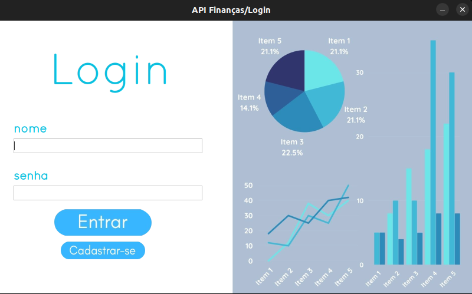
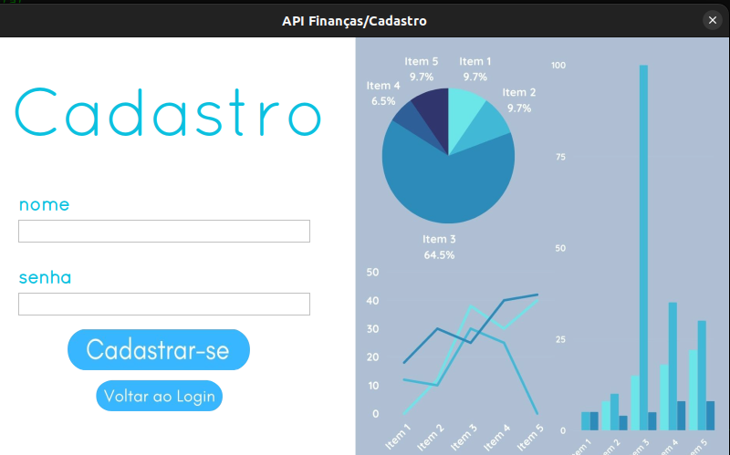
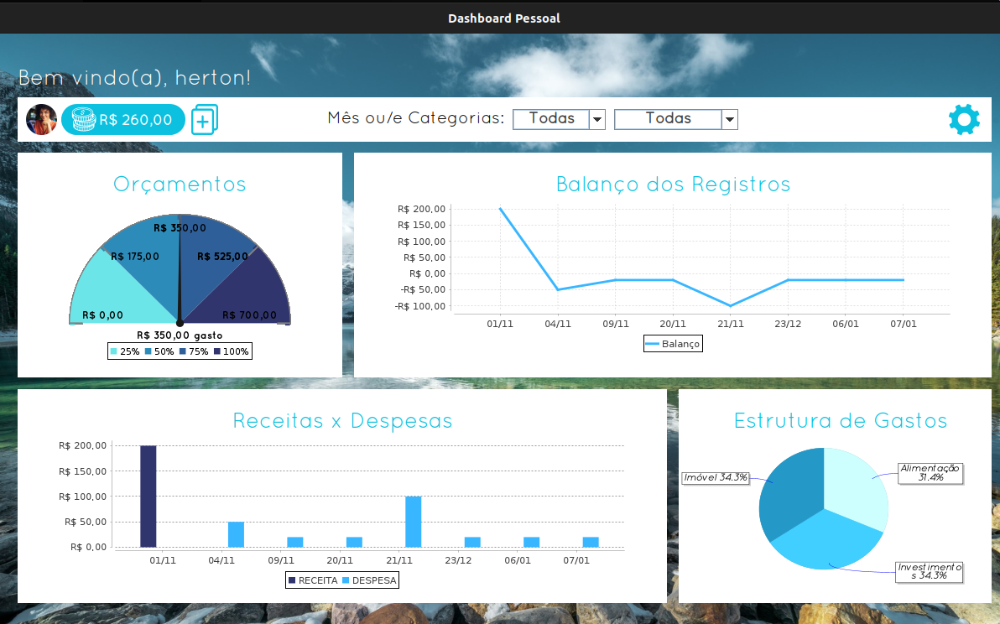
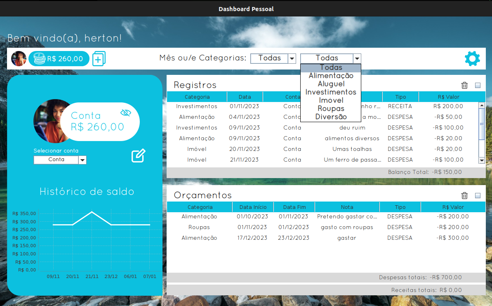
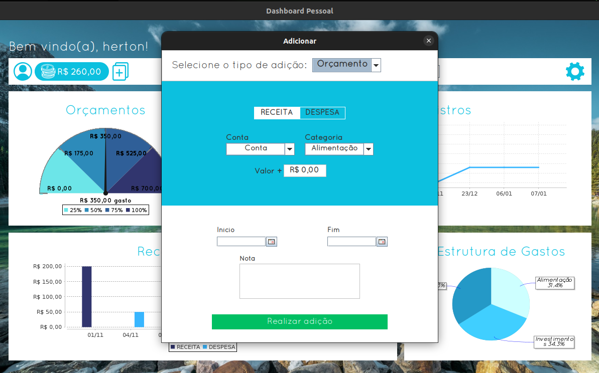

## Backend architecture

### The database

Data persistence is handled by PostgreSQL. The relational schema reflects the classes in the data layer, designed to store records manipulated by the program. The database structure was documented using a UML (Unified Modeling Language) class diagram.

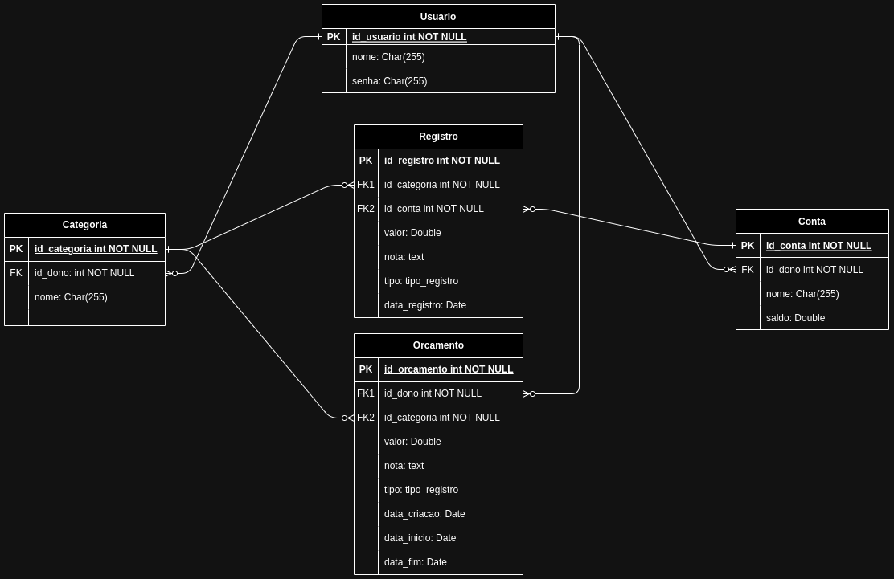

The diagram above describes relationships across the User, Account, Category, Record, and Budget tables. The Record table contains two foreign keys: one linking to the account and another to the corresponding category. The Account table references the user who owns the account.

### Encapsulation and the DAO pattern

In Java applications, scattering raw SQL queries across multiple layers complicates code maintenance. To centralize database access, this project uses the DAO (Data Access Object) pattern.

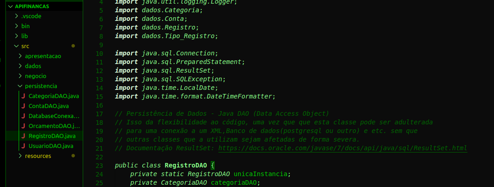
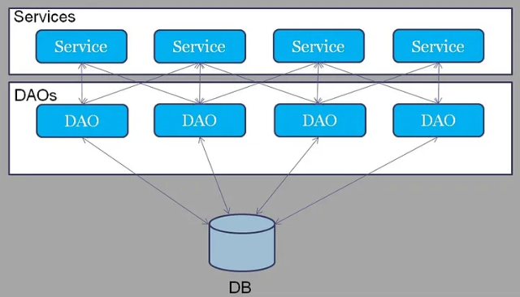

Each domain entity has a dedicated DAO class handling insertion, retrieval, update, and deletion operations. Combined with the singleton pattern, where only one instance of each DAO remains active, database communication stays centralized and avoids redundant connections.

The final database structure:

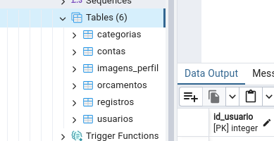

### Business layer

Application logic mediates between DAO classes and the graphical interface. Routine tasks such as user input validation, account registration, and session cleanup are processed by central service classes before updating the display.

General project structure:

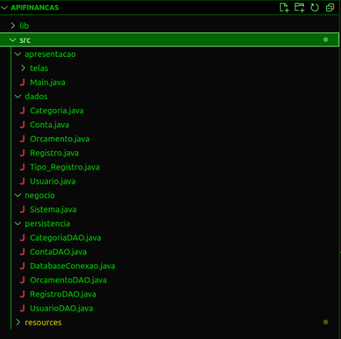

## User interface and experience

### Visual identity and typography

The interface maintains a consistent visual palette across all application windows, using blue tones, standardized typography, and custom icons for navigation.

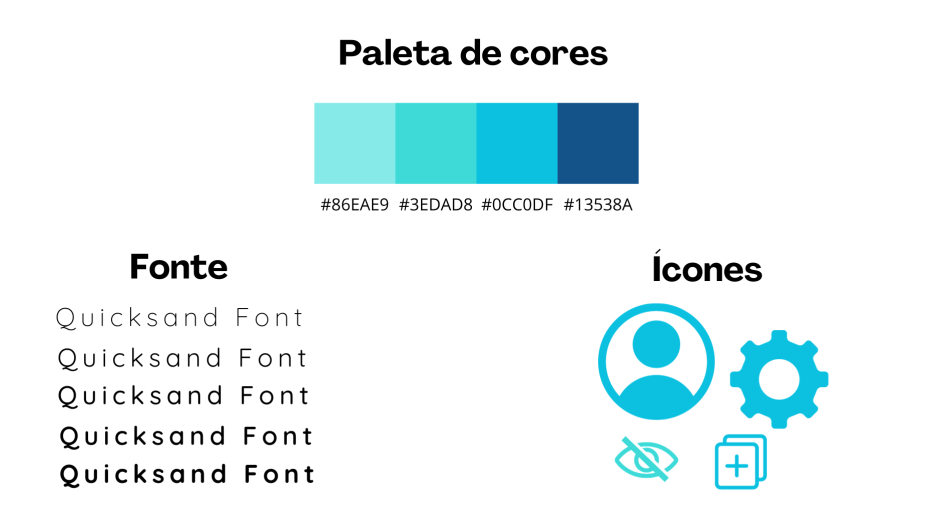

### Layouts in Java Swing

The user interface was built with Java Swing. Because Swing provides legacy component styles out of the box, buttons, inputs, and selection lists were customized to produce a cleaner desktop layout.

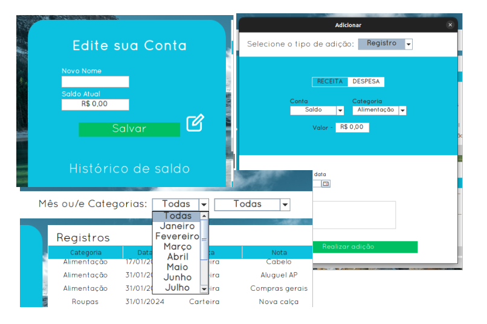

### Charts and tables

The main dashboard charts were built using the JFreeChart library, displaying time-series trends and categorical bars. Values along the X and Y axes update dynamically when the user filters records by date or category, and summary tables remain synchronized on the same screen.

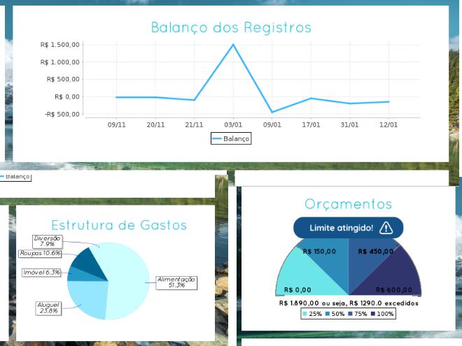

## Conclusion

The project covered domain modeling, DAO-based persistence in PostgreSQL, and desktop UI design in Java Swing. Potential next steps include automated integration tests, native installers for Windows and Linux, and refinements to budget planning tools.

GitHub repository: [https://github.com/hertonnn/API-Financas](https://github.com/hertonnn/API-Financas)

## References

* PostgreSQL Documentation: [https://www.postgresql.org/docs/current/intro-whatis.html](https://www.postgresql.org/docs/current/intro-whatis.html)
* Object-Oriented Programming (IBM): [https://www.ibm.com/docs/pt-br/watsonx-as-a-service?topic=language-object-oriented-programming](https://www.ibm.com/docs/pt-br/watsonx-as-a-service?topic=language-object-oriented-programming)
* UML (Microsoft): [https://www.microsoft.com/pt-br/microsoft-365/business-insights-ideas/resources/guide-to-uml-diagramming-and-database-modeling](https://www.microsoft.com/pt-br/microsoft-365/business-insights-ideas/resources/guide-to-uml-diagramming-and-database-modeling)
* DAO Pattern: [https://www.macoratti.net/11/10/pp_dao1.htm](https://www.macoratti.net/11/10/pp_dao1.htm)
