In the previous post about the [Legal System](https://hertonnn.github.io/blog/SistemaJuridico/), I covered the relational modeling completed during a Database course at UDESC: tables, foreign keys, cardinalities, and integrity constraints in PostgreSQL.

This second phase expands the project so users without SQL knowledge can interact with the system:

1. A web interface built with vanilla HTML, CSS, and JavaScript, called JusDigital.
2. A Python API that converts natural language queries into SQL and produces plain-language legal case summaries.

## The interface: JusDigital

### The decision to go web

The initial academic project relied on a command-line interface (CLI) with numbered menus. While suitable for basic CRUD testing, it was impractical for routine lookup tasks.

We ported the interface to the web using plain HTML, CSS, and vanilla JavaScript without client-side frameworks or build steps. On the backend, static pages and JSON endpoints are served directly by `com.sun.net.httpserver.HttpServer`, a standard class in the JDK.

Running `java -jar Run.jar` and choosing option 20 starts the server on port 8081, accessible at `http://localhost:8081/`.

### Frontend architecture

The frontend consists of 13 independent HTML pages communicating with the Java backend via the Fetch API. Rendering occurs directly in the browser DOM without client-side SPA routing.

File structure:

```
src/view/
├── style.css                    # Design system completo
├── auth.js                      # Módulo de sessão (localStorage)
├── index.html                   # Landing page + busca global
├── login.html                   # Autenticação
├── cadastro.html                # Registro de usuários
├── processos.html               # Tabela de processos
├── visualizar_processo.html     # Detalhe + resumo por IA
├── busca.html                   # Busca unificada
├── advogados.html               # Catálogo de advogados
├── perfil_advogado.html         # Perfil individual
├── jurisprudencia.html          # Base de leis
├── acordao.html                 # Detalhe de lei + processos que a citam
├── diarios.html                 # Diários oficiais (DJe)
└── modelos.html                 # Modelos de petições
```

Each page contains between 70 and 200 lines of code, making it straightforward to inspect and debug.

### Visual design decisions

Visual hierarchy and information layout were modeled after Brazilian case lookup portals such as [JusBrasil](https://www.jusbrasil.com.br/).

The interface uses the Inter font family (Google Fonts). The palette pairs institutional blue (`#1a56db`) as an accent with neutral grays for typography and backgrounds, alongside status badges (green for completed, blue for in progress, and yellow for suspended).

Typography sizes, colors, and layout spacing are declared as `:root` variables in CSS:

```css
:root {
    --primary-color: #1a56db;
    --text-color: #1f2937;
    --bg-color: #f9fafb;
    /* ... */
}
```

### Main application screens

Home page: global search input at the top and three cards for quick navigation to Cases, Official Gazettes, and Document Templates.

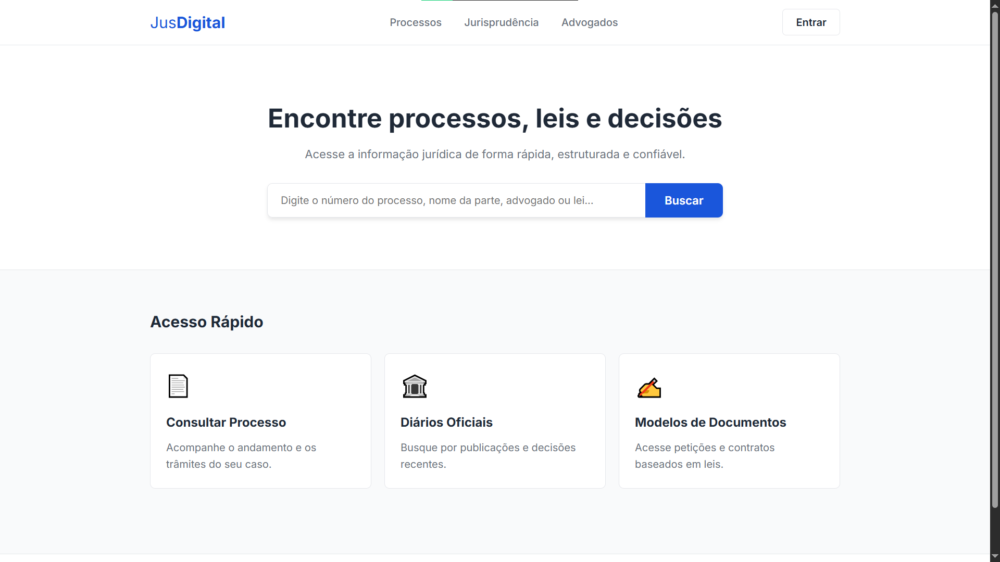

Authentication: login and registration forms authenticated against the `Usuario` table in PostgreSQL. Sessions are stored in `localStorage`, updating header controls with the user's name and a logout option.

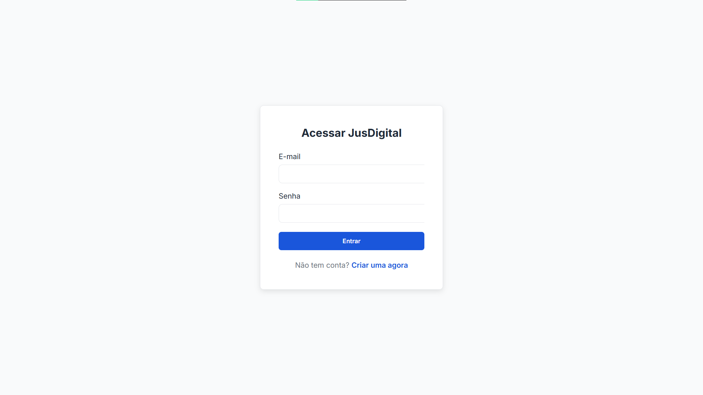

Case list: table consuming `/api/processos`, displaying case number, lawsuit type, subject matter, and color-coded status badges.

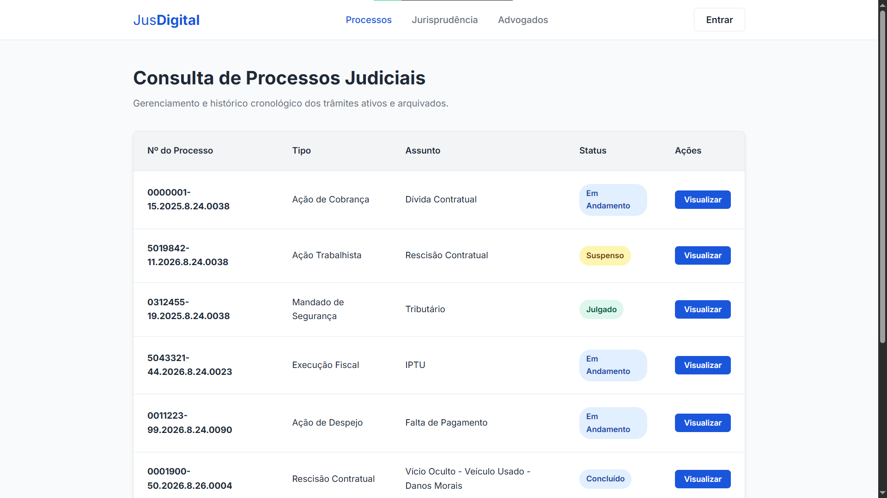

Case detail: shows court division data, plaintiff and defendant details, a chronological timeline of proceedings, and a panel for AI-generated summaries.

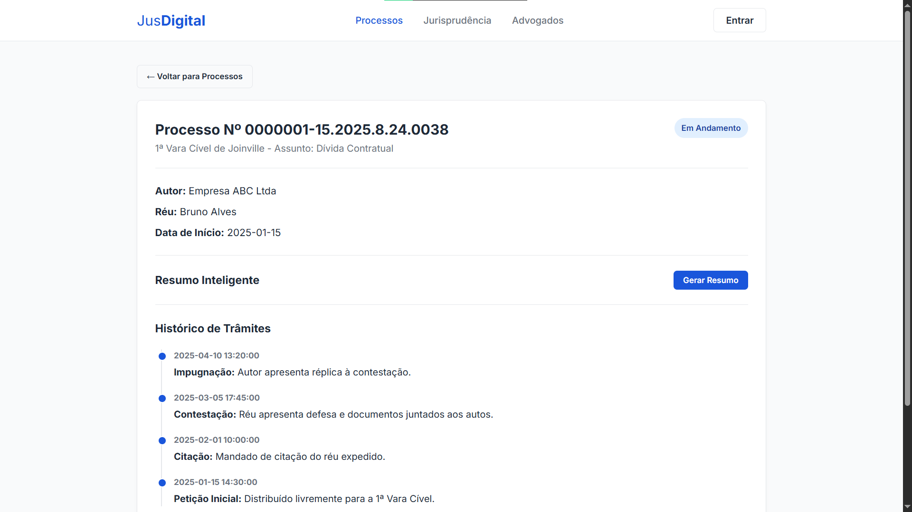
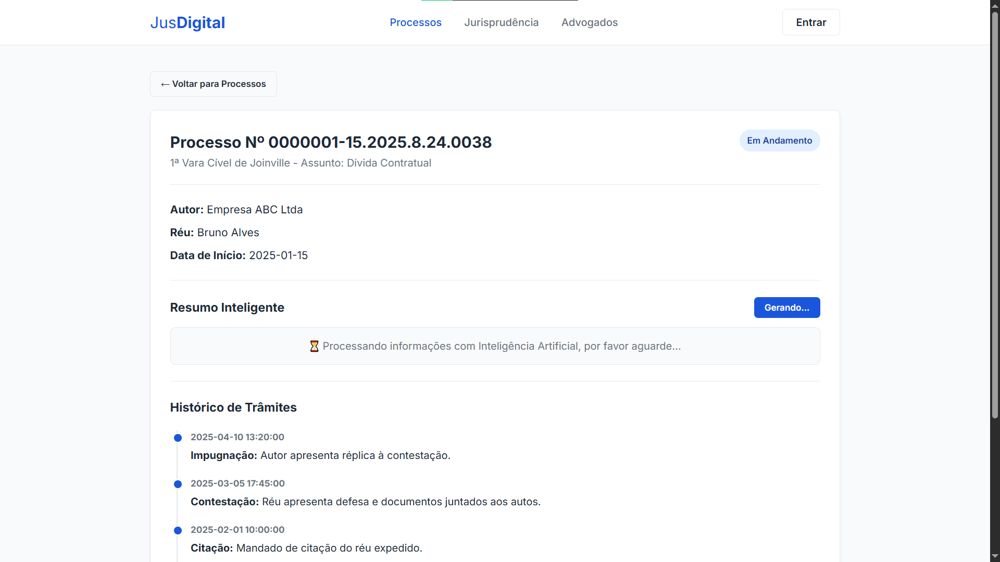
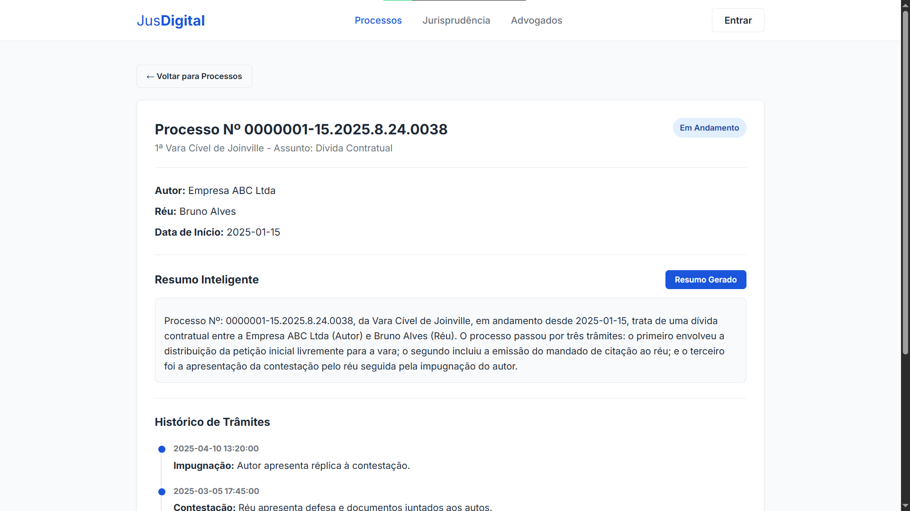

Unified search: queries three API routes in parallel (`/api/processos`, `/api/advogados`, and `/api/leis`), filtering matching text directly in the browser.

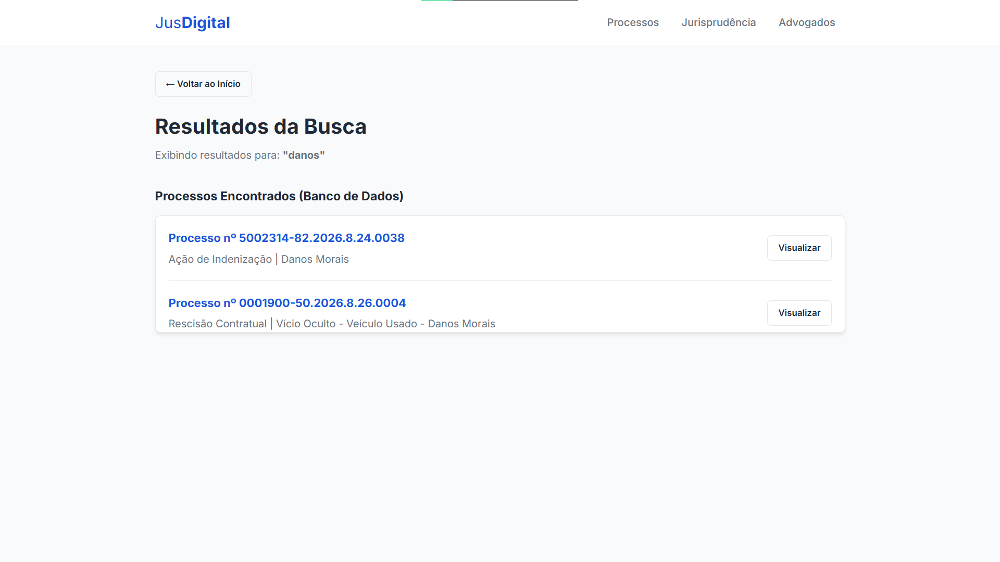

Lawyers: responsive card grid displaying attorney name, bar registration (OAB), and practice area, linking to individual case assignment histories.

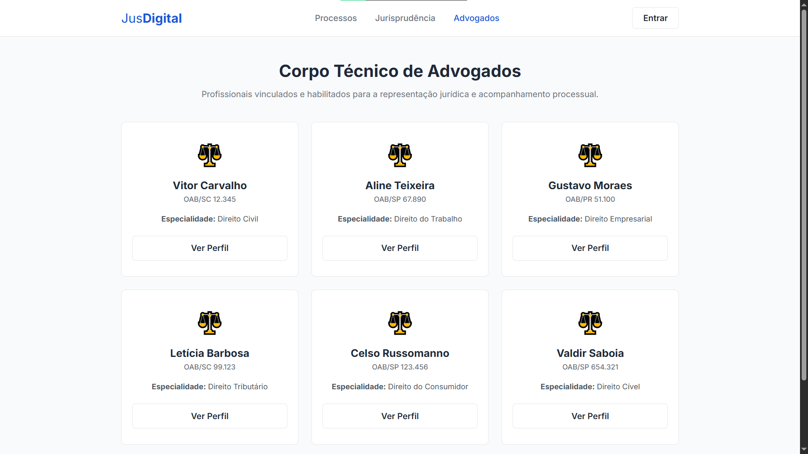

Case law and rulings: statute index with detail views listing all cases citing a given law.

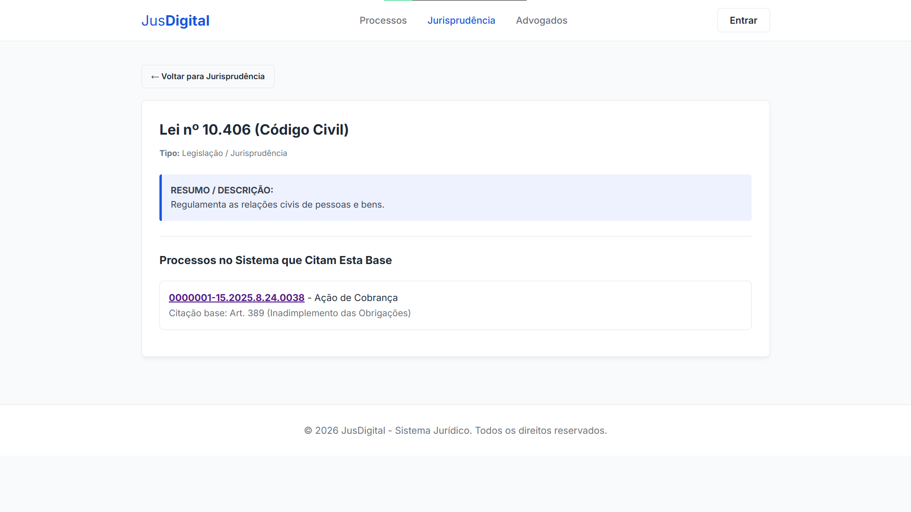

Document templates: pre-written court motions with a button copying formatted text using the Clipboard API.

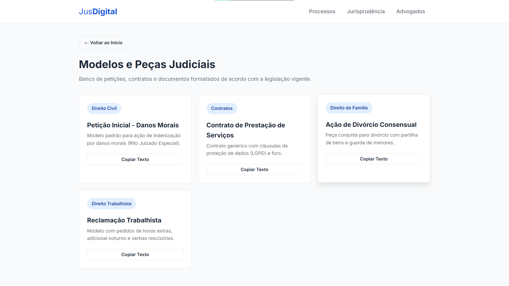

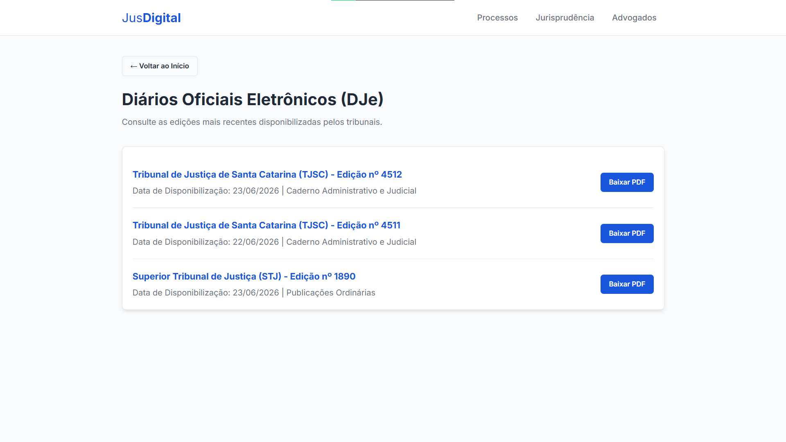

### Standard Java HTTP server

The `ServidorWeb.java` file handles incoming HTTP traffic using the JDK's built-in `com.sun.net.httpserver.HttpServer`, avoiding external application servers:

| Endpoint | Método | Descrição |
|---|---|---|
| `/` | GET | Serve `index.html` e arquivos estáticos |
| `/api/processos` | GET | Lista todos os processos |
| `/api/processo?id=N` | GET | Detalhe de um processo (partes, trâmites, vara) |
| `/api/advogados` | GET | Lista todos os advogados |
| `/api/advogado?id=N` | GET | Perfil do advogado e seus processos |
| `/api/leis` | GET | Lista todas as leis |
| `/api/lei?id=N` | GET | Detalhe da lei e processos que a citam |
| `/api/login` | POST | Autenticação |
| `/api/cadastro` | POST | Registro de novo usuário |

Handlers receive an active JDBC connection and construct JSON responses manually with `StringBuilder`, escaping field values before transmission.

## The AI layer: natural language to SQL translation

### The natural language query challenge

While form-based navigation handles standard searches, unstructured user inquiries require expressive filtering:

- "Which eviction lawsuits were filed against Adriano in 2026?"
- "List State Treasury cases with disputed amounts above 50,000"
- "Summary of case 0001234-55.2026.8.26.0001"

The companion API translates these free-form questions into relational SQL queries and returns formatted records.

### Tech stack: FastAPI, LiteLLM, and Ollama

The API is written in Python with FastAPI, running on port 8000. Communication with language models is handled through LiteLLM, allowing environment variables to route queries between local runtimes and remote providers.

The default configuration runs Qwen 2.5 (3B) locally on CPU through Ollama.

```
LLM-Juridica/
├── main.py            # FastAPI, rotas e CORS
├── llm_service.py     # Lógica das 3 camadas de IA
├── prompts.py         # Todos os prompts centralizados
├── schemas.py         # Modelos Pydantic (request/response)
├── config.py          # Settings com Pydantic + .env
├── test_client.py     # Script de testes
└── pyproject.toml     # Dependências (uv)
```

### Three-layer pipeline

Instead of feeding user prompts directly into SQL generation, the service separates execution into three distinct stages:

#### Layer 1: named entity recognition (NER)

The first stage parses structured arguments from the user query into a JSON object containing fields such as `tipo_acao`, `autor`, `reu`, `ano`, `numero_processo`, `valor_causa`, and `comarca`.

Base prompt:
> "You are a specialist in legal entity extraction. Analyze the query and return ONLY a valid JSON. Use null for fields not found."

Input example:
`"Eviction action by Condomínio Edifício Central against Adriano in 2026"`

Output example:
```json
{
  "tipo_acao": "despejo",
  "autor": "Condomínio Edifício Central",
  "reu": "Adriano",
  "ano": 2026,
  "numero_processo": null,
  "valor_causa": null,
  "comarca": null,
  "extras": {}
}
```

The service parses the JSON block using regular expressions to strip extraneous markdown and validates keys against a Pydantic schema.

#### Layer 2: SQL generation

The second stage accepts the extracted parameters along with an optional schema definition (`db_context`) sent by the client:

```json
{
  "tables": {
    "processos": ["id", "numero_cnj", "tipo_acao", "ano_distribuicao", "autor_id", "reu_id"],
    "partes": ["id", "nome", "cpf_cnpj"]
  },
  "sample_data": {
    "processos": [{"id": 1, "tipo_acao": "despejo", "ano_distribuicao": 2026}]
  }
}
```

Passing schema context prevents hallucinated column names. Prompt rules require:
- Read-only queries (`SELECT` only).
- Case-insensitive string matching with `ILIKE`.
- Explicit relational joins (`JOIN`).
- A mandatory `LIMIT 100` clause.

#### Layer 3: legal case summaries

The third stage receives raw case records (court division, litigants, and docket history) and generates an accessible overview in plain language. This endpoint is called when the user clicks "Generate Summary" on the case detail screen, making a `POST` request to `/summary`.

### Basic validation against destructive SQL

To protect the database against unwanted write operations, the `validate_sql_safety()` function in `llm_service.py` checks queries before returning them:

```python
_DANGEROUS_PATTERN = re.compile(
    r"\b(DROP|DELETE|UPDATE|INSERT|TRUNCATE|ALTER|CREATE|GRANT|REVOKE|EXEC|EXECUTE)\b",
    re.IGNORECASE,
)

def validate_sql_safety(sql: str) -> None:
    if not _SELECT_START_PATTERN.match(sql):
        raise HTTPException(status_code=422, detail="Query não começa com SELECT")
    match = _DANGEROUS_PATTERN.search(sql)
    if match:
        raise HTTPException(status_code=422, detail=f"Palavra proibida: {match.group()}")
```

Checks performed:
1. The query must start strictly with `SELECT`.
2. The query must not contain write or schema-modification statements (such as `DROP`, `DELETE`, `UPDATE`, or `ALTER`).

If either check fails, the API responds with HTTP 422.

### API endpoints

| Endpoint | Método | Descrição |
|---|---|---|
| `/health` | GET | Health check (`{"status": "ok"}`) |
| `/search` | POST | NER and SQL generation pipeline. Accepts `query` and optional `db_context` |
| `/summary` | POST | Plain-language case summary from raw text |

### Model configuration

Configuration settings in `config.py` allow pointing individual stages to different local or remote models:

```env
NER_MODEL=ollama/qwen2.5:3B
NER_API_BASE=http://localhost:11434

SQL_MODEL=ollama/qwen2.5:3B
SQL_API_BASE=http://localhost:11434

SUMMARY_MODEL=ollama/qwen2.5:3B
SUMMARY_API_BASE=http://localhost:11434
```

To route the SQL generation layer to a commercial provider while keeping NER local, adjust the environment variables without editing application code:

```env
SQL_MODEL=gpt-4o
SQL_API_KEY=sk-...
```

## How to run the project

### Prerequisites

- Java 17+ (for the web server and data API)
- PostgreSQL (with the `sistema_juridico` database configured)
- Python 3.12+ (for the AI API)
- Ollama (for running the local language model)

### 1. Database

With PostgreSQL running, execute the schema creation and data population scripts:

```bash
psql -U seu_usuario -d sistema_juridico -f refs/Script_BD.sql
psql -U seu_usuario -d sistema_juridico -f refs/PopularBanco.sql
```

### 2. Web server (Java)

```bash
# Compile sources
javac -d out src/*.java src/bean/*.java src/controller/*.java src/db/*.java src/model/*.java

# Build JAR file
jar cfm Run.jar MANIFEST.MF -C out .

# Run application
java -jar Run.jar
```

In the main menu, enter `20` to start the HTTP server, then visit `http://localhost:8081/`.

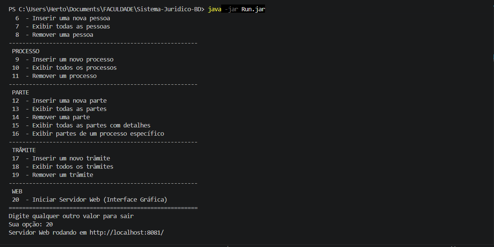

### 3. AI API

```bash
# Pull model in Ollama
ollama pull qwen2.5:3b

# Install API dependencies
cd LLM-Juridica
pip install -r requirements.txt
# or with uv:
uv sync

# Configure environment variables
cp .env.example .env

# Run server
uvicorn main:app --reload
```

The API runs at `http://localhost:8000/`, with Swagger documentation at `/docs`.

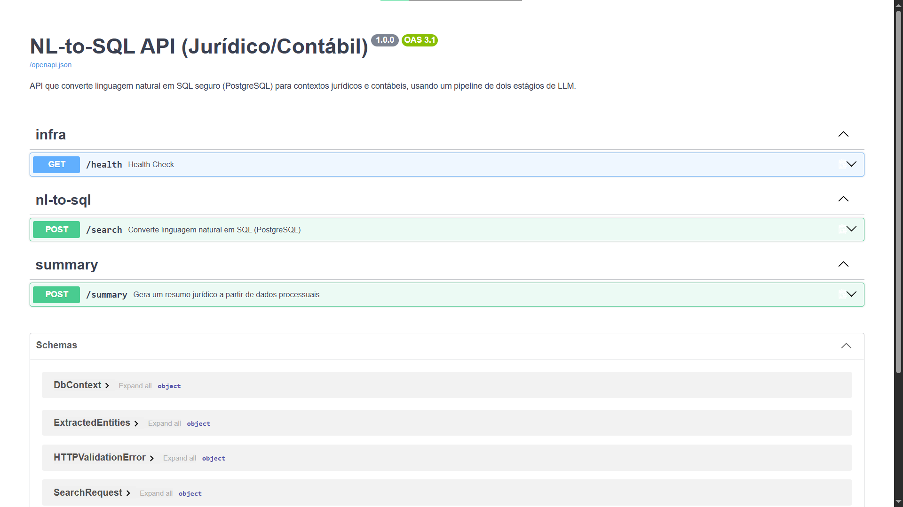

### 4. Frontend and AI integration

With both servers active (Java on 8081, Python on 8000):

1. Visit `http://localhost:8081/`
2. Open a case detail page.
3. Click "Generate Summary".
4. The browser posts case content to `/summary` on the Python API and displays the resulting text.

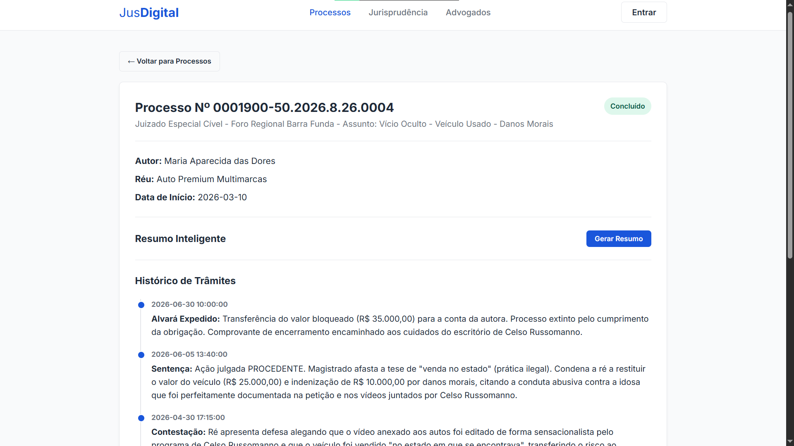
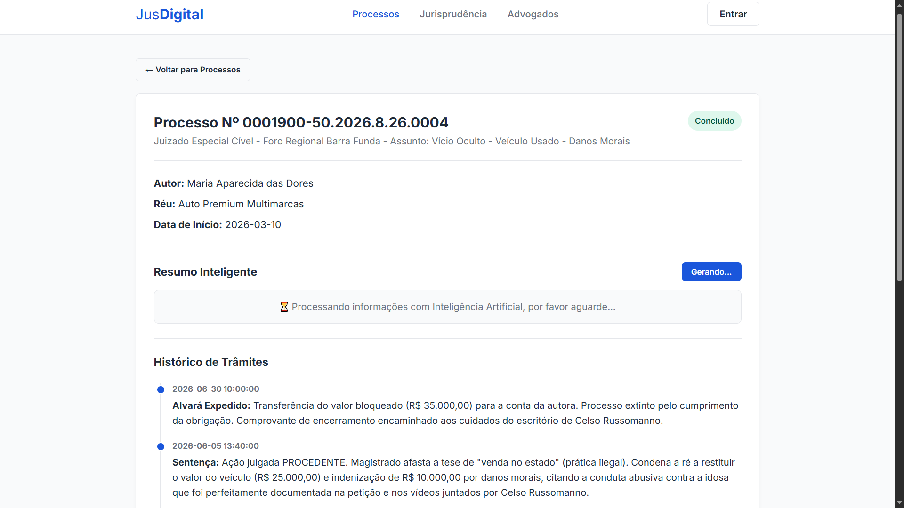
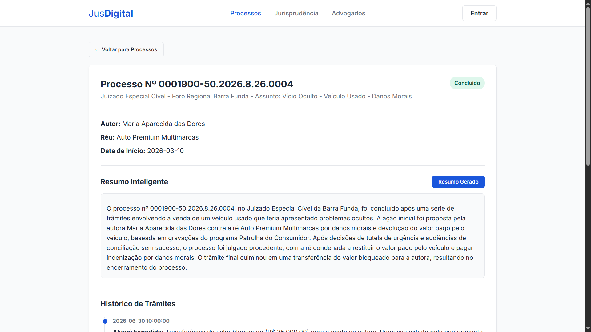

To run automated integration tests:

```bash
cd LLM-Juridica
python test_client.py
```

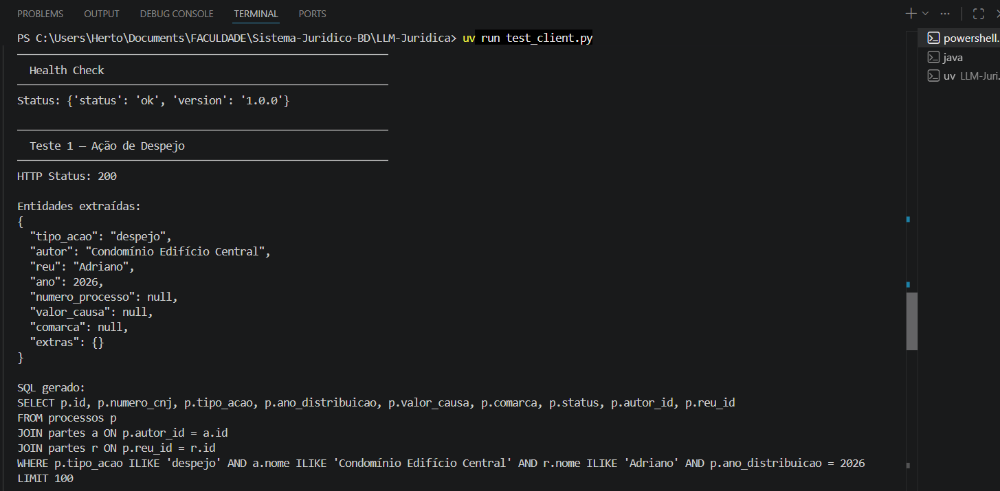
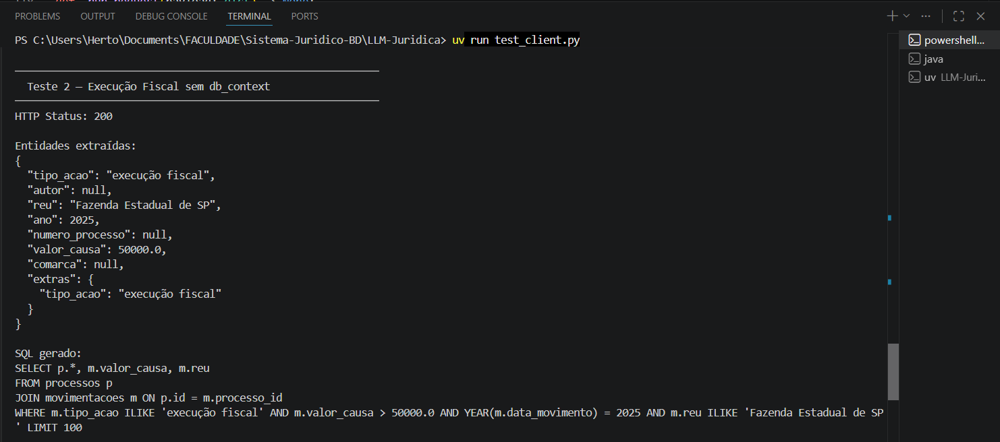
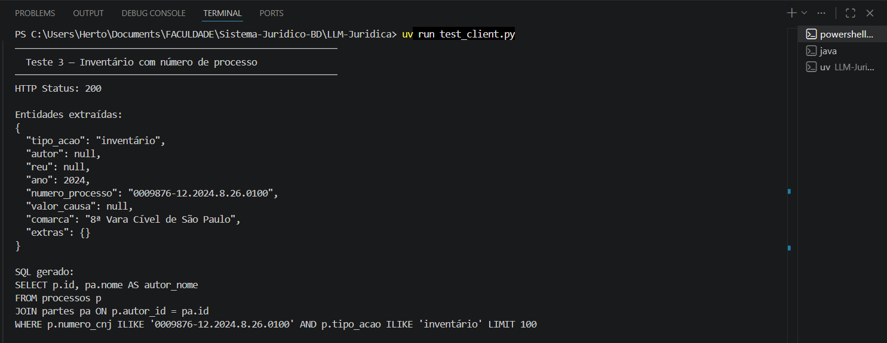

## Integration diagram

```
┌─────────────────────────────────────────────────────────┐
│                    USUÁRIO (Navegador)                  │
│                  http://localhost:8081                  │
└────────────┬──────────────────────────┬─────────────────┘
             │ fetch("/api/...")        │ fetch("localhost:8000/summary")
             ▼                          ▼
┌────────────────────────┐  ┌──────────────────────────────┐
│   ServidorWeb.java     │  │     FastAPI (LLM-Juridica)   │
│   HttpServer :8081     │  │     Uvicorn :8000            │
│                        │  │                              │
│  ┌─ /api/processos     │  │  ┌─ POST /search             │
│  ├─ /api/processo?id=  │  │  │  ├─ Camada 1: NER         │
│  ├─ /api/advogados     │  │  │  ├─ Camada 2: SQL Gen     │
│  ├─ /api/leis          │  │  │  └─ validate_sql_safety() │
│  ├─ /api/login         │  │  │                           │
│  └─ /api/cadastro      │  │  └─ POST /summary            │
│                        │  │     └─ Camada 3: Resumo      │
└────────────┬───────────┘  └──────────────┬───────────────┘
             │                             │
             ▼                             ▼
┌────────────────────────┐  ┌──────────────────────────────┐
│      PostgreSQL        │  │     Ollama (Qwen 2.5 3B)     │
│   sistema_juridico     │  │     http://localhost:11434   │
└────────────────────────┘  └──────────────────────────────┘
```

## What I learned

The project progressed from initial relational modeling into a working system with a graphical UI and natural language query processing. Key takeaways:

- A two-stage pipeline (entity extraction followed by SQL generation) is more reliable than requesting SQL directly from a free-form question, as the second model call receives well-defined fields and explicit table context.
- Compact models running locally on CPU (such as Qwen 2.5 3B via Ollama) perform reliably for focused tasks like entity parsing and `SELECT` query drafting, without depending on external network APIs.
- Pre-execution validation using regular expressions and strict keyword disallowances provides a baseline guardrail against unauthorized write queries reaching the database.

Full source code is available in the [GitHub repository](https://github.com/hertonnn/Sistema-Juridico-BD).

**Course:** Banco de Dados II  
**Institution:** Universidade do Estado de Santa Catarina (UDESC), Centro de Ciências Tecnológicas (CCT)  
**Authors:** Herton Silveira, Arthur Bertoli Silva  
**Year:** 2025/2026  

<div class="mb-5">
    <span class="d-inline-block px-2 py-1 bg-light text-dark rounded small">
        <strong>Java</strong>
    </span>
    <span class="d-inline-block px-2 py-1 bg-light text-dark rounded small">
        <strong>HTML/CSS/JS</strong>
    </span>
    <span class="d-inline-block px-2 py-1 bg-light text-dark rounded small">
        <strong>FastAPI</strong>
    </span>
    <span class="d-inline-block px-2 py-1 bg-light text-dark rounded small">
        <strong>LiteLLM</strong>
    </span>
    <span class="d-inline-block px-2 py-1 bg-light text-dark rounded small">
        <strong>Ollama</strong>
    </span>
    <span class="d-inline-block px-2 py-1 bg-light text-dark rounded small">
        <strong>PostgreSQL</strong>
    </span>
    <span class="d-inline-block px-2 py-1 bg-light text-dark rounded small">
        <strong>UDESC</strong>
    </span>
</div>
