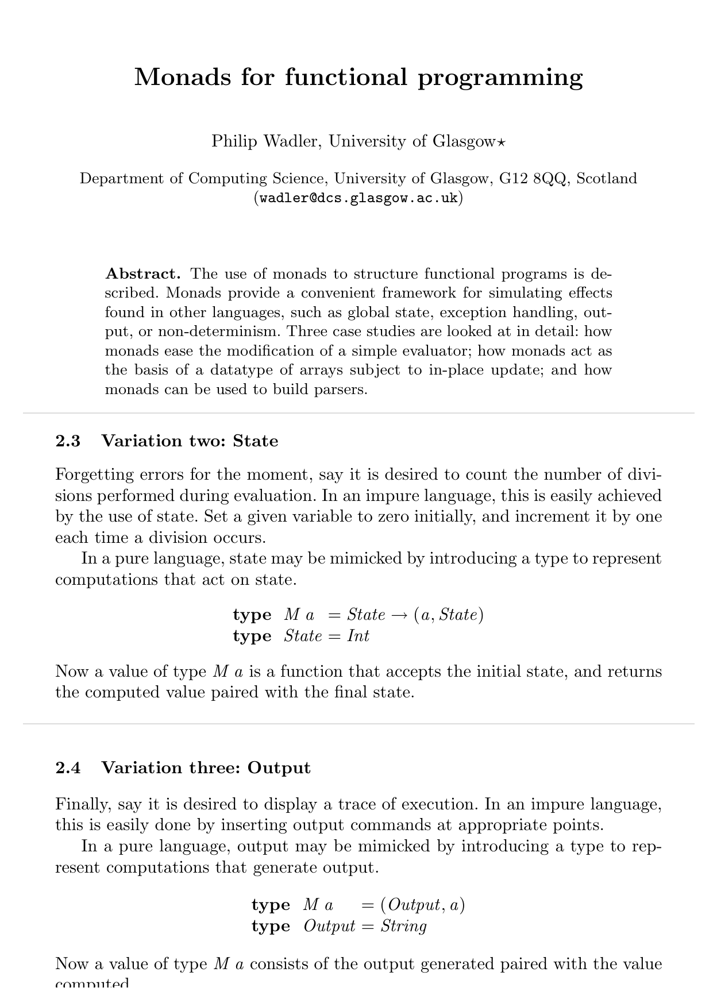
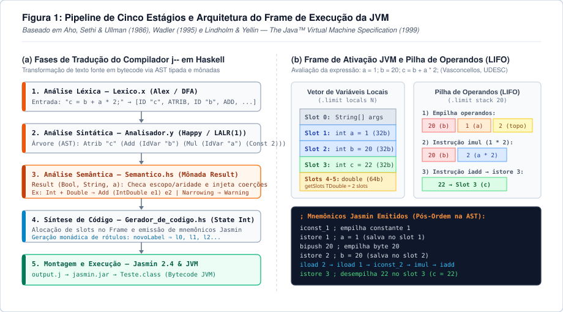
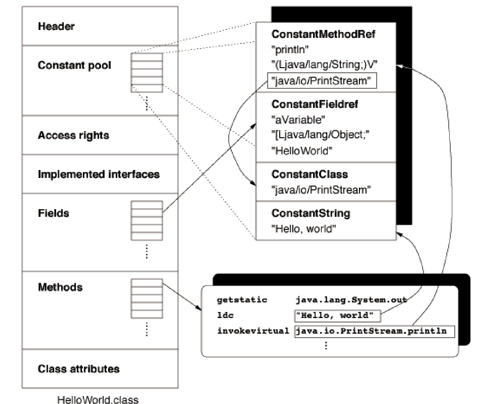
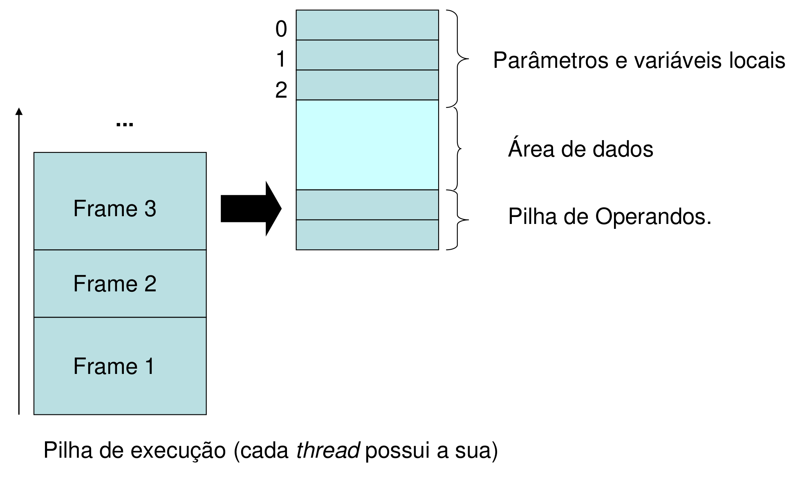
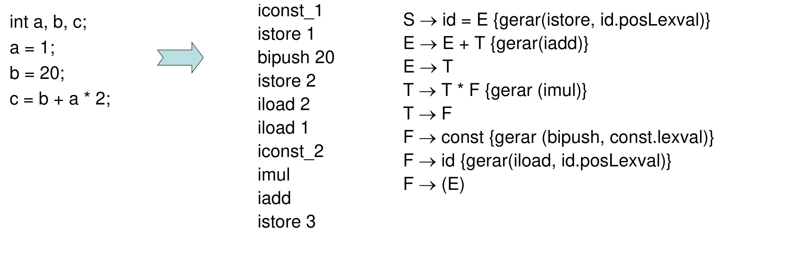
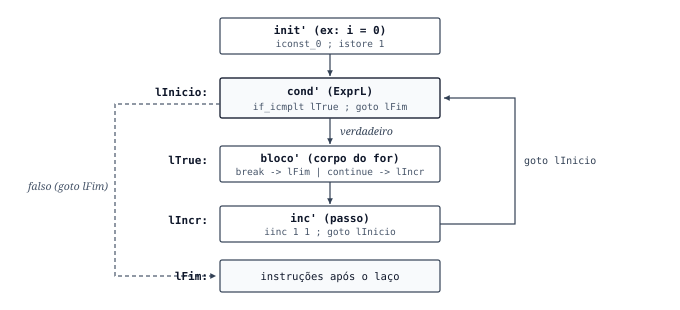

In my [earlier post on the Compilers course](https://hertonnn.github.io/blog/compiladores/), I listed the reading materials from [Prof. Dr. Cristiano Damiani Vasconcellos's classes](https://github.com/cdvasconcellos/Compiladores) at UDESC. This article documents the compiler built during the semester for the `j--` language (a subset of Java), written in Haskell and hosted at [github.com/hertonnn/Compilador-Java](https://github.com/hertonnn/Compilador-Java).

A compiler is a program, or set of programs, that translates source code written in a compiled language into semantically equivalent object code. In its classic form, that translation takes a high-level textual language and produces machine instructions for a specific processor and operating system, or bytecode for a virtual machine such as the JVM.

Before looking at the Haskell modules, the next section reviews the papers behind the tools used in this project, from the earliest translators of the 1950s to monadic type checkers and stack virtual machines.

## From early translators to stack virtual machines

### Grace Hopper and the A-0 system (1952)

Before the 1950s, writing software meant translating algorithms by hand into octal or hexadecimal machine codes and managing physical memory addresses directly. Grace Murray Hopper coined the term *compiler* between 1951 and 1952 while working on the UNIVAC I at Remington Rand.

In ["The Education of a Computer" (ACM National Conference, 1952)](https://dl.acm.org/doi/10.1145/609784.609818), Hopper described the A-0 system, a program that read mathematical specifications and assembled subroutines stored on magnetic tape into an executable binary. At the time, many engineers doubted that computers should be used to generate code rather than solely perform numerical calculations.

### John Backus and the FORTRAN I compiler (1957)

Even after Hopper's translators and Alick Glennie's *Autocode* (1952), most programmers assumed automatically generated machine code would run much slower than hand-written assembly.

In 1957, an IBM team led by John Backus published ["The FORTRAN Automatic Coding System" (Western Joint Computer Conference, 1957)](https://dl.acm.org/doi/10.1145/1455567.1455599) for the IBM 704 mainframe. The compiler took 18 person-years to write and introduced operator-precedence expression analysis, index register allocation, and loop optimization, generating machine code that matched the performance of experienced assembly programmers.

### Formal grammars, BNF, and LALR parsers (1956 to 1969)

Early compilers parsed source code with custom heuristics written for each language. The mathematical foundation that made automatic parser generation possible took shape between 1956 and 1969.

In ["Three models for the description of language" (IRE Transactions on Information Theory, 1956)](https://ieeexplore.ieee.org/document/1056813), Noam Chomsky classified formal grammars by expressive power, separating regular grammars (Type 3, used in lexical scanners) from context-free grammars (Type 2, used in syntax parsers). Four years later, John Backus and Peter Naur introduced BNF (*Backus-Naur Form*) in the [Revised Report on the Algorithmic Language ALGOL 60](https://dl.acm.org/doi/10.1145/365928.365956) to describe language syntax without ambiguity.

To parse those grammars efficiently, Donald Knuth defined LR(*k*) parsers in ["On the Translation of Languages from Left to Right" (Information and Control, 1965)](https://www.sciencedirect.com/science/article/pii/S0019995865904262), proving that deterministic context-free languages can be recognized in linear time by a pushdown automaton performing *shift* and *reduce* actions. Because Knuth's canonical LR(1) state tables were too large for 1960s computer memory, Frank DeRemer proposed the LALR(1) (*Look-Ahead LR*) algorithm in his MIT thesis, ["Practical Translators for LR(k) Languages" (1969)](https://dl.acm.org/doi/book/10.5555/905579). Merging LR(1) states that share identical cores made parser generators such as Yacc (Bell Labs, 1975) and Happy in Haskell practical.

### Monads in functional compilers (1989 to 1995)

Pure functional languages like Haskell represent Abstract Syntax Trees (ASTs) directly through Algebraic Data Types and pattern matching. Still, a real compiler needs effects while walking the tree: collecting multiple type errors and warnings without halting on the first mistake, querying symbol tables, and incrementing a label counter (`l0`, `l1`, `l2`) during code emission.

The mathematical model for structuring these effects in a pure language came from [Eugenio Moggi's "Computational lambda-calculus and monads" (LICS, 1989)](https://ieeexplore.ieee.org/document/39155) and was adapted to Haskell by Philip Wadler in ["Monads for functional programming" (Båstad Spring School / Springer LNCS 925, 1995)](https://homepages.inf.ed.ac.uk/wadler/papers/marktoberdorf/baastad.pdf), a core reading in the UDESC course.

<div class="my-6 rounded-lg overflow-hidden border border-slate-800 bg-white p-2">
    
</div>

Wadler starts from a simple expression evaluator in Haskell and shows how to add error handling, mutable state (`State`), and execution traces (`Output`) by changing the monad definition rather than rewriting every recursive call. We use this exact pattern in `Semantico.hs` and `Gerador_de_codigo.hs`.

### Stack virtual machines, the JVM, and UDESC research

To avoid rewriting code generators for every physical CPU architecture, many compilers target stack-based abstract machines, following the approach popularized by UCSD Pascal's *P-code* in the 1970s and detailed by Alfred Aho, Ravi Sethi, and Jeffrey Ullman in [*Compilers: Principles, Techniques, and Tools* (Dragon Book)](https://dl.acm.org/doi/book/10.5555/6448).

In 1996, Tim Lindholm and Frank Yellin published [The Java™ Virtual Machine Specification](https://docs.oracle.com/javase/specs/jvms/se8/html/), defining a stack-oriented virtual processor that executes binary `.class` files. The following year, Jonathan Meyer and Troy Downing released the [Jasmin assembler (*Java Assembler Interface*, 1997)](https://jasmin.sourceforge.net/), which converts human-readable JVM mnemonics (`.j`) into `.class` bytecode.

At UDESC, compiler design and static/dynamic analysis have also been explored in academic theses within the Computer Science department, such as:

- [João Guilherme Packer (Advisor: Prof. Fabiano Baldo, 2013), *"Implementação de uma extensão de um compilador de SpecC para SystemC"*](https://repositorio.udesc.br/entities/publication/2a91d71a-7d3c-48a5-9c2a-f1f50fbca082);
- [Gerson Fernando Budke (Advisor: Prof. Claudio Cesar de Sá, 2008), *"Estrutura de análise dinâmica para compiladores"*](https://repositorio.udesc.br/handle/UDESC/18461).

## Tools and compiler architecture

The `j--` compiler is organized into five stages combining Haskell parser tools with the Jasmin assembler:

| Tool | Role in the project | Documentation and reference |
| :--- | :--- | :--- |
| **Haskell (GHC)** | AST types, monadic semantic verification, and Jasmin code generation. | [Glasgow Haskell Compiler](https://www.haskell.org/ghc/) and [Wadler (1995)](https://homepages.inf.ed.ac.uk/wadler/papers/marktoberdorf/baastad.pdf) |
| **Alex** (`.x` to `.hs`) | Lexical analyzer generator based on regular expressions and deterministic finite automata. | [Alex Documentation](https://haskell-alex.readthedocs.io/en/latest/index.html) |
| **Happy** (`.y` to `.hs`) | Bottom-up LALR(1) parser generator from BNF grammar rules. | [Happy Documentation](https://haskell-happy.readthedocs.io/en/latest/) |
| **Jasmin 2.4** (`.j` to `.class`) | Assembler translating symbolic JVM instructions into `.class` bytecode. | [Jasmin User Guide](https://jasmin.sourceforge.net/xt.html) |
| **Compiler Explorer and `javap`** | Inspection of reference bytecode produced by `javac` to verify descriptors and stack usage. | [Compiler Explorer (Godbolt)](https://godbolt.org/) and [JVM Spec](https://docs.oracle.com/javase/specs/jvms/se8/html/) |

<div class="my-6 rounded-lg overflow-hidden border border-slate-800 bg-white p-3">
    
</div>

### `.class` file layout and JVM execution frames

Generating valid Jasmin code requires matching the internal layout of a `.class` file and the JVM memory model. As shown in Prof. Cristiano Damiani Vasconcellos's lecture slides, a `.class` file contains a header (with magic number `0xCAFEBABE`), a *Constant Pool* storing strings, class names, and method descriptors, and the method table with bytecode instructions:

<div class="my-6 rounded-lg overflow-hidden border border-slate-800 bg-white p-3">
    
</div>

At runtime, each method call pushes a new *Frame* onto the current thread's execution stack. Every frame holds a zero-indexed local variable array of 32-bit words, a data area linked to the *Constant Pool*, and a LIFO operand stack where values are pushed before arithmetic or method instructions:

<div class="my-6 rounded-lg overflow-hidden border border-slate-800 bg-white p-3">
    
</div>

Because each local slot is 32 bits wide, `int`, `float`, and `String` references take 1 slot, while 64-bit `double` values take 2 consecutive slots.

## Implementing the compiler stages

All source files, along with `jasmin.jar` and test programs, are available in [github.com/hertonnn/Compilador-Java](https://github.com/hertonnn/Compilador-Java).

### Lexical analysis with Alex (`Tokens.hs` and `Lexico.x`)

`Tokens.hs` defines the algebraic data type for all terminal symbols, and `Lexico.x` maps regular expressions to token constructors while skipping whitespace and comments (`//` and `/* ... */`). Running `alex Lexico.x -o Lexico.hs` compiles the scanner into `alexScanTokens :: String -> [Tokens]`.

### Abstract syntax tree and LALR parser (`SintaxeAbstrata.hs` and `Analisador.y`)

`SintaxeAbstrata.hs` separates arithmetic expressions (`Expr`), relational comparisons (`ExprR`), boolean logic (`ExprL`), variables (`Id :#: (Tipo, Int)`), and statements (`Comando`). In `Analisador.y`, operator precedence declarations (`%left`, `%right`, `%nonassoc`) resolve shift/reduce conflicts in the LALR(1) table generated by Happy.

### Semantic analysis with the `Result` monad (`Semantico.hs`)

Following Wadler (1995), `Semantico.hs` defines `data Result a = Result (Bool, String, a)` to accumulate errors and warnings across the entire AST without stopping at the first error, while inserting explicit type coercion nodes (`IntDouble`, `DoubleInt`, `IntFloat`, `FloatDouble`):

```haskell
data Result a = Result (Bool, String, a) deriving Show

instance Monad Result where
  return = pure
  Result (e1, l1, a) >>= f =
    let Result (e2, l2, b) = f a
    in Result (e1 || e2, l1 ++ l2, b)

errorMsg :: String -> Result ()
errorMsg s = Result (True, "Error: " ++ s ++ "\n", ())

warningMsg :: String -> Result ()
warningMsg s = Result (False, "Warning: " ++ s ++ "\n", ())
```

### Slot allocation and Jasmin code generation (`Main.hs` and `Gerador_de_codigo.hs`)

`Main.hs` assigns local frame indices according to slot width (`getSlots TDouble = 2`, others `1`). Expression translation follows the syntax-directed scheme from the course lectures: for `c = b + a * 2;`, a post-order AST traversal pushes operands with `iload` and `iconst` and emits `imul`, `iadd`, and `istore`:

<div class="my-6 rounded-lg overflow-hidden border border-slate-800 bg-white p-3">
    
</div>

Inside `Gerador_de_codigo.hs`, the `State Int String` monad increments the label counter (`novoLabel`) and selects the shortest integer constant instruction (`iconst_n` for `-1..5`, `bipush` for `-128..127`, and `ldc` otherwise).

## Adding new instructions to the language

Extending the grammar requires updating all five compiler modules. Below are five extensions implemented in the repository.

### The `for` loop and increment operators (`++`, `--`, `+=`)

Because the JVM has no dedicated `for` instruction, the loop is lowered into basic blocks connected by labels, conditional jumps (`if_icmp<cond>`), and unconditional branches (`goto`):

<div class="my-6 rounded-lg overflow-hidden border border-slate-800 bg-white p-3">
    
</div>

For integer increments (`i++`), the code generator emits `iinc <slot> 1`, which updates the local variable slot in place without touching the operand stack:

```haskell
genCmd fun tab (For init cond inc bloco) = do
  init'   <- genCmd fun tab init
  lInicio <- novoLabel
  lTrue   <- novoLabel
  lFim    <- novoLabel
  cond'   <- genExprL fun tab lTrue lFim cond
  bloco'  <- genBloco fun tab bloco
  inc'    <- genCmd fun tab inc
  return $
    init' ++
    lInicio ++ ":\n" ++
    cond' ++
    lTrue ++ ":\n" ++
    bloco' ++
    inc' ++
    "\tgoto " ++ lInicio ++ "\n" ++
    lFim ++ ":\n"
```

### 32-bit `float` and numeric conversions (`i2f`, `f2d`, `fcmpg`)

Supporting 32-bit IEEE 754 `float` literals (`3.14f`) uses 1 local slot (`fload`, `fstore`, `ldc`). Unlike integers, floating-point comparisons on the JVM require pushing `-1`, `0`, or `1` with `fcmpg` (or `dcmpg`) followed by a zero-comparison branch (`iflt`, `ifeq`, `ifgt`), while mixed arithmetic uses `i2f`, `f2d`, `f2i`, and `d2f`.

### String content equality (`String.equals`), `Scanner` input, and `LoopContext` (`break`/`continue`)

When comparing `TString` operands with `==` or `!=`, the code generator emits `invokevirtual java/lang/String/equals(Ljava/lang/Object;)Z` rather than comparing object references. For terminal input (`read(x)`), it instantiates `java/util/Scanner(System.in)` on the stack and calls `nextInt()I`, `nextFloat()F`, `nextDouble()D`, or `next()Ljava/lang/String;`, while `random()` invokes `java/lang/Math/random()D`. Finally, propagating `type LoopContext = Maybe (String, String)` (`(lIncr, lFim)`) ensures that `continue` inside a `for` loop jumps to `lIncr` so the step increment still executes before re-testing the loop condition.

## Conclusion

Writing each stage of the compiler connects topics that are usually taught in separate Computer Science courses. Regular expressions and finite automata generate the token stream in `Lexico.x`, context-free grammars and LALR(1) tables drive `Analisador.y`, and Wadler's monads keep semantic error reporting and jump label generation modular without global mutable variables.

Targeting Jasmin and the JVM also makes it straightforward to test new language constructs: after updating the AST, checking types in `Semantico.hs`, and emitting the corresponding stack instructions, the resulting `.class` file runs directly on the standard Java runtime. Build scripts, test cases, and the step-by-step guide for adding new operators and control structures are available in the [Compilador-Java](https://github.com/hertonnn/Compilador-Java) repository.
