

Na disciplina de Programação Orientada a Objetos na Universidade do Estado de Santa Catarina (UDESC), a proposta de trabalho final foi implementar uma aplicação em três etapas: modelagem das camadas de dados e negócio em Java, desenvolvimento da interface gráfica e integração com banco de dados para persistência.

A aplicação gerencia finanças pessoais por meio do cadastro de receitas e despesas em categorias específicas, incluindo:

* Gráficos e estimativas no painel principal a partir das entradas e saídas financeiras.
* Histórico de transações filtrado por categorias pré-definidas.
* Interface gráfica pensada para facilitar o uso diário.
* Sistema de login e cadastro de usuários.
* Previsão orçamentária para controle de gastos.

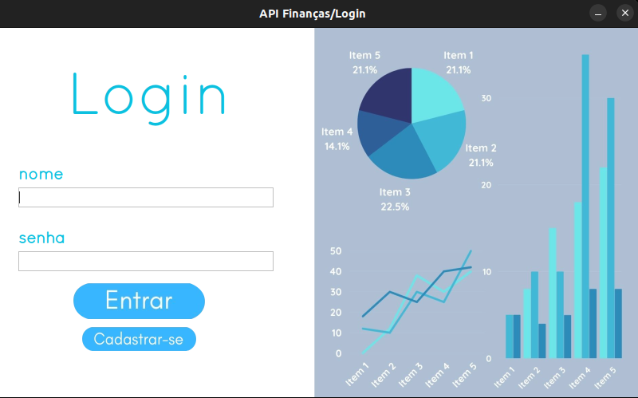
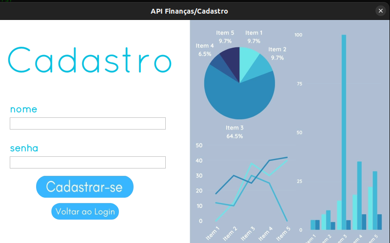
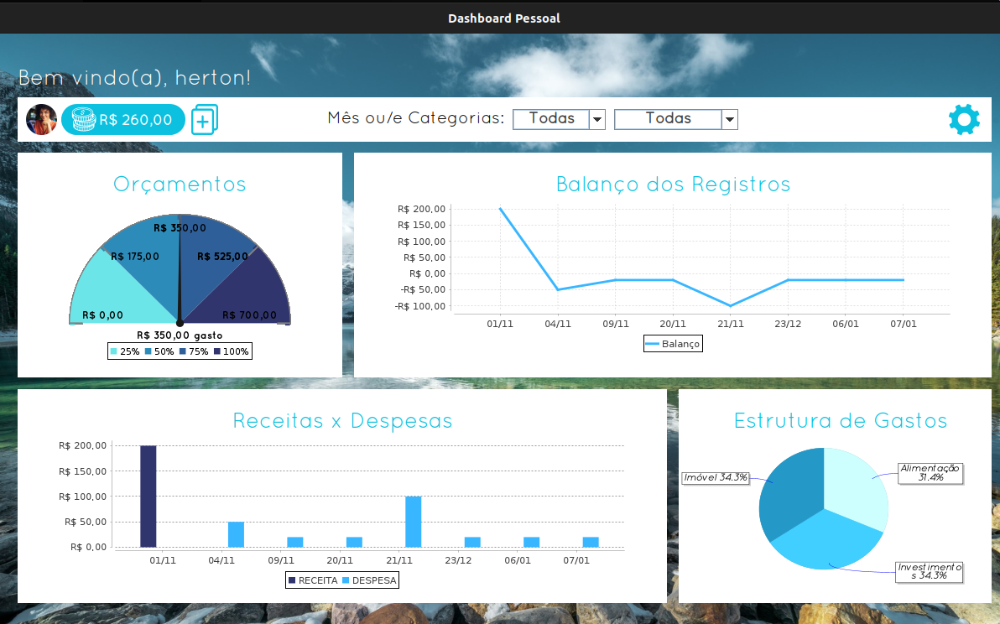
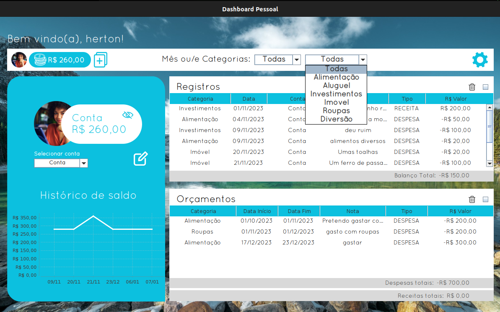
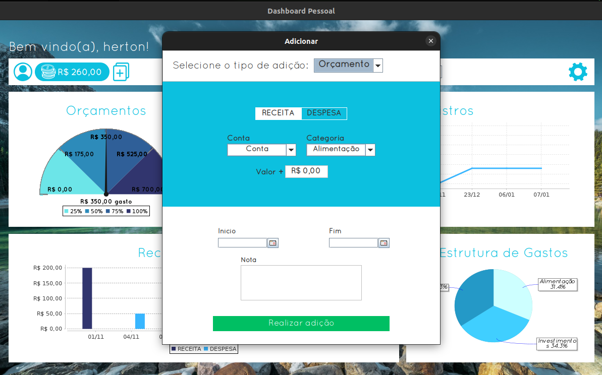

## Arquitetura do back-end

### O banco de dados

A persistência de dados utiliza PostgreSQL. A organização do esquema reflete as classes da camada de dados, projetadas para armazenar os registros manipulados pelo programa. O banco foi documentado por meio de um diagrama de classes UML (Unified Modeling Language).

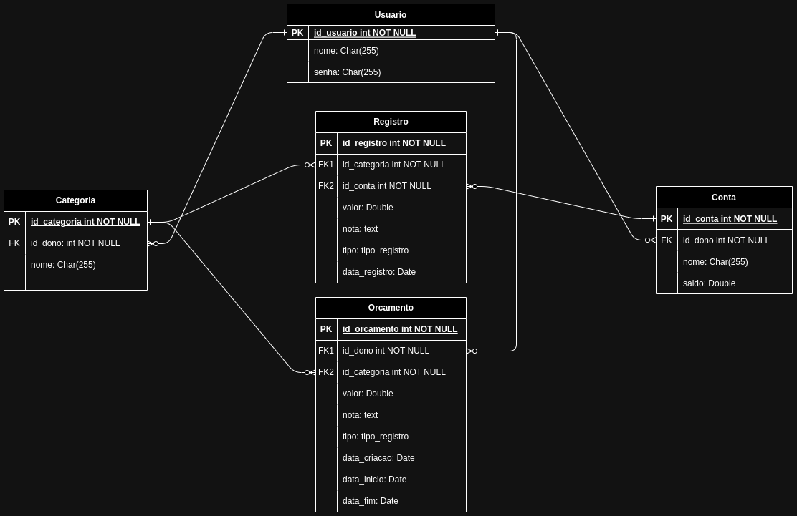

O diagrama acima descreve as relações entre as tabelas Usuário, Conta, Categoria, Registro e Orçamento. A tabela Registro possui duas chaves estrangeiras: uma apontando para a conta e outra para a categoria correspondente. A tabela Conta referencia o usuário proprietário da conta que registrou a movimentação.

### Encapsulamento e padrão DAO

Em projetos em Java, manter chamadas SQL dispersas por diferentes camadas prejudica a manutenção. Por isso, a camada de acesso adota o padrão DAO (Data Access Object).

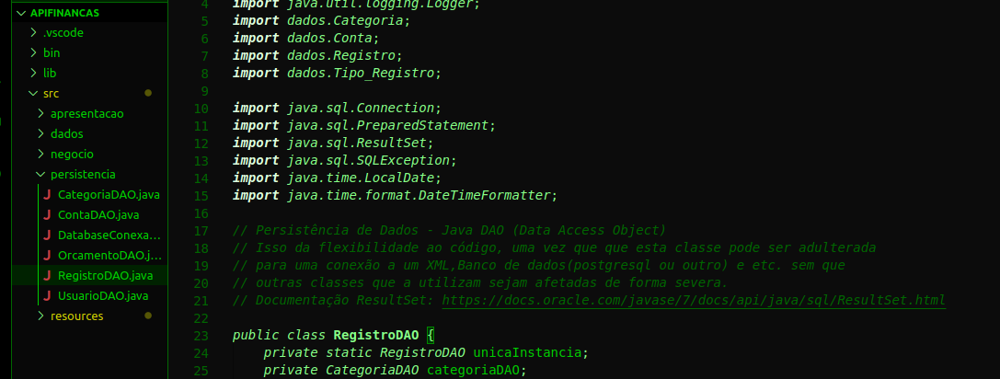
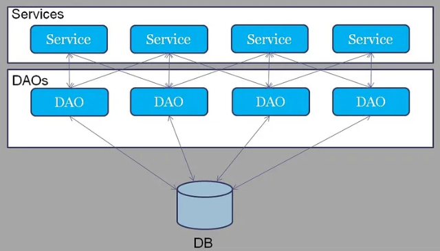

Cada entidade possui uma classe DAO dedicada que concentra as operações de inserção, leitura, atualização e remoção. Combinado com o padrão singleton, em que cada DAO mantém uma única instância ativa, o acesso aos dados fica centralizado e evita conexões redundantes com o banco.

A estrutura do banco final:

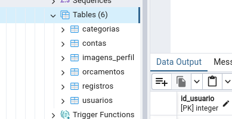

### Camada de negócio

A lógica da aplicação atua como intermediária entre as classes DAO e a interface gráfica. Operações como validação de dados, cadastro de contas e encerramento de sessão são coordenadas pela classe central do sistema antes de refletir os dados nas telas.

A estrutura geral do projeto:

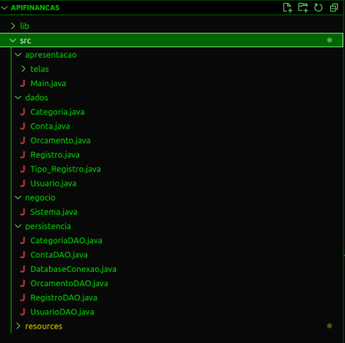

## Interface e experiência de uso

### Identidade visual e tipografia

A interface adota uma identidade visual consistente em todas as telas do programa, com paleta de cores em tons de azul, tipografia padronizada e conjunto próprio de ícones para compor a navegação.

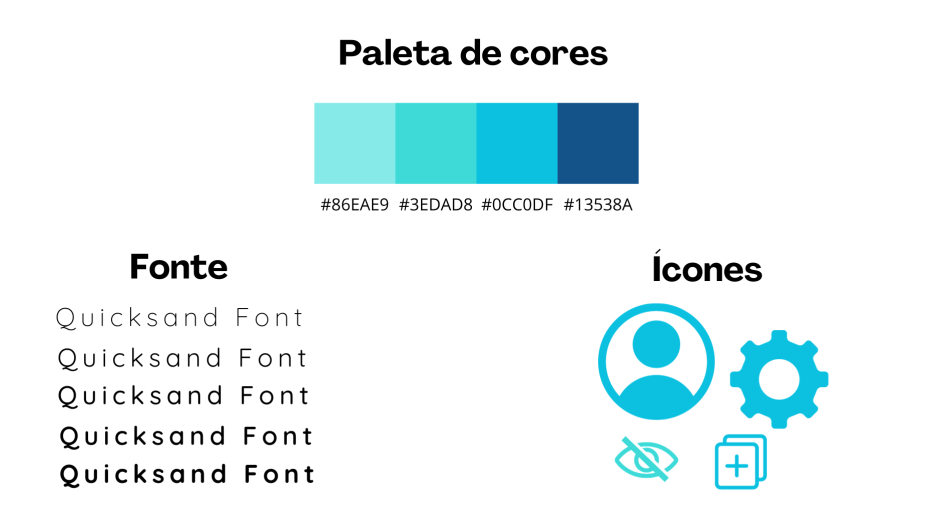

### Layouts em Java Swing

O desenvolvimento gráfico utilizou Java Swing. Como a biblioteca possui componentes visuais com aparência clássica, os botões, campos de texto e listas foram personalizados manualmente para criar um visual mais limpo e próximo de aplicações desktop modernas.

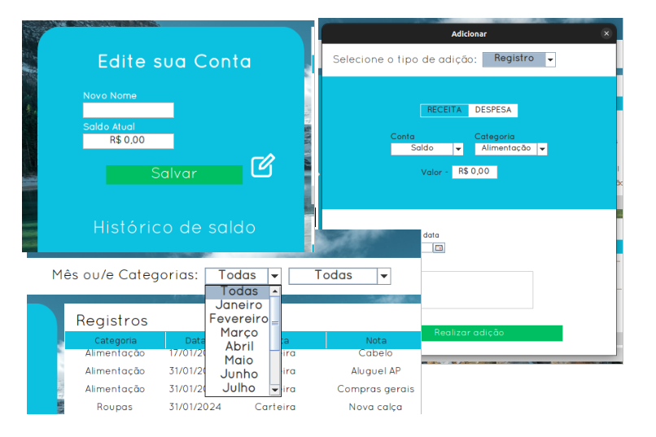

### Gráficos e relatórios

Os gráficos do painel principal foram construídos com a biblioteca JFreeChart, exibindo séries temporais e barras comparativas. Os dados nos eixos X e Y são recalculados dinamicamente conforme o usuário altera os filtros de período e categoria, e as tabelas associadas são sincronizadas na mesma tela.

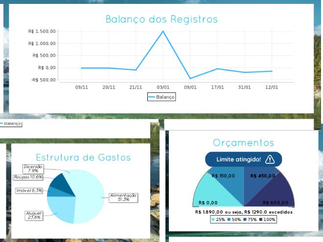

## Conclusão

O projeto atendeu aos requisitos da disciplina ao cobrir a modelagem de domínio, a persistência com DAO no PostgreSQL e a construção da interface gráfica em Java Swing. Próximos passos incluiriam testes automatizados de integração, geração de instaladores para Linux e Windows e aperfeiçoamentos no fluxo de orçamentos.

Repositório no GitHub: [https://github.com/hertonnn/API-Financas](https://github.com/hertonnn/API-Financas)

## Referências

* PostgreSQL Documentation: [https://www.postgresql.org/docs/current/intro-whatis.html](https://www.postgresql.org/docs/current/intro-whatis.html)
* Programação orientada a objetos (IBM): [https://www.ibm.com/docs/pt-br/watsonx-as-a-service?topic=language-object-oriented-programming](https://www.ibm.com/docs/pt-br/watsonx-as-a-service?topic=language-object-oriented-programming)
* UML (Microsoft): [https://www.microsoft.com/pt-br/microsoft-365/business-insights-ideas/resources/guide-to-uml-diagramming-and-database-modeling](https://www.microsoft.com/pt-br/microsoft-365/business-insights-ideas/resources/guide-to-uml-diagramming-and-database-modeling)
* Padrão DAO: [https://www.macoratti.net/11/10/pp_dao1.htm](https://www.macoratti.net/11/10/pp_dao1.htm)
