No post anterior sobre o [Sistema Jurídico](https://hertonnn.github.io/blog/SistemaJuridico/), descrevi a modelagem relacional feita na disciplina de Banco de Dados da UDESC: tabelas, chaves, cardinalidades e regras de integridade no PostgreSQL.

Esta segunda etapa expande o projeto para torná-lo utilizável por pessoas que não operam via SQL:

1. Uma interface web desenvolvida em HTML, CSS e JavaScript vanilla, chamada JusDigital.
2. Uma API em Python que traduz consultas em linguagem natural para SQL e gera resumos explicativos de processos.

## A interface: JusDigital

### A decisão de ir para a web

O projeto acadêmico original utilizava uma interface de linha de comando (CLI) baseada em menus numéricos. Embora funcional para testes de CRUD, o modelo era pouco prático para consultas do dia a dia.

A interface foi então portada para a web utilizando apenas HTML, CSS e JavaScript no navegador, sem frameworks ou etapas de build. No backend, as páginas estáticas e as rotas de dados são servidas pelo `com.sun.net.httpserver.HttpServer`, componente nativo da biblioteca padrão do Java.

Ao executar `java -jar Run.jar` e selecionar a opção 20 no menu, o servidor inicia na porta 8081 e permite o acesso imediato por `http://localhost:8081/`.

### A arquitetura do front-end

A camada visual é composta por 13 páginas HTML independentes que se comunicam com o servidor Java por meio da Fetch API. A renderização de dados ocorre diretamente no DOM do cliente, sem necessidade de roteador de SPA.

Estrutura de arquivos:

```
src/view/
├── style.css                    # Design system completo
├── auth.js                      # Módulo de sessão (localStorage)
├── index.html                   # Landing page + busca global
├── login.html                   # Autenticação
├── cadastro.html                # Registro de usuários
├── processos.html               # Tabela de processos
├── visualizar_processo.html     # Detalhe + resumo por IA
├── busca.html                   # Busca unificada
├── advogados.html               # Catálogo de advogados
├── perfil_advogado.html         # Perfil individual
├── jurisprudencia.html          # Base de leis
├── acordao.html                 # Detalhe de lei + processos que a citam
├── diarios.html                 # Diários oficiais (DJe)
└── modelos.html                 # Modelos de petições
```

Cada arquivo mantém entre 70 e 200 linhas de código, facilitando a inspeção direta em qualquer editor de texto.

### Critérios visuais de design

A organização das informações e a hierarquia visual foram inspiradas em plataformas de consulta processual como o [JusBrasil](https://www.jusbrasil.com.br/).

A tipografia utiliza a família Inter (Google Fonts). As cores baseiam-se em uma paleta neutra com azul institucional (`#1a56db`) como cor de destaque, tons de cinza para tipografia e fundos, e etiquetas coloridas para indicar o andamento processual (verde para concluído, azul para em andamento e amarelo para suspenso).

Todas as cores, espaçamentos e tamanhos de fonte foram centralizados em variáveis `:root` no CSS:

```css
:root {
    --primary-color: #1a56db;
    --text-color: #1f2937;
    --bg-color: #f9fafb;
    /* ... */
}
```

### Principais telas da aplicação

Página inicial: campo de busca global na seção superior e cartões de acesso rápido para Processos, Diários Oficiais e Modelos de Petições.

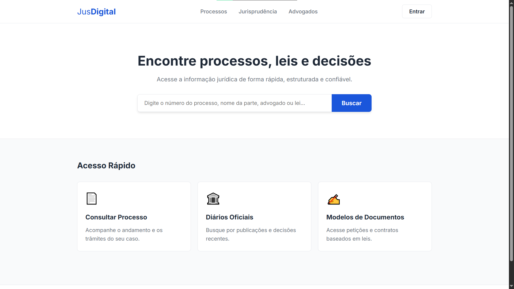

Autenticação: formulários de login e cadastro validados pelo backend Java na tabela `Usuario`. A sessão é preservada no `localStorage`, atualizando o cabeçalho das páginas com o nome do usuário e o botão de logout.

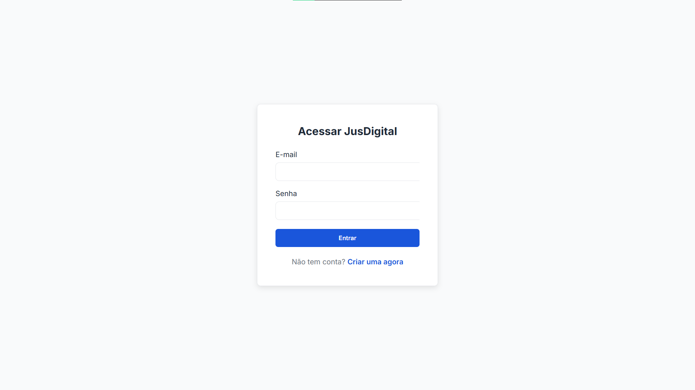

Listagem de processos: tabela que consome o endpoint `/api/processos`, exibindo número do processo, tipo de ação, assunto e status com etiquetas coloridas.

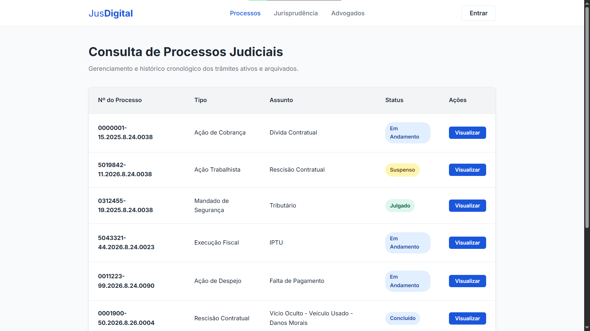

Detalhe do processo: exibe os dados da vara, as partes envolvidas (autor e réu), o histórico cronológico de trâmites e uma área para geração de resumo textual via IA.

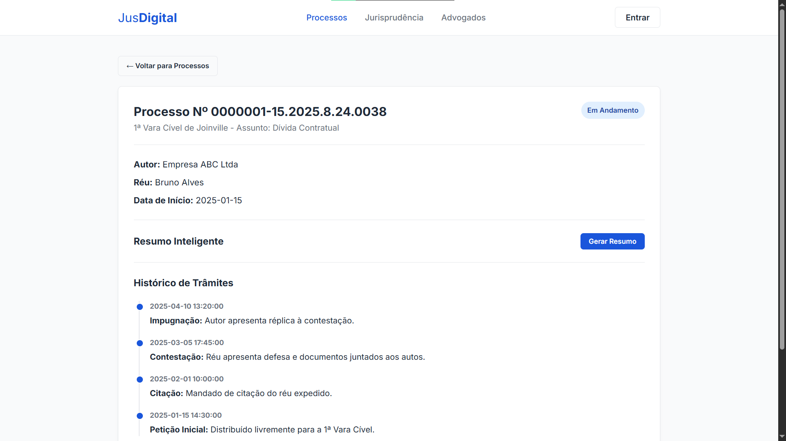
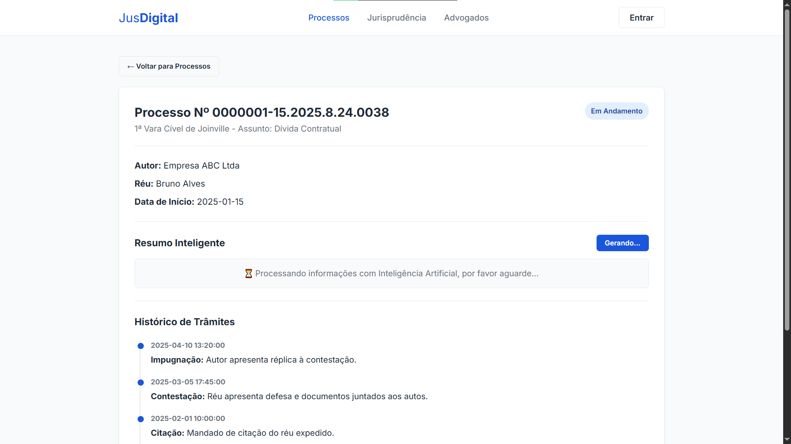
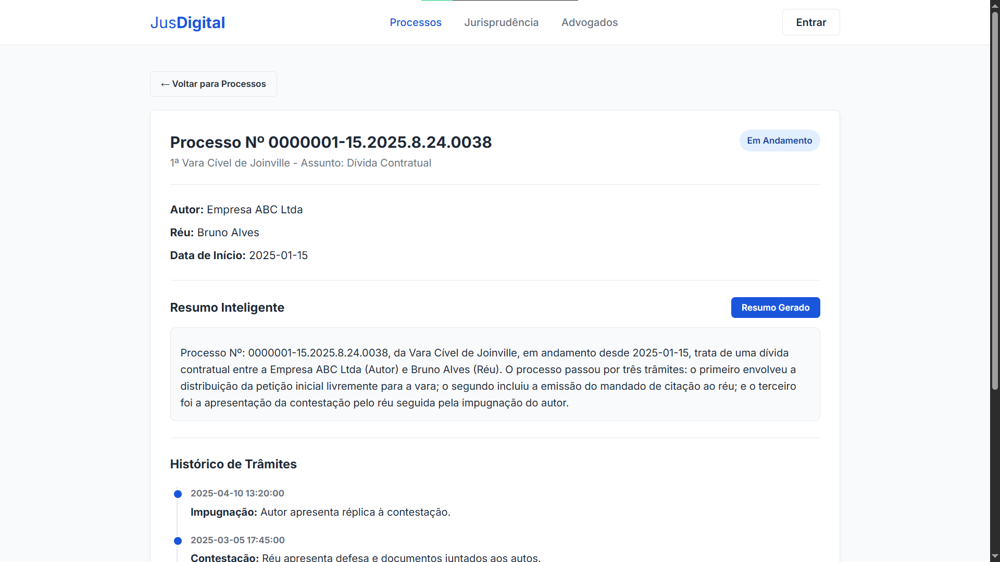

Busca unificada: formulário que consulta em paralelo três rotas da API (`/api/processos`, `/api/advogados` e `/api/leis`), filtrando os termos no navegador por correspondência de texto.

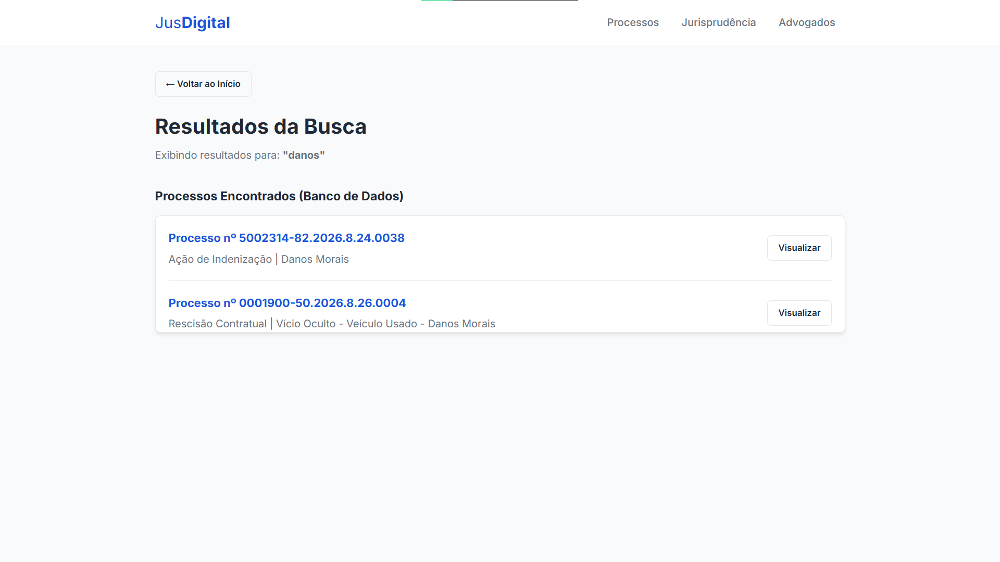

Catálogo de advogados: grade responsiva com dados profissionais (nome, inscrição na OAB e área de atuação), com link para o histórico individual de processos.

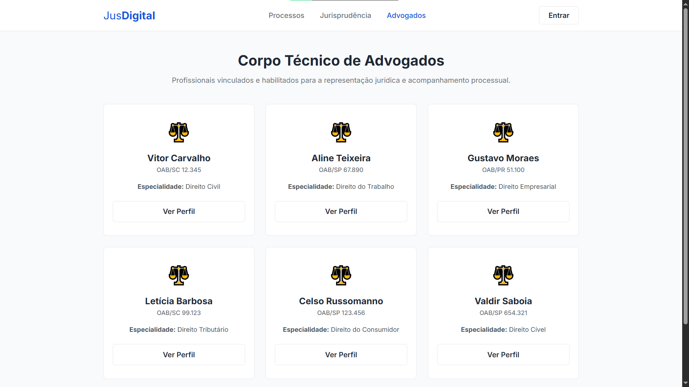

Jurisprudência e acórdãos: catálogo de leis cadastradas com tela de detalhe que lista os processos que citam cada dispositivo legal.

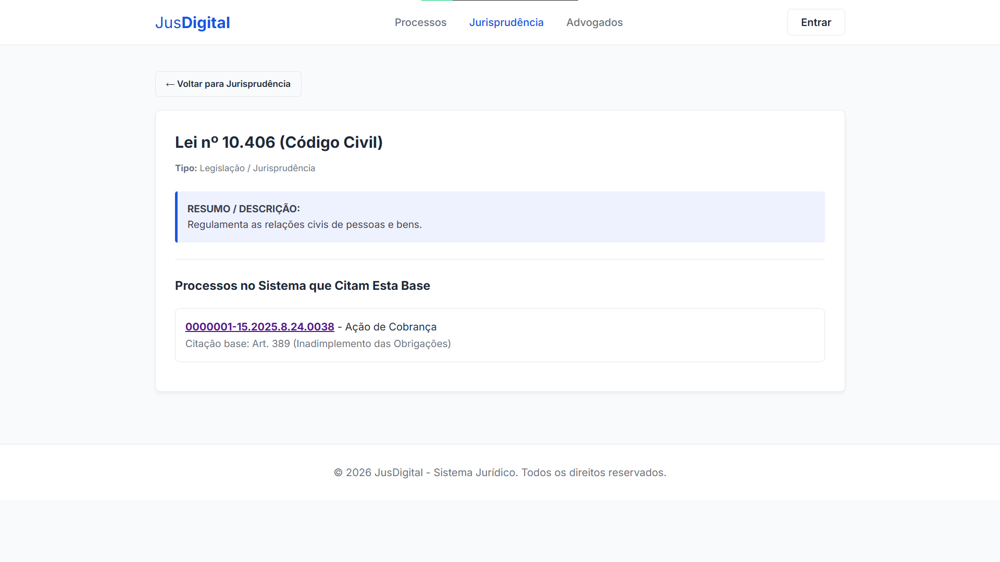

Modelos de documentos: minutas de petições com botão para transferir o conteúdo diretamente para a área de transferência usando a Clipboard API.

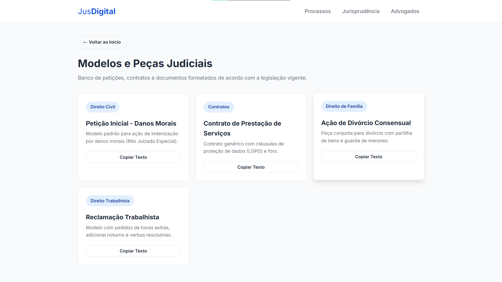

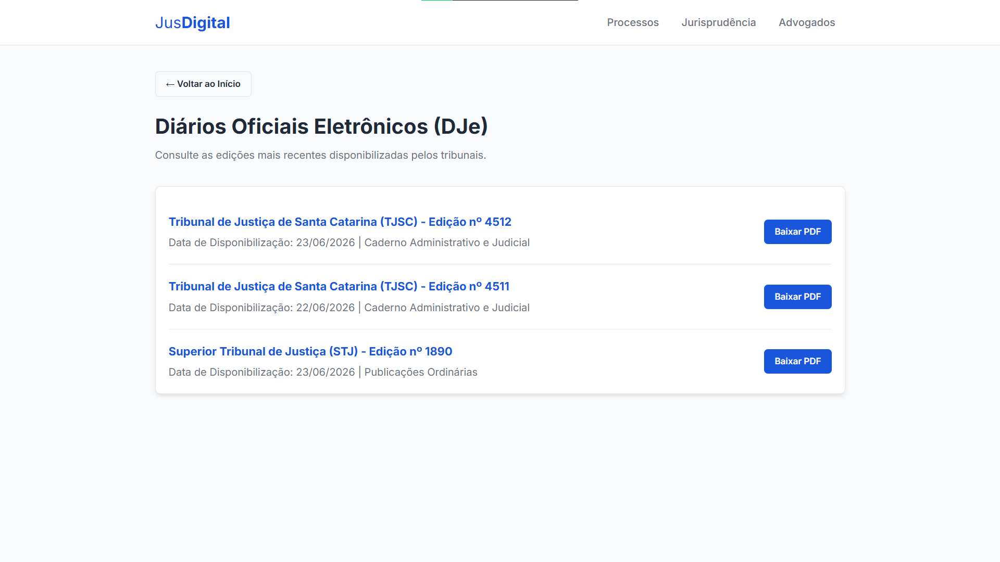

### Servidor HTTP em Java padrão

O arquivo `ServidorWeb.java` implementa a comunicação HTTP utilizando a classe `com.sun.net.httpserver.HttpServer` do JDK, sem frameworks externos como Spring Boot:

| Endpoint | Método | Descrição |
|---|---|---|
| `/` | GET | Serve `index.html` e arquivos estáticos |
| `/api/processos` | GET | Lista todos os processos |
| `/api/processo?id=N` | GET | Detalhe de um processo (partes, trâmites, vara) |
| `/api/advogados` | GET | Lista todos os advogados |
| `/api/advogado?id=N` | GET | Perfil do advogado e seus processos |
| `/api/leis` | GET | Lista todas as leis |
| `/api/lei?id=N` | GET | Detalhe da lei e processos que a citam |
| `/api/login` | POST | Autenticação |
| `/api/cadastro` | POST | Registro de novo usuário |

Cada manipulador de rota recebe a conexão JDBC ativa e formata as respostas em JSON com `StringBuilder`, escapando caracteres textuais manualmente.

## A camada de IA: conversão de linguagem natural em SQL

### O problema das consultas em linguagem natural

A interface visual organiza a navegação comum, mas não atende perguntas compostas em linguagem livre, tais como:

- "Quais ações de despejo foram abertas contra o Adriano em 2026?"
- "Liste os processos da Fazenda Estadual com valor acima de 50 mil"
- "Resumo do processo 0001234-55.2026.8.26.0001"

A API complementar foi construída para converter essas perguntas em comandos SQL e devolver os dados formatados.

### Pilha tecnológica: FastAPI, LiteLLM e Ollama

A API roda em Python com FastAPI na porta 8000. A comunicação com o modelo de linguagem é mediada pela biblioteca LiteLLM, permitindo alternar entre provedores locais e remotos por variáveis de ambiente.

O modelo padrão configurado é o Qwen 2.5 (3B), executado localmente pelo Ollama em CPU.

```
LLM-Juridica/
├── main.py            # FastAPI, rotas e CORS
├── llm_service.py     # Lógica das 3 camadas de IA
├── prompts.py         # Todos os prompts centralizados
├── schemas.py         # Modelos Pydantic (request/response)
├── config.py          # Settings com Pydantic + .env
├── test_client.py     # Script de testes
└── pyproject.toml     # Dependências (uv)
```

### Pipeline de três camadas

Em vez de enviar a pergunta bruta do usuário diretamente para a geração do SQL, o sistema organiza o fluxo em três etapas independentes:

#### Camada 1: extração de entidades (NER)

A primeira etapa extrai parâmetros estruturados a partir da consulta do usuário. O modelo retorna um JSON contendo campos como `tipo_acao`, `autor`, `reu`, `ano`, `numero_processo`, `valor_causa` e `comarca`.

Prompt base:
> "Você é um especialista em extração de entidades jurídicas. Analise a consulta e retorne APENAS um JSON válido. Use null para campos não encontrados."

Exemplo de entrada:
`"Ação de despejo do Condomínio Edifício Central contra o Adriano em 2026"`

Exemplo de saída:
```json
{
  "tipo_acao": "despejo",
  "autor": "Condomínio Edifício Central",
  "reu": "Adriano",
  "ano": 2026,
  "numero_processo": null,
  "valor_causa": null,
  "comarca": null,
  "extras": {}
}
```

O código extrai o bloco JSON com expressões regulares mesmo se o modelo adicionar marcadores markdown e valida os campos contra um esquema do Pydantic.

#### Camada 2: geração de SQL

A segunda camada recebe as entidades extraídas e a descrição do esquema relacional (`db_context`) enviada pelo cliente:

```json
{
  "tables": {
    "processos": ["id", "numero_cnj", "tipo_acao", "ano_distribuicao", "autor_id", "reu_id"],
    "partes": ["id", "nome", "cpf_cnpj"]
  },
  "sample_data": {
    "processos": [{"id": 1, "tipo_acao": "despejo", "ano_distribuicao": 2026}]
  }
}
```

O envio do contexto reduz alucinações sobre nomes de tabelas e colunas. As regras do prompt determinam:
- Apenas consultas de leitura (`SELECT`).
- Comparação de texto com `ILIKE`.
- Junções explícitas (`JOIN`) entre tabelas relacionadas.
- Cláusula `LIMIT 100` obrigatória.

#### Camada 3: resumo processual

A terceira camada recebe os dados brutos de um processo (número, vara, partes e histórico de trâmites) e gera uma explicação simplificada em linguagem acessível. Essa rota é acionada pelo botão "Gerar Resumo" na interface do JusDigital via requisição `POST` para `/summary`.

### Validação contra SQL destrutivo

Para evitar a execução de operações destrutivas em banco geradas pelo modelo, a função `validate_sql_safety()` em `llm_service.py` aplica verificações básicas antes do retorno:

```python
_DANGEROUS_PATTERN = re.compile(
    r"\b(DROP|DELETE|UPDATE|INSERT|TRUNCATE|ALTER|CREATE|GRANT|REVOKE|EXEC|EXECUTE)\b",
    re.IGNORECASE,
)

def validate_sql_safety(sql: str) -> None:
    if not _SELECT_START_PATTERN.match(sql):
        raise HTTPException(status_code=422, detail="Query não começa com SELECT")
    match = _DANGEROUS_PATTERN.search(sql)
    if match:
        raise HTTPException(status_code=422, detail=f"Palavra proibida: {match.group()}")
```

Regras aplicadas:
1. A instrução deve iniciar estritamente com `SELECT`.
2. A instrução não pode conter comandos de modificação de dados ou alteração de esquema (como `DROP`, `DELETE`, `UPDATE` ou `ALTER`).

Se qualquer condição for violada, a API responde com código HTTP 422.

### Endpoints da API

| Endpoint | Método | Descrição |
|---|---|---|
| `/health` | GET | Verificação de integridade do serviço (`{"status": "ok"}`) |
| `/search` | POST | Pipeline de NER e geração de SQL. Recebe `query` e `db_context` opcional |
| `/summary` | POST | Geração de resumo processual a partir de texto bruto |

### Configuração de modelos

As variáveis de ambiente do `config.py` permitem apontar cada camada para um modelo ou provedor distinto:

```env
NER_MODEL=ollama/qwen2.5:3B
NER_API_BASE=http://localhost:11434

SQL_MODEL=ollama/qwen2.5:3B
SQL_API_BASE=http://localhost:11434

SUMMARY_MODEL=ollama/qwen2.5:3B
SUMMARY_API_BASE=http://localhost:11434
```

É possível redirecionar a camada de SQL para provedores externos alterando apenas as variáveis de configuração, sem modificar o código-fonte da aplicação:

```env
SQL_MODEL=gpt-4o
SQL_API_KEY=sk-...
```

## Como executar o projeto

### Pré-requisitos

- Java 17+ (para o servidor web e a camada de dados)
- PostgreSQL (com a base `sistema_juridico` configurada)
- Python 3.12+ (para a API com IA)
- Ollama (para execução do modelo de linguagem local)

### 1. Banco de dados

Com o PostgreSQL em execução, aplique os scripts de criação do esquema e inserção de dados:

```bash
psql -U seu_usuario -d sistema_juridico -f refs/Script_BD.sql
psql -U seu_usuario -d sistema_juridico -f refs/PopularBanco.sql
```

### 2. Servidor web (Java)

```bash
# Compilar os fontes
javac -d out src/*.java src/bean/*.java src/controller/*.java src/db/*.java src/model/*.java

# Empacotar arquivo JAR
jar cfm Run.jar MANIFEST.MF -C out .

# Executar a aplicação
java -jar Run.jar
```

No menu principal, informe `20` para iniciar o servidor web e abra `http://localhost:8081/`.

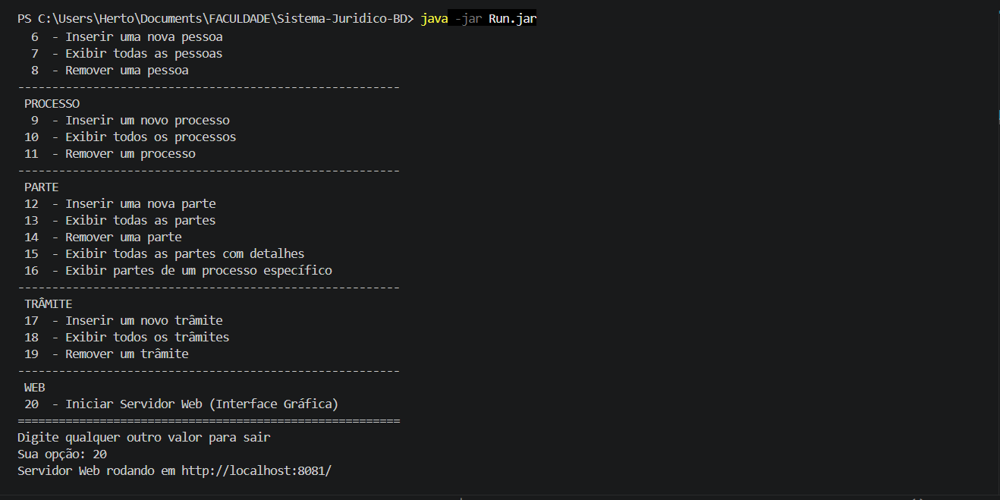

### 3. API com IA

```bash
# Baixar o modelo no Ollama
ollama pull qwen2.5:3b

# Instalar as dependências da API
cd LLM-Juridica
pip install -r requirements.txt
# ou com uv:
uv sync

# Configurar as variáveis de ambiente
cp .env.example .env

# Executar a API
uvicorn main:app --reload
```

A API estará acessível em `http://localhost:8000/`, com documentação Swagger disponível em `/docs`.

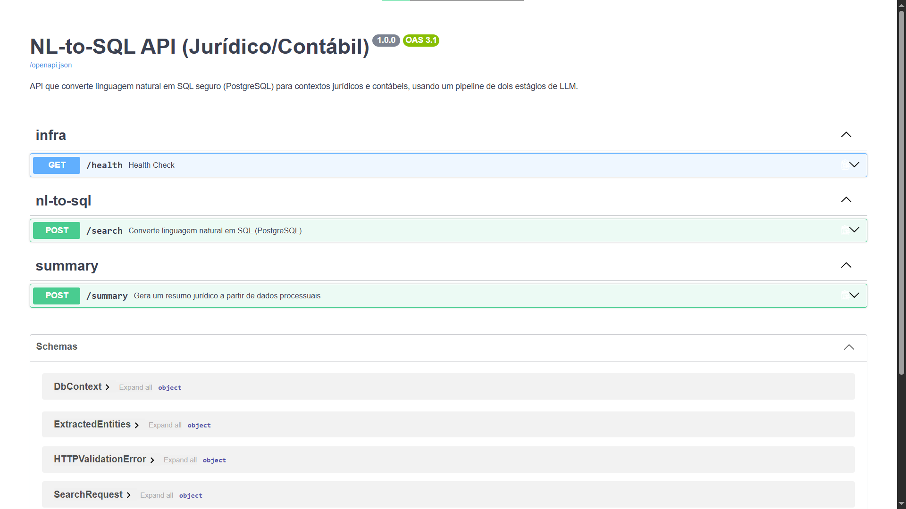

### 4. Integração front-end e IA

Com os serviços ativos nas portas 8081 (Java) e 8000 (Python):

1. Acesse `http://localhost:8081/`
2. Abra a página de detalhes de um processo.
3. Clique em "Gerar Resumo".
4. O navegador envia os dados para a rota `/summary` da API em Python e exibe o texto gerado na tela.

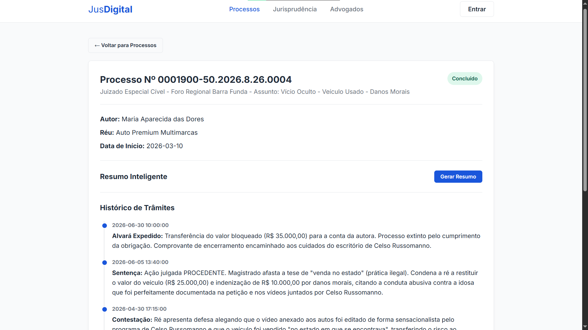
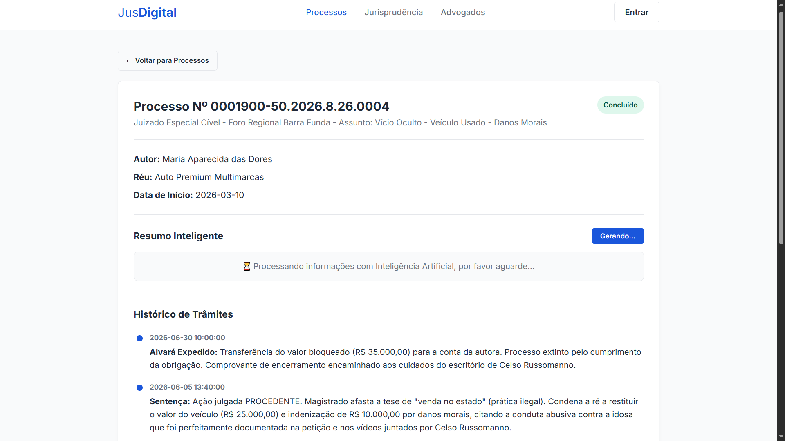
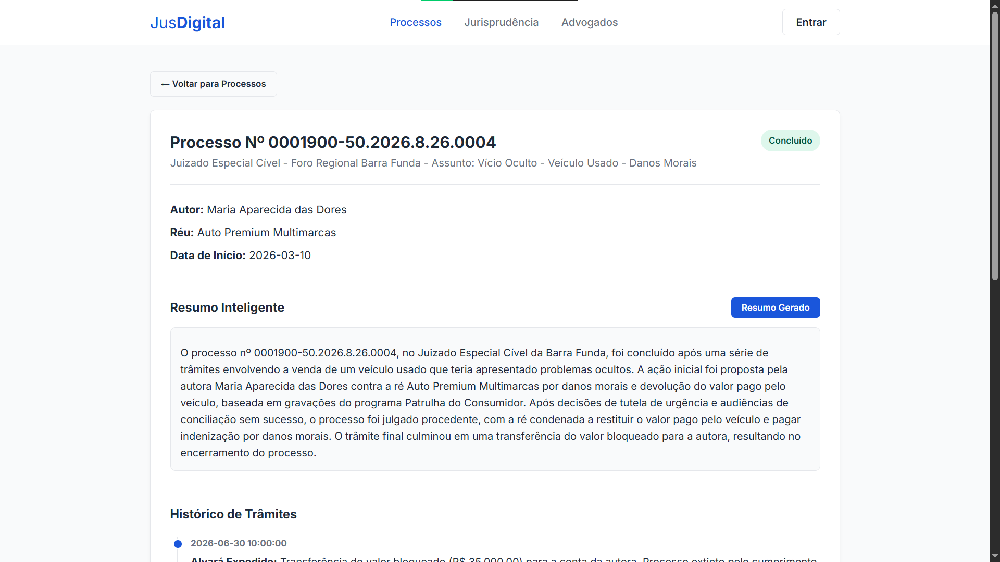

Para executar os testes automatizados da API:

```bash
cd LLM-Juridica
python test_client.py
```

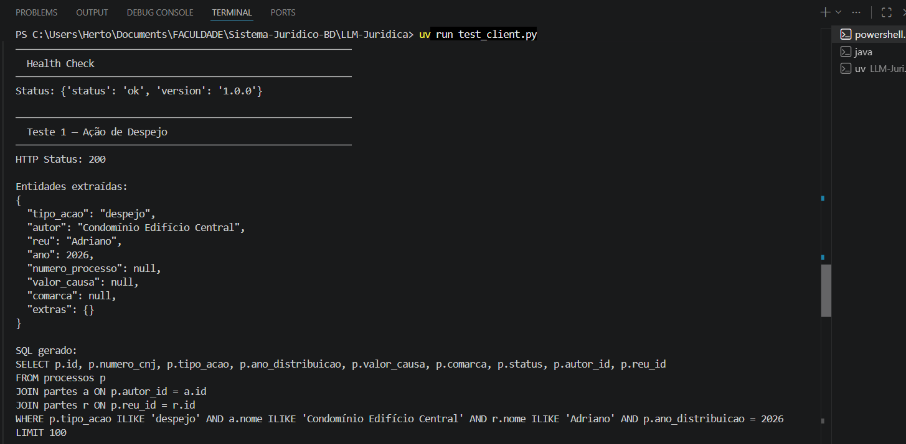
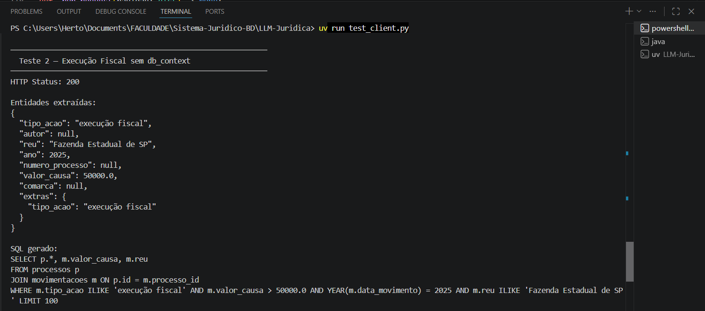
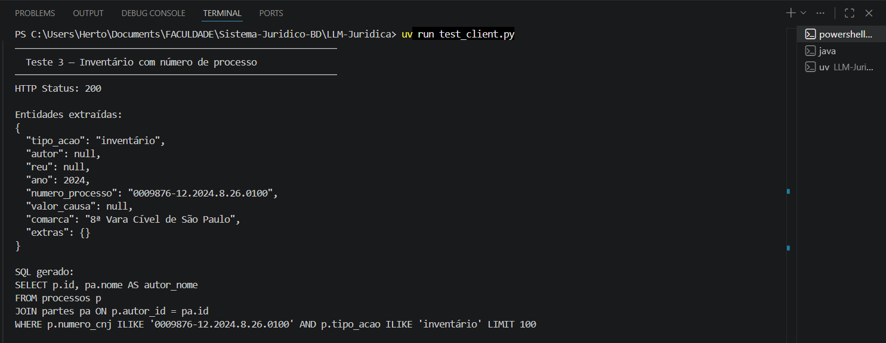

## Diagrama de integração

```
┌─────────────────────────────────────────────────────────┐
│                    USUÁRIO (Navegador)                  │
│                  http://localhost:8081                  │
└────────────┬──────────────────────────┬─────────────────┘
             │ fetch("/api/...")        │ fetch("localhost:8000/summary")
             ▼                          ▼
┌────────────────────────┐  ┌──────────────────────────────┐
│   ServidorWeb.java     │  │     FastAPI (LLM-Juridica)   │
│   HttpServer :8081     │  │     Uvicorn :8000            │
│                        │  │                              │
│  ┌─ /api/processos     │  │  ┌─ POST /search             │
│  ├─ /api/processo?id=  │  │  │  ├─ Camada 1: NER         │
│  ├─ /api/advogados     │  │  │  ├─ Camada 2: SQL Gen     │
│  ├─ /api/leis          │  │  │  └─ validate_sql_safety() │
│  ├─ /api/login         │  │  │                           │
│  └─ /api/cadastro      │  │  └─ POST /summary            │
│                        │  │     └─ Camada 3: Resumo      │
└────────────┬───────────┘  └──────────────┬───────────────┘
             │                             │
             ▼                             ▼
┌────────────────────────┐  ┌──────────────────────────────┐
│      PostgreSQL        │  │     Ollama (Qwen 2.5 3B)     │
│   sistema_juridico     │  │     http://localhost:11434   │
└────────────────────────┘  └──────────────────────────────┘
```

## Aprendizados do projeto

O projeto evoluiu da modelagem relacional para uma aplicação completa com interface visual e tradução de consultas. Principais observações do desenvolvimento:

- O pipeline em duas etapas (extração de entidades seguida por geração de SQL) mostrou-se mais estável do que solicitar a consulta SQL diretamente ao modelo, pois o segundo estágio recebe parâmetros delimitados e um esquema de dados conhecido.
- Modelos compactos executados localmente em CPU (como o Qwen 2.5 3B via Ollama) atenderam com precisão as tarefas de extração estruturada e escrita de consultas `SELECT`, sem dependência de serviços externos.
- A validação sintática prévia por expressões regulares e restrições de comandos impediu que instruções de alteração ou exclusão de tabelas chegassem ao banco.

O código-fonte completo está disponível no [repositório do GitHub](https://github.com/hertonnn/Sistema-Juridico-BD).

**Disciplina:** Banco de Dados II  
**Instituição:** Universidade do Estado de Santa Catarina (UDESC), Centro de Ciências Tecnológicas (CCT)  
**Autores:** Herton Silveira, Arthur Bertoli Silva  
**Ano:** 2025/2026  

<div class="mb-5">
    <span class="d-inline-block px-2 py-1 bg-light text-dark rounded small">
        <strong>Java</strong>
    </span>
    <span class="d-inline-block px-2 py-1 bg-light text-dark rounded small">
        <strong>HTML/CSS/JS</strong>
    </span>
    <span class="d-inline-block px-2 py-1 bg-light text-dark rounded small">
        <strong>FastAPI</strong>
    </span>
    <span class="d-inline-block px-2 py-1 bg-light text-dark rounded small">
        <strong>LiteLLM</strong>
    </span>
    <span class="d-inline-block px-2 py-1 bg-light text-dark rounded small">
        <strong>Ollama</strong>
    </span>
    <span class="d-inline-block px-2 py-1 bg-light text-dark rounded small">
        <strong>PostgreSQL</strong>
    </span>
    <span class="d-inline-block px-2 py-1 bg-light text-dark rounded small">
        <strong>UDESC</strong>
    </span>
</div>
