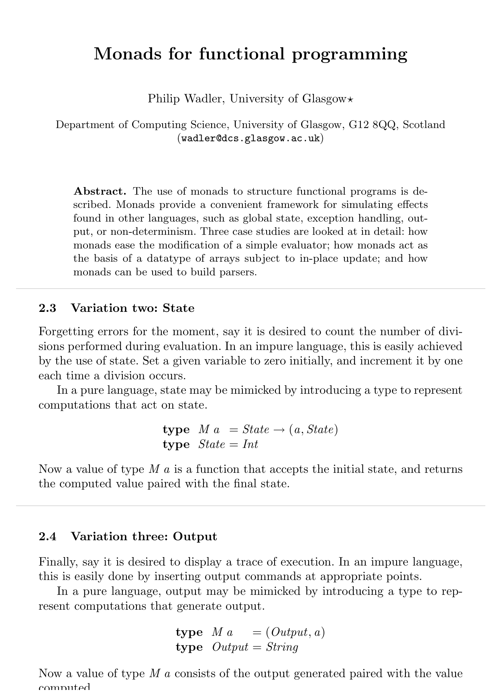
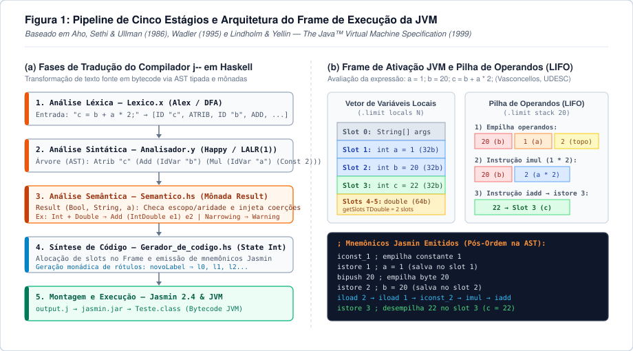
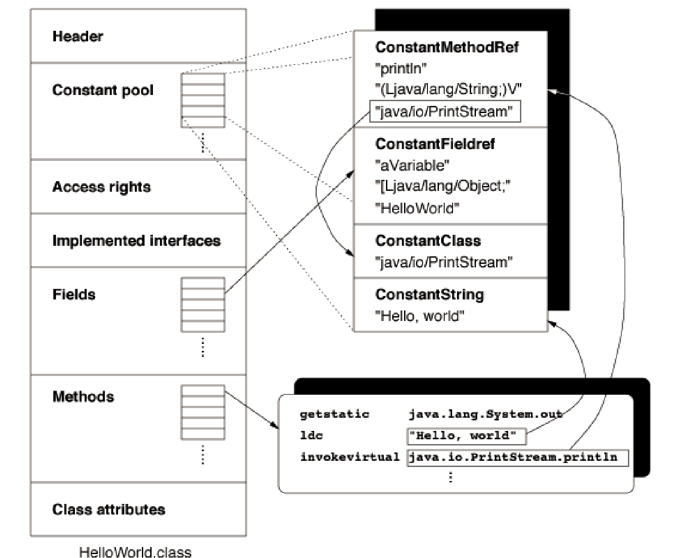
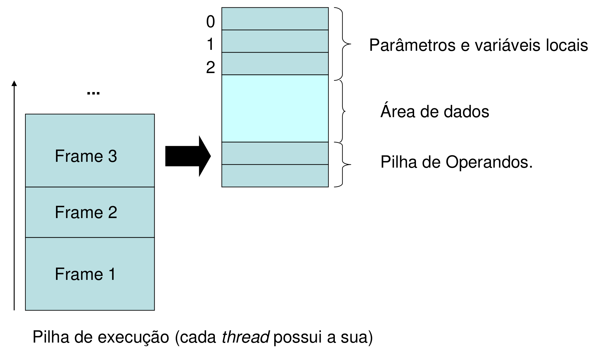
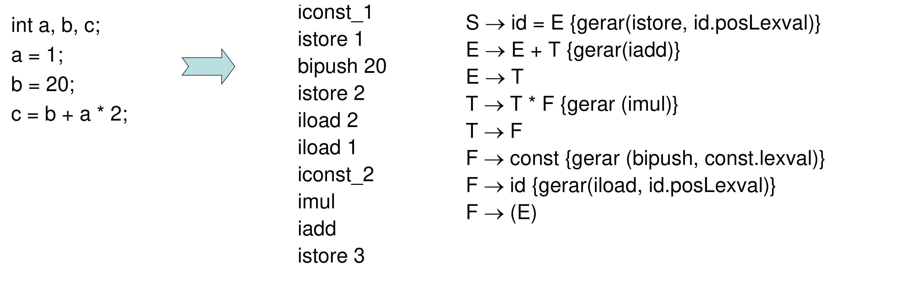
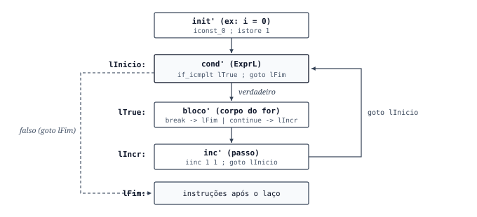

No [post anterior sobre a disciplina de Compiladores](https://hertonnn.github.io/blog/compiladores/), reuni as referências iniciais das aulas ministradas pelo [Prof. Dr. Cristiano Damiani Vasconcellos](https://github.com/cdvasconcellos/Compiladores) na UDESC. Este artigo documenta o projeto prático desenvolvido ao longo do semestre: um compilador completo para a linguagem `j--` (um subconjunto de Java), escrito em Haskell e disponível no repositório [github.com/hertonnn/Compilador-Java](https://github.com/hertonnn/Compilador-Java).

Por definição, um compilador é um programa, ou conjunto de programas, que lê um código-fonte escrito em uma linguagem compilada e produz um código-objeto semanticamente equivalente. No formato clássico, essa tradução parte de uma linguagem textual de alto nível e gera instruções de máquina para um processador e sistema operacional específicos, ou para uma máquina virtual como a JVM.

Antes de entrar no código em Haskell, vale percorrer os artigos que formaram a base teórica das ferramentas usadas no projeto, desde os primeiros tradutores da década de 1950 até o uso de mônadas e máquinas de pilha.

## Dos primeiros tradutores às máquinas de pilha

### Grace Hopper e o sistema A-0 (1952)

Antes da década de 1950, escrever software exigia converter algoritmos manualmente para códigos numéricos em octal ou hexadecimal e controlar cada endereço físico de memória. O termo *compiler* foi criado por Grace Murray Hopper entre 1951 e 1952 enquanto trabalhava no UNIVAC I na Remington Rand.

No artigo ["The Education of a Computer" (ACM National Conference, 1952)](https://dl.acm.org/doi/10.1145/609784.609818), Hopper apresentou o sistema A-0. O programa lia especificações matemáticas e reunia sub-rotinas pré-gravadas em fita magnética para montar um binário executável. Na época, a ideia de usar o próprio computador para gerar código encontrou resistência entre engenheiros que viam a máquina apenas como um calculador numérico.

### John Backus e o compilador FORTRAN I (1957)

Mesmo depois dos primeiros tradutores de Hopper e do *Autocode* de Alick Glennie (1952), predominava a visão de que qualquer código gerado automaticamente seria lento demais em comparação ao *assembly* escrito à mão.

Em 1957, a equipe da IBM liderada por John Backus publicou ["The FORTRAN Automatic Coding System" (Western Joint Computer Conference, 1957)](https://dl.acm.org/doi/10.1145/1455567.1455599) para o mainframe IBM 704. O projeto consumiu 18 pessoas-ano e introduziu rotinas para análise de expressões aritméticas com precedência, alocação de registradores de índice e otimização de laços, gerando código de máquina com desempenho próximo ao escrito por programadores experientes.

### Gramáticas formais, BNF e analisadores LALR (1956 a 1969)

Nos primeiros compiladores, a análise sintática dependia de regras ad hoc para cada linguagem. A formalização matemática que permitiu gerar analisadores automaticamente surgiu entre 1956 e 1969.

Em ["Three models for the description of language" (IRE Transactions on Information Theory, 1956)](https://ieeexplore.ieee.org/document/1056813), Noam Chomsky classificou as gramáticas formais em níveis de expressividade, separando as gramáticas regulares (Tipo 3, usadas na análise léxica) das gramáticas livres de contexto (Tipo 2, usadas na análise sintática). Quatro anos depois, John Backus e Peter Naur adotaram a notação BNF (*Backus-Naur Form*) no [Revised Report on the Algorithmic Language ALGOL 60](https://dl.acm.org/doi/10.1145/365928.365956) para descrever regras gramaticais sem ambiguidade.

Faltava um algoritmo eficiente para reconhecer essas gramáticas. Em ["On the Translation of Languages from Left to Right" (Information and Control, 1965)](https://www.sciencedirect.com/science/article/pii/S0019995865904262), Donald Knuth definiu os analisadores LR(*k*), provando que linguagens determinísticas livres de contexto podem ser reconhecidas em tempo linear por um autômato de pilha com operações de empilhamento (*shift*) e redução (*reduce*). Como as tabelas LR(1) canônicas de Knuth eram grandes demais para a memória dos computadores da década de 1960, Frank DeRemer propôs em sua tese no MIT, ["Practical Translators for LR(k) Languages" (1969)](https://dl.acm.org/doi/book/10.5555/905579), o método LALR(1) (*Look-Ahead LR*). A compactação de estados LR(1) com núcleos idênticos viabilizou geradores de parsers como o Yacc (Bell Labs, 1975) e o Happy em Haskell.

### Mônadas em compiladores funcionais (1989 a 1995)

Linguagens funcionais puras como Haskell representam árvores sintáticas de forma direta por meio de tipos algébricos de dados (*Algebraic Data Types*) e casamento de padrões (*pattern matching*). Um compilador completo, porém, precisa lidar com estado e efeitos durante a travessia da árvore: acumular mensagens de erro e avisos sem interromper a análise no primeiro problema, consultar tabelas de símbolos e incrementar contadores para rótulos de desvio (`l0`, `l1`, `l2`).

A base teórica para tratar esses efeitos sem abrir mão da pureza funcional veio do trabalho de [Eugenio Moggi em "Computational lambda-calculus and monads" (LICS, 1989)](https://ieeexplore.ieee.org/document/39155) e foi trazida para o Haskell por Philip Wadler no artigo ["Monads for functional programming" (Båstad Spring School / Springer LNCS 925, 1995)](https://homepages.inf.ed.ac.uk/wadler/papers/marktoberdorf/baastad.pdf), utilizado como leitura na disciplina da UDESC.

<div class="my-6 rounded-lg overflow-hidden border border-slate-800 bg-white p-2">
    
</div>

No artigo, Wadler parte de um avaliador de expressões aritméticas escrito em Haskell e mostra como adicionar tratamento de erros, contagem de estado (`State`) e log de execução (`Output`) alterando apenas a definição da mônada, sem reescrever toda a estrutura recursiva. É exatamente esse padrão que usamos nos módulos `Semantico.hs` e `Gerador_de_codigo.hs`, além de ser a base do próprio compilador GHC.

### Máquinas virtuais de pilha, JVM e trabalhos na UDESC

Para desacoplar o *front-end* da linguagem das particularidades de cada família de processadores físicos, muitos compiladores geram código intermediário voltado a máquinas abstratas de pilha, abordagem difundida pelo *P-code* do UCSD Pascal nos anos 1970 e sistematizada por Alfred Aho, Ravi Sethi e Jeffrey Ullman no livro [*Compilers: Principles, Techniques, and Tools* (Dragon Book)](https://dl.acm.org/doi/book/10.5555/6448).

Em 1996, Tim Lindholm e Frank Yellin publicaram a [The Java™ Virtual Machine Specification](https://docs.oracle.com/javase/specs/jvms/se8/html/), definindo um processador virtual baseado em pilha de operandos que executa arquivos binários `.class`. No ano seguinte, Jonathan Meyer e Troy Downing lançaram o montador [Jasmin (*Java Assembler Interface*, 1997)](https://jasmin.sourceforge.net/), que converte arquivos de texto com mnemônicos da JVM (`.j`) para `.class`.

Na UDESC, o estudo e o desenvolvimento de compiladores também aparecem em trabalhos de conclusão e pesquisas do departamento de Ciência da Computação, como:

- [João Guilherme Packer (Orientador: Prof. Fabiano Baldo, 2013), *"Implementação de uma extensão de um compilador de SpecC para SystemC"*](https://repositorio.udesc.br/entities/publication/2a91d71a-7d3c-48a5-9c2a-f1f50fbca082), voltado à tradução e síntese em projetos de sistemas embarcados;
- [Gerson Fernando Budke (Orientador: Prof. Claudio Cesar de Sá, 2008), *"Estrutura de análise dinâmica para compiladores"*](https://repositorio.udesc.br/handle/UDESC/18461), focado em ferramentas de verificação em tempo de execução.

## Ferramentas e arquitetura do compilador

O compilador de `j--` foi dividido em cinco etapas, combinando geradores clássicos do ecossistema Haskell com o montador Jasmin:

| Ferramenta | Papel no projeto | Documentação e referência |
| :--- | :--- | :--- |
| **Haskell (GHC)** | Definição da árvore sintática, verificação de tipos com mônadas e geração de código. | [Glasgow Haskell Compiler](https://www.haskell.org/ghc/) e [Wadler (1995)](https://homepages.inf.ed.ac.uk/wadler/papers/marktoberdorf/baastad.pdf) |
| **Alex** (`.x` para `.hs`) | Gerador de analisador léxico baseado em expressões regulares e autômatos finitos determinísticos. | [Documentação do Alex](https://haskell-alex.readthedocs.io/en/latest/index.html) |
| **Happy** (`.y` para `.hs`) | Gerador de analisador sintático ascendente LALR(1) a partir da gramática livre de contexto. | [Documentação do Happy](https://haskell-happy.readthedocs.io/en/latest/) |
| **Jasmin 2.4** (`.j` para `.class`) | Montador que traduz instruções simbólicas da JVM para bytecode `.class`. | [Jasmin User Guide](https://jasmin.sourceforge.net/xt.html) |
| **Compiler Explorer e `javap`** | Inspeção de bytecode gerado pelo `javac` para conferir descritores de métodos e uso da pilha. | [Compiler Explorer (Godbolt)](https://godbolt.org/) e [JVM Spec](https://docs.oracle.com/javase/specs/jvms/se8/html/) |

O diagrama a seguir resume a sequência de módulos desde o arquivo-fonte `.j--` até a montagem do `.class`:

<div class="my-6 rounded-lg overflow-hidden border border-slate-800 bg-white p-3">
    
</div>

### Organização do arquivo `.class` e dos frames da JVM

Para gerar código Jasmin válido, o compilador precisa respeitar a organização interna do arquivo `.class` e o modelo de memória da máquina virtual. Conforme ilustrado nos materiais de aula do Prof. Cristiano Damiani Vasconcellos, cada arquivo `.class` reúne um cabeçalho (com o número mágico `0xCAFEBABE` e a versão do formato), a tabela de constantes (*Constant Pool*) com strings, nomes de classes e assinaturas simbólicas, além da lista de métodos com suas instruções:

<div class="my-6 rounded-lg overflow-hidden border border-slate-800 bg-white p-3">
    
</div>

Durante a execução, cada chamada de método aloca um *Frame* na pilha da thread corrente. O frame contém um vetor de variáveis locais indexado a partir de zero em palavras de 32 bits, uma área de dados ligada à *Constant Pool* e uma pilha de operandos (*Operand Stack*) onde os valores são empilhados antes de cada operação:

<div class="my-6 rounded-lg overflow-hidden border border-slate-800 bg-white p-3">
    
</div>

Como cada posição do vetor de variáveis locais possui 32 bits, variáveis dos tipos `int`, `float` e referências `String` ocupam 1 posição (*slot*), enquanto valores `double` de 64 bits ocupam 2 posições consecutivas.

## Implementação das etapas do compilador

Todo o código-fonte comentado nas seções abaixo, junto com o `jasmin.jar` e os arquivos de teste, está no repositório [github.com/hertonnn/Compilador-Java](https://github.com/hertonnn/Compilador-Java).

### Análise léxica com Alex (`Tokens.hs` e `Lexico.x`)

O módulo `Tokens.hs` declara o tipo algébrico que representa os símbolos terminais da linguagem: palavras reservadas, literais, operadores e delimitadores.

```haskell
module Tokens where

data Tokens
  = TDOUBLE | TINT | TFLOAT | TSTRING | TVOID
  | ID String
  | CDOUBLE Double | CFLOAT Float | CINT Int | LITERAL String
  | TIF | TELSE | TWHILE | TDO | TFOR | TREAD | TRETURN | TPRINT
  | ADD | SUB | MUL | DIV | RMOD | POW | SQR
  | EQUAL | NEQUAL | MAJOR | MINOR | MAJEQ | MINEQ | AND | OR | NOT
  | ATRIB | PLUSPLUS | MINUSMINUS | EQUALPLUS | EQUALMINUS | EQUALMUL | EQUALDIV
  | LPAR | RPAR | LBRACK | RBRACK | LCBRAK | RCBRAK | SEMICOLON | COMMA
  deriving (Eq, Show)
```

No arquivo `Lexico.x`, associamos expressões regulares às ações em Haskell que constroem cada token, ignorando espaços em branco e comentários:

```haskell
%wrapper "basic"

$digit   = [0-9]
$alpha   = [a-zA-Z]

@int     = $digit+
@double  = '-'? $digit+ \. $digit* | \. $digit+
@float   = @double [fF]
@id      = $alpha ($alpha | $digit | '_')*
@literal = \" ([^\"\\] | \\ .)* \"

tokens :-
<0> {
    $white+                                             ;
    "//".*                                              ;
    "/*" ([^\*]|[\r\n]|(\*+([^\*\/]|[\r\n])))* \*+ "/"  ;

    "int"       { \s -> TINT }
    "float"     { \s -> TFLOAT }
    "double"    { \s -> TDOUBLE }
    "string"    { \s -> TSTRING }
    "void"      { \s -> TVOID }
    "if"        { \s -> TIF }
    "else"      { \s -> TELSE }
    "while"     { \s -> TWHILE }
    "for"       { \s -> TFOR }
    "print"     { \s -> TPRINT }
    "read"      { \s -> TREAD }

    @float      { \s -> CFLOAT (read (init s)) }
    @double     { \s -> CDOUBLE (read s) }
    @int        { \s -> CINT (read s) }
    @literal    { \s -> LITERAL (init (tail s)) }
    @id         { \s -> ID s }
}
```

O comando `alex Lexico.x -o Lexico.hs` gera o autômato finito determinístico e expõe a função `alexScanTokens :: String -> [Tokens]`.

### Árvore sintática abstrata e parser LALR (`SintaxeAbstrata.hs` e `Analisador.y`)

O arquivo `SintaxeAbstrata.hs` define a estrutura da Árvore Sintática Abstrata (AST), separando expressões aritméticas (`Expr`), relacionais (`ExprR`), lógicas (`ExprL`), declarações de variáveis (`Var`) e comandos (`Comando`):

```haskell
module SintaxeAbstrata where

type Id = String

data Tipo = TDouble | TInt | TFloat | TString | TVoid
  deriving (Show, Eq, Ord)

data Expr
  = Add Expr Expr | Sub Expr Expr | Mul Expr Expr | Div Expr Expr
  | Pow Expr Expr | Mod Expr Expr | Neg Expr      | Sqr Expr
  | Const TCons   | IdVar String  | Lit String    | Chamada Id [Expr]
  -- Nós de coerção inseridos durante a verificação semântica:
  | IntDouble Expr | DoubleInt Expr | IntFloat Expr
  | FloatDouble Expr | FloatInt Expr | DoubleFloat Expr
  deriving (Show, Eq)

data Var      = Id :#: (Tipo, Int)         deriving (Show, Eq)
data Funcao   = Id :->: ([Var], Tipo)      deriving (Show, Eq)
data Programa = Prog [Funcao] [(Id, [Var], Bloco)] [Var] Bloco
  deriving (Show, Eq)
```

Em `Analisador.y`, especificamos a precedência dos operadores (`%left`, `%right`, `%nonassoc`) para resolver conflitos *shift/reduce* na tabela LALR(1) e montamos a AST a partir da lista de tokens:

```haskell
%left '||' '&&'
%right '!'
%nonassoc '==' '!=' '>' '<' '>=' '<='
%left '+' '-'
%left '*' '/' '%'
%right '**'

%%

Expr : Expr '+' Expr    { Add $1 $3 }
     | Expr '-' Expr    { Sub $1 $3 }
     | Expr '*' Expr    { Mul $1 $3 }
     | Expr '/' Expr    { Div $1 $3 }
     | Expr '**' Expr   { Pow $1 $3 }
     | '(' Expr ')'     { $2 }
     | CInt             { Const (CInt $1) }
     | CDouble          { Const (CDouble $1) }
     | CFloat           { Const (CFloat $1) }
     | id               { IdVar $1 }
     | id '(' Args ')'  { Chamada $1 $3 }
```

### Análise semântica com a mônada `Result` (`Semantico.hs`)

Seguindo a estrutura de Wadler (1995), `Semantico.hs` define a mônada `Result a`, uma tupla com um booleano indicando se houve erro fatal, uma `String` acumulando todas as mensagens geradas durante a verificação e o nó da árvore resultante:

```haskell
data Result a = Result (Bool, String, a) deriving Show

instance Functor Result where
  fmap f (Result (err, log, a)) = Result (err, log, f a)

instance Applicative Result where
  pure a = Result (False, "", a)
  Result (e1, l1, f) <*> Result (e2, l2, x) = Result (e1 || e2, l1 ++ l2, f x)

instance Monad Result where
  return = pure
  Result (e1, l1, a) >>= f =
    let Result (e2, l2, b) = f a
    in Result (e1 || e2, l1 ++ l2, b)

errorMsg :: String -> Result ()
errorMsg s = Result (True, "Error: " ++ s ++ "\n", ())

warningMsg :: String -> Result ()
warningMsg s = Result (False, "Warning: " ++ s ++ "\n", ())
```

Além de validar declarações duplicadas, variáveis fora de escopo e aridade de funções, o analisador semântico insere nós de conversão na árvore quando encontra operações mistas entre `int`, `float` e `double`:

```haskell
coercaoBinaria :: (Expr -> Expr -> Expr) -> Expr -> Expr -> Tipo -> Tipo -> Result (Tipo, Expr)
coercaoBinaria op e1 e2 t1 t2 = case (t1, t2) of
  (TInt, TInt)       -> return (TInt, op e1 e2)
  (TFloat, TFloat)   -> return (TFloat, op e1 e2)
  (TDouble, TDouble) -> return (TDouble, op e1 e2)

  (TInt, TFloat)     -> return (TFloat, op (IntFloat e1) e2)
  (TFloat, TInt)     -> return (TFloat, op e1 (IntFloat e2))
  (TInt, TDouble)    -> return (TDouble, op (IntDouble e1) e2)
  (TDouble, TInt)    -> return (TDouble, op e1 (IntDouble e2))
  (TFloat, TDouble)  -> return (TDouble, op (FloatDouble e1) e2)
  (TDouble, TFloat)  -> return (TDouble, op e1 (FloatDouble e2))

  _ -> retornarErro ("Tipos incompativeis: " ++ show t1 ++ " e " ++ show t2) (TDouble, op e1 e2)
```

Quando uma variável inteira recebe uma expressão `double` ou `float`, o analisador emite um `warningMsg` avisando sobre a perda de casas decimais e envolve a expressão no construtor `DoubleInt` ou `FloatInt`.

### Alocação de índices e geração de código (`Main.hs` e `Gerador_de_codigo.hs`)

Antes de emitir as instruções Jasmin, `Main.hs` percorre a tabela de variáveis de cada função para numerar seus índices no frame da JVM, reservando 2 posições para `TDouble` e 1 posição para os demais tipos:

```haskell
getSlots :: Tipo -> Int
getSlots TDouble = 2
getSlots TFloat  = 1
getSlots _       = 1

atribuirIndicesVariaveis :: Int -> [Var] -> [Var]
atribuirIndicesVariaveis _ [] = []
atribuirIndicesVariaveis n ((id :#: (tipo, _)):resto) =
  let slots = getSlots tipo
      varIndexada = id :#: (tipo, n)
  in varIndexada : atribuirIndicesVariaveis (n + slots) resto
```

A tradução de expressões segue o esquema dirigido por sintaxe apresentado nas aulas da disciplina: para calcular `c = b + a * 2;`, o gerador percorre os nós da AST em pós-ordem, empilhando os operandos com `iload` e `iconst` e emitindo `imul`, `iadd` e `istore`:

<div class="my-6 rounded-lg overflow-hidden border border-slate-800 bg-white p-3">
    
</div>

No módulo `Gerador_de_codigo.hs`, a mônada `State Int String` mantém o contador inteiro usado para criar rótulos únicos (`novoLabel`) e seleciona a instrução mais curta para carregar constantes inteiras:

```haskell
novoLabel :: State Int String 
novoLabel = do 
    n <- get
    put (n + 1)
    return ("l" ++ show n)

genInt :: Int -> String
genInt i
  | i == -1               = "\ticonst_m1\n"
  | i >= 0 && i <= 5      = "\ticonst_" ++ show i ++ "\n"
  | i >= -128 && i <= 127 = "\tbipush " ++ show i ++ "\n"
  | otherwise             = "\tldc " ++ show i ++ "\n"
```

Valores entre `-1` e `5` ocupam um único byte (`iconst_n`), valores entre `-128` e `127` usam `bipush` com operando imediato de 1 byte, e constantes maiores são carregadas da *Constant Pool* com `ldc`.

## Adicionando novas instruções à linguagem

Para estender a gramática original do trabalho, qualquer nova construção precisa atravessar as cinco etapas do compilador (`SintaxeAbstrata.hs`, `Tokens.hs`, `Lexico.x`, `Analisador.y`, `Semantico.hs` e `Gerador_de_codigo.hs`). Abaixo estão cinco extensões implementadas no projeto.

### Laço `for` e operadores de incremento (`++`, `--`, `+=`)

A JVM não possui uma instrução específica para `for`. Assim como ocorre no esquema de tradução do `while`, o laço precisa ser decomposto em blocos básicos ligados por rótulos, desvios condicionais (`if_icmp<cond>`) e saltos incondicionais (`goto`):

<div class="my-6 rounded-lg overflow-hidden border border-slate-800 bg-white p-3">
    
</div>

Na AST e na gramática do Happy, o comando `For` recebe o comando de inicialização, a expressão lógica de parada, o comando de passo e o bloco de instruções:

```haskell
-- SintaxeAbstrata.hs
data Comando = ...
             | For Comando ExprL Comando Bloco
             | Incr Id
             | Decr Id

-- Analisador.y
Comando : for '(' CmdFor ';' ExprL ';' CmdFor ')' Bloco
          { For $3 $5 $7 $9 }

CmdFor  : id '=' Expr   { Atrib $1 $3 }
        | id '+=' Expr  { Atrib $1 (Add (IdVar $1) $3) }
        | id '++'       { Incr $1 }
        | id '--'       { Decr $1 }
```

Note que `id '+=' Expr` é expandido diretamente no parser para uma atribuição comum `Atrib $1 (Add (IdVar $1) $3)`. Já para o incremento unitário `i++` em variáveis inteiras, o gerador de código emite a instrução `iinc <slot> 1`, que soma `1` diretamente na posição da variável local sem passar pela pilha de operandos:

```haskell
genCmd fun tab (Incr nome) =
  case lookupVar nome tab of
    Just (TInt, n)    -> return ("\tiinc " ++ show n ++ " 1\n")
    Just (TDouble, n) -> return ("\tdload " ++ show n ++ "\n\tldc2_w 1.0\n\tdadd\n\tdstore " ++ show n ++ "\n")

genCmd fun tab (For init cond inc bloco) = do
  init'   <- genCmd fun tab init
  lInicio <- novoLabel
  lTrue   <- novoLabel
  lFim    <- novoLabel
  cond'   <- genExprL fun tab lTrue lFim cond
  bloco'  <- genBloco fun tab bloco
  inc'    <- genCmd fun tab inc
  return $
    init' ++
    lInicio ++ ":\n" ++
    cond' ++
    lTrue ++ ":\n" ++
    bloco' ++
    inc' ++
    "\tgoto " ++ lInicio ++ "\n" ++
    lFim ++ ":\n"
```

### Tipo `float` de 32 bits e conversões numéricas

A inclusão do tipo `float` (ponto flutuante IEEE 754 de 32 bits, escrito com sufixo `f` como `3.14f`) ilustra algumas diferenças no conjunto de instruções da JVM em relação a `int` e `double`.

No frame, variáveis `float` ocupam apenas 1 slot (contra 2 slots do `double`) e usam as instruções `fload`, `fstore`, `fadd`, `fsub`, `fmul`, `fdiv` e `ldc`. Nas comparações relacionais, porém, a JVM só possui desvios diretos como `if_icmplt` para inteiros. Para comparar valores `float` ou `double`, é preciso executar antes `fcmpg` (ou `dcmpg`), que consome os dois valores da pilha e empilha `-1`, `0` ou `1`, seguido por uma instrução de salto baseada em zero (`iflt`, `ifeq`, `ifgt`):

```haskell
genRel :: Tipo -> String -> String -> String
genRel TInt    v op = "\tif_icmp" ++ op ++ " " ++ v ++ "\n"
genRel TFloat  v op = "\tfcmpg\n\tif" ++ op ++ " " ++ v ++ "\n"
genRel TDouble v op = "\tdcmpg\n\tif" ++ op ++ " " ++ v ++ "\n"

-- Conversões entre int, float e double na pilha:
genExpr fun tab (IntFloat e)    = genExpr fun tab e >>= \(_, e') -> return (TFloat,  e' ++ "\ti2f\n")
genExpr fun tab (FloatDouble e) = genExpr fun tab e >>= \(_, e') -> return (TDouble, e' ++ "\tf2d\n")
genExpr fun tab (FloatInt e)    = genExpr fun tab e >>= \(_, e') -> return (TInt,    e' ++ "\tf2i\n")
genExpr fun tab (DoubleFloat e) = genExpr fun tab e >>= \(_, e') -> return (TFloat,  e' ++ "\td2f\n")
```

### Igualdade de conteúdo em `String` com `String.equals`

Na JVM, variáveis `String` guardam referências (`Ljava/lang/String;`) para objetos no *Heap*. Usar a instrução `if_acmpeq` em uma expressão como `s1 == s2` compararia apenas se as duas variáveis apontam para o mesmo endereço de memória, o que falha quando as strings vêm de leituras no teclado.

Para comparar o texto das strings, verificamos no gerador de código se os operandos de `Req` (`==`) ou `Rdif` (`!=`) possuem tipo `TString` e emitimos uma chamada ao método `java/lang/String/equals(Ljava/lang/Object;)Z`:

```haskell
genExprR fun tab v f (Req e1 e2) = do
  (t1, code1) <- genExpr fun tab e1
  (t2, code2) <- genExpr fun tab e2
  if t1 == TString && t2 == TString
    then return $
      code1 ++ code2 ++
      "\tinvokevirtual java/lang/String/equals(Ljava/lang/Object;)Z\n" ++
      "\tifne " ++ v ++ "\n" ++
      "\tgoto " ++ f ++ "\n"
    else return (code1 ++ code2 ++ genRel t1 v "eq" ++ "\tgoto " ++ f ++ "\n")
```

### Entrada de dados com `Scanner` e chamada a `Math.random()`

Como o bytecode gerado roda sobre a JVM padrão, podemos conectar comandos da linguagem `j--` diretamente às classes da biblioteca do Java.

No comando `read(x)`, instanciamos `java.util.Scanner` na pilha de operandos (`new`, `dup`, `getstatic java/lang/System/in`, `invokespecial <init>`) e chamamos o método de leitura correspondente ao tipo de `x` na tabela de símbolos:

```haskell
genCmd fun tab (Leitura nome) =
  case lookupVar nome tab of
    Just (tipo, idx) ->
      let (metodo, store) = case tipo of
            TInt    -> ("nextInt()I",               "\tistore " ++ show idx ++ "\n")
            TFloat  -> ("nextFloat()F",             "\tfstore " ++ show idx ++ "\n")
            TDouble -> ("nextDouble()D",            "\tdstore " ++ show idx ++ "\n")
            TString -> ("next()Ljava/lang/String;", "\tastore " ++ show idx ++ "\n")
      in return $
        "\tnew java/util/Scanner\n" ++
        "\tdup\n" ++
        "\tgetstatic java/lang/System/in Ljava/io/InputStream;\n" ++
        "\tinvokespecial java/util/Scanner/<init>(Ljava/io/InputStream;)V\n" ++
        "\tinvokevirtual java/util/Scanner/" ++ metodo ++ "\n" ++
        store
```

Da mesma forma, adicionar uma expressão `random()` à linguagem requer apenas empilhar o retorno de `Math.random()` com uma chamada estática:

```haskell
-- Semantico.hs
tExpr tfun tvar Random = return (TDouble, Random)

-- Gerador_de_codigo.hs
genExpr fun tab Random =
  return (TDouble, "\tinvokestatic java/lang/Math/random()D\n")
```

### Saltos `break` e `continue` com contexto de laço

Para que `break;` e `continue;` funcionem dentro de laços `while`, `do-while` e `for` (inclusive aninhados), o gerador de código propaga um parâmetro `LoopContext` com o par de rótulos do laço mais interno:

```haskell
type LoopContext = Maybe (String, String) -- (LabelContinue, LabelBreak)

genCmd :: [Funcao] -> [Var] -> LoopContext -> Comando -> State Int String
genCmd fun tab loopCtx Break =
  case loopCtx of
    Just (_, lBreak) -> return ("\tgoto " ++ lBreak ++ "\n")
    Nothing          -> error "Erro: comando 'break' utilizado fora de um laco."

genCmd fun tab loopCtx Continue =
  case loopCtx of
    Just (lCont, _)  -> return ("\tgoto " ++ lCont ++ "\n")
    Nothing          -> error "Erro: comando 'continue' utilizado fora de um laco."
```

Em um laço `while`, o `continue` salta para `lInicio` (onde a condição é reavaliada). No laço `for`, saltar direto para `lInicio` pularia a instrução de incremento (`i++`), travando o programa em um laço infinito. Por isso, posicionamos um rótulo `lIncr` imediatamente antes do código de incremento e passamos `Just (lIncr, lFim)` para o bloco interno do `for`, conforme mostrado no diagrama de fluxo mais acima.

## Conclusão

Escrever cada etapa do compilador conecta assuntos que costumam ser estudados separadamente ao longo do curso de Ciência da Computação. Expressões regulares e autômatos finitos deixam de ser apenas definições da disciplina de Linguagens Formais e passam a gerar a lista de tokens no `Lexico.x`. Da mesma forma, gramáticas livres de contexto e tabelas LALR(1) ganham aplicação direta no `Analisador.y`, enquanto as mônadas apresentadas por Wadler organizam o acúmulo de erros semânticos e a criação de rótulos de salto sem depender de variáveis globais.

Ter o Jasmin e a JVM como alvo final também facilita experimentar novas construções na linguagem: basta ajustar a árvore sintática, validar os tipos em `Semantico.hs` e emitir os mnemônicos correspondentes para ver o arquivo `.class` rodando na máquina virtual. Os scripts de compilação, exemplos de teste e o guia passo a passo para adicionar novos operadores e estruturas de controle estão disponíveis no repositório [Compilador-Java](https://github.com/hertonnn/Compilador-Java).
